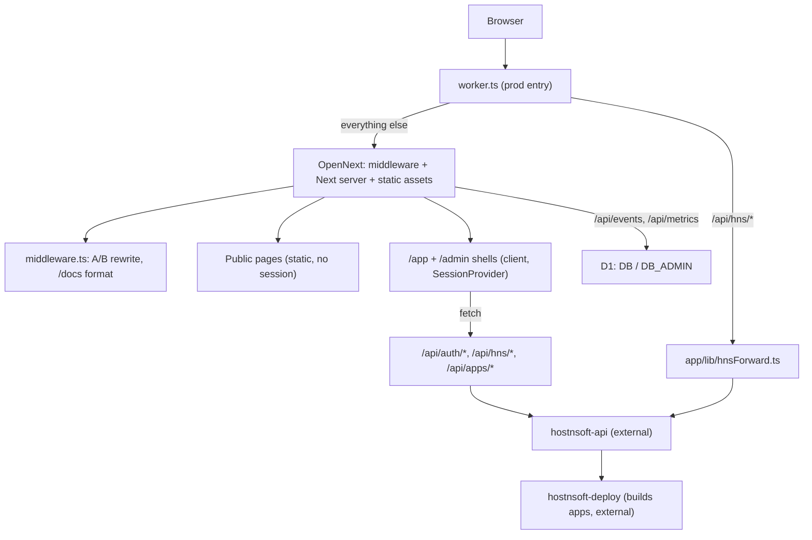

# Architecture & Mental Model

Next.js 15 App Router (React 19, Tailwind plus hand-written CSS in `app/base.css` and `app/design.css`), built by `@opennextjs/cloudflare` and deployed as **one Cloudflare Worker** that serves `embarko.ai` and `www.embarko.ai` (`wrangler.jsonc`). <!-- verify:ignore -->
The repo is the **website**, the **user panel** (`/app`) and the **admin** (`/admin`). All product data lives in the separate `hostnsoft-api` service; the browser never talks to it directly, only through this app's BFF routes. The only data this repo owns is a Cloudflare D1 database for A/B events, feature votes and legacy contact rows (`migrations/`). <!-- verify:ignore -->

## System Overview & Mental Model

Mental model in one line: **the panel shows the app and its state; the AI agent (via `hostnsoft-api`) does the hosting work** (`CLAUDE.md`). Nothing in this repo creates, builds or runs an app. <!-- verify:ignore -->

## Entry Points & Bootstrap Sequence

**Production (Cloudflare Worker).** `wrangler.jsonc` sets `main` to `worker.ts`, which wraps the generated `.open-next/worker.js`: <!-- verify:ignore -->

1. `worker.ts` inspects the request. If the path starts with `/api/hns/`, the method is in `app/lib/hnsForward.ts:FORWARDED_METHODS`, and the host is not `www.embarko.ai`, it calls `app/lib/hnsForward.ts:forwardRequest` and returns **without loading the Next server**. This exists because booting Next cost ~150ms of Worker CPU per proxied call (commit `c557b9e`). <!-- verify:ignore -->
2. Everything else goes to OpenNext. `open-next.config.ts` enables `enableCacheInterception` with the read-only `staticAssetsIncrementalCache`: prerendered HTML is served from the Worker's own assets before the Next server loads. Middleware still runs first, so the A/B rewrite applies to cached pages.
3. The Next server handles dynamic pages, route handlers and the `/api/hns` fallback route `app/api/hns/[...path]/route.ts`.

**Development.** `next dev` never runs `worker.ts`; `app/api/hns/[...path]/route.ts` serves the proxy. `next.config.mjs` calls `initOpenNextCloudflareForDev()` only when `NODE_ENV=development` so `getCloudflareContext()` can hand out D1 bindings locally. `predev`/`prebuild` run `npm run system:facts` (`scripts/build-system-map.mjs`, `scripts/build-system-history.mjs`) to regenerate the Live PRD facts.

**React tree.** `app/layout.tsx:RootLayout` is the only root: global CSS, metadata defaults, JSON-LD, GTM (`app/components/analytics/GoogleTagManager.tsx`), `app/components/analytics/PageViewTracker.tsx`, `app/components/NavDepth.tsx`, `app/components/connector/ConnectorTokenPickup.tsx` and `app/components/BetaBanner.tsx`. Nested layouts add the audience shells:

| Audience | Layout | What it adds |
|---|---|---|
| Public site (`/`, /v1..v5, `/docs`, `/guides`, `/showcase`, `/pricing`, legal) | `app/v1/layout.tsx` … `app/v5/layout.tsx`, `app/showcase/layout.tsx` | Landing metadata (`app/lib/landingMetadata.ts:LANDING_METADATA`), scoped CSS. No session. |
| Panel (`/app/**`) | `app/app/layout.tsx:ConsoleLayout` → `app/app/console-shell.tsx:ConsoleShell` | Inline `app/lib/themeScript.ts:THEME_SCRIPT`, then `ThemeProvider` → `SessionProvider` → `BillingProvider` → `Shell` (spinner / `LoginScreen` / no-workspace / full chrome). |
| Admin (`/admin/**`) | `app/admin/layout.tsx:AdminLayout` | Same theme script and `ThemeProvider`; every page calls `app/admin/guard.tsx:requireAdmin` server-side. |
| Claim (`/claim`) | `app/claim/layout.tsx:ClaimLayout` | The console sign-in on its own noindex page. |

`/` itself: `middleware.ts:middleware` rewrites `/` to one of `app/lib/variants.ts:VARIANTS` (`alpha..delta` → /v1..v4) and pins the arm in the `lp_variant` cookie. `app/page.tsx` only re-exports `app/v3/page.tsx` as a no-middleware fallback.

## Major Modules & Responsibilities

| Module / Layer | Path | Core Responsibility | Sources of Truth | May Depend On | Must NOT Depend On |
|---|---|---|---|---|---|
| Edge middleware | `middleware.ts` | A/B rewrite + cookie, `X-Robots-Tag` on /v*, `/docs` content negotiation → `/guide-raw/*` | `lp_variant` cookie, `Accept` header | `app/lib/variants.ts` only | Anything runtime-specific (`app/lib/variants.ts` header comment) |
| Worker shim | `worker.ts` | Answer `/api/hns/*` before Next boots | `HOSTNSOFT_API_URL` binding | `app/lib/hnsForward.ts` | `next/*` (would pull the server in) |
| BFF server core | `app/lib/api.ts`, `app/lib/hnsForward.ts` | Hold the session cookie, add `proxy_auth_token`, timeouts, 502 normalisation, admin gates | `hns_pat` httpOnly cookie | `next/headers` (api.ts only) | Client code |
| Route handlers | `app/api/**` | Thin wrappers: auth (`app/api/auth/`), generic proxy, upload, logs, events, metrics, system | `app/lib/api.ts` | `app/lib/db.ts`, `app/lib/api.ts` | React |
| Client API | `app/lib/client.ts:hns`, `app/lib/hnsApi.ts` | One typed function per `hostnsoft-api` endpoint, `HnsError` normalisation | `/api/hns/*` responses | `app/lib/types.ts` | `app/lib/api.ts` (server-only) |
| Session & panel state | `app/lib/session.tsx`, `app/lib/billing.tsx`, `app/lib/useProject.ts`, `app/lib/earlyReads.ts`, `app/lib/lastSeen.ts` | Who is signed in, active workspace, billing, per-project detail, instant first frame | `/api/auth/me`, localStorage | `app/lib/client.ts`, `app/lib/hnsApi.ts` | Route handlers |
| Panel UI | `app/app/**`, `app/components/console/`, `app/components/ui/` | Console pages (all `"use client"`), shadcn-style primitives, `app/components/console/kit.tsx` | Session context + hooks | Design tokens in `app/base.css` | Server-only modules |
| Public design layer | `app/components/ds/`, `app/design.css` | The Showcase-set visual standard (`docs/DESIGN.md`); server components except `app/components/ds/PrimaryCta.tsx` | `--ds-*` tokens | Nothing from the panel | Session, `hnsApi` |
| Agent guide | `app/lib/guide/content.js` → `app/lib/guide/markdown.js`, `app/lib/guide/discovery.js`, `app/lib/guide/site.ts` | One content object rendered as HTML (`app/docs/`), Markdown/JSON (`app/guide-raw/[file]/route.ts`), llms.txt, OpenAPI, the .well-known files | `content.js` only | `app/lib/site.ts` | Request-time IO |
| Blog guides | `content/guides/*.md` → `app/lib/guides.ts:POSTS`, `app/guides/[slug]/page.tsx`, `app/guides/_interactive/engines.ts` | Markdown posts imported as raw strings; interactive engines lazy-loaded per slug | The Markdown files | Webpack `asset/source` rule | Filesystem reads |
| Showcase (public) | `app/showcase/**`, `app/lib/showcase.ts` | Server-rendered gallery read over HTTP from `hostnsoft-api` `/public/showcase/*` | API responses | `app/lib/api.ts:API_BASE` | Session |
| D1 store | `app/lib/db.ts:getDb`, `app/lib/db.ts:getAdminDb`, `migrations/` | A/B events, feature votes, legacy contact rows | D1 `DB` / `DB_ADMIN` bindings | `@opennextjs/cloudflare` | Build-time code |
| Live PRD | `app/lib/system/*`, `scripts/build-system-map.mjs`, `scripts/build-prd.mjs`, `docs/prd/` | Scan code → facts → model → `/admin/system` page and `docs/prd/*.md` | `app/lib/system/story.ts` + scanned facts | Node (`scripts/`) | Workers runtime for the scan |
| Analytics | `app/lib/tracking.ts`, `app/lib/gtm.ts`, `app/components/analytics/` | A/B events to `/api/events`; GTM dataLayer pageviews and `user_state` | `lp_variant` cookie, `visitor_id` | `app/lib/variants.ts` | Session (except `SessionSignals`) |

Dependency rules that are enforced by the runtime, not by lint:

- `app/lib/api.ts` imports `next/headers`; importing it from a `"use client"` file breaks the build. Client code uses `app/lib/client.ts` and `app/lib/hnsApi.ts`.
- `app/lib/hnsForward.ts` must stay free of Next imports because `worker.ts` bundles it outside Next.
- `app/lib/variants.ts` is imported by the edge middleware and by client components; keep it pure.
- `app/lib/site.ts` is the only place in `app/` that spells hostnames; JS, Markdown and config files repeat them by hand.

## Rendering Strategy & Boundaries

- **Pattern:** hybrid. Static prerender wherever nothing depends on the request; `force-dynamic` only where the data changes daily or the page needs the cookie.
- **Static (prerendered at `next build`, served from assets):** landing arms `app/v1/page.tsx`…`app/v5/page.tsx`, the agent guide (`app/docs/[slug]/page.tsx` with `force-static` + `generateStaticParams`), `app/guide-raw/[file]/route.ts`, blog posts (`app/guides/[slug]/page.tsx`), discovery files (`app/llms.txt/route.ts`, `app/openapi.json/route.ts`, `app/.well-known/`), legal pages, and the **panel shells**: every `app/app/**` page is `"use client"` and renders a skeleton that fetches after hydration, so `/app` and `/app/projects/[projectId]` are static HTML.
- **Dynamic per request:** `app/showcase/**` and `app/pricing/page.tsx` (`force-dynamic`, read `hostnsoft-api` over HTTP), `app/sitemap.ts` (Showcase URLs), every `app/admin/**` page (`requireAdmin` reads the cookie), `app/admin/system/page.tsx`, and all `app/api/**` handlers.
- **Client/server boundary:** 113 files carry `"use client"`; the public site is server components except small islands (`app/components/ds/PrimaryCta.tsx`, trackers). The panel is client from `app/app/console-shell.tsx` down. Server data for the panel is **never** fetched in server components; it is all `fetch('/api/...')` from hooks.
- **Hydration rules:** `app/layout.tsx` sets `suppressHydrationWarning` on `<html>` because `THEME_SCRIPT` writes `data-theme` before React runs. `app/lib/theme.tsx:ThemeProvider` starts `"light"` and corrects in an effect for the same reason.
- **Markdown as source:** `next.config.mjs` adds a webpack rule `{ test: /\.md$/, type: "asset/source" }`. `content/docs/hackathons.md` and `content/guides/*.md` are imported as strings (`app/lib/guides.ts`, `app/lib/docs.ts`). There is no `fs` read of content at request time anywhere, because the Worker has no filesystem.
- **Loading UX:** instead of Suspense, the panel paints the last answer from localStorage (`app/lib/lastSeen.ts:readLastSeen`) and replaces it when the fetch lands; `app/lib/earlyReads.ts:startEarlyReads` starts the apps-list read in parallel with `/api/auth/me`.

> [!WARNING]
> No `revalidate`, `revalidateTag` or `use cache` anywhere. The incremental cache in `open-next.config.ts` is read-only static assets; adding any revalidation would silently never refresh. Switch to a KV/R2 cache first.

> [!WARNING]
> Never add an opengraph-image route or any route that renders images or reads disk at request time. Production has no filesystem; covers are committed PNGs produced by `scripts/guide-covers.mjs` (see `docs/SEO.md`).

## Application State Ownership

| State Kind | Owner / Tool | Lifespan | Invalidation / Reset Rule |
|---|---|---|---|
| Login session | `hns_pat` httpOnly cookie, set by `app/lib/api.ts:exchange`, read by `app/lib/hnsForward.ts:readCookie` and `app/lib/api.ts` | 30 days (`PAT_MAX_AGE`) | Deleted by `app/lib/api.ts:logout`, or by `app/lib/api.ts:me` when `hostnsoft-api` answers 401/403 |
| Identity + workspaces (client) | `app/lib/session.tsx:SessionProvider` (`status`, `user`, `companies`, `apiConnected`, `isSuperAdmin`) | Tab | `reload()` re-calls `authMe`; `signOut()` clears everything |
| Active workspace | `localStorage` `hns.activeCompany` (`app/lib/session.tsx`) | Persistent | `setActiveCompanyId` writes it and fires best-effort `POST /api/auth/switch-company`; removed on sign-out |
| Billing | `app/lib/billing.tsx:BillingProvider` | Per active company | `reload()` after plan changes; waits for `whenMainDataSettled` off the Billing page |
| Project detail | `app/lib/useProject.ts:useProject` (per-instance state + shared in-flight request, 2s) | Component | `app/lib/useProject.ts:refreshProjects` bumps a revision every instance subscribes to |
| Last-seen snapshots | `localStorage` `hns.lastSeen:*` (`app/lib/lastSeen.ts`) | Persistent | `clearLastSeen` on sign-out or expired session; only ever a first frame |
| One-time token dedupe | `sessionStorage` `hns.exchangedToken` (`app/lib/client.ts:wasExchanged`) | Tab | Prevents spending a single-use MSG91 token twice |
| Connector hand-off | `localStorage` keys in `app/lib/connectorPendingRedirect.ts` | Until picked up by `ConnectorTokenPickup` | localStorage on purpose: the MSG91 widget may land in another tab |
| Claim flow | `sessionStorage` `hns.claim` (`app/claim/page.tsx`) | Tab, until claimed | Page-local |
| Theme | `app/lib/theme.tsx:ThemeProvider` → `data-theme` on `<html>` | Console/admin mount | Follows the OS only; **nothing stored**; attribute removed on unmount so marketing pages stay cream |
| A/B arm | `lp_variant` cookie, set only by `middleware.ts` on `/` | 90 days | Nothing on the URL can change it; /v1..v5 direct hits do not touch it |
| Visitor id | `visitor_id` cookie + localStorage (`app/lib/tracking.ts:getOrCreateVisitorId`) | 1 year | Never reset |
| Nav depth | `sessionStorage` `embarko-nav-depth` (`app/components/NavDepth.tsx`) | Tab | Reset when arriving from outside the origin |
| Showcase "seen" | `localStorage` `embarko.showcase.seen.<id>` (`app/lib/showcaseSeen.ts`) | Persistent | Nicety only; errors swallowed |
| Guide progress | `localStorage` `embarko-steps-*` in each `app/guides/_*/engine.js` | Persistent | Per guide |
| URL state | Route params only (`/app/projects/[projectId]/*`, `/showcase/...`); `/docs?format=md` | Bookmarkable | No filters or pagination are kept in the query string |

There is no global store library (no Redux/Zustand/TanStack Query): contexts for session and billing, a module-level revision counter for projects, and plain `useState` everywhere else.

## API Access & Contract Flow

- **Client wrapper:** `app/lib/client.ts:hns` → `fetch('/api/hns' + path)`; typed per-endpoint functions in `app/lib/hnsApi.ts` (`companiesApi`, `projectsApi`, `appsApi`, …). Auth endpoints bypass the proxy: `authExchange`, `authMe`, `authLogout`, `authWidgetToken`, `authSwitchCompany` in `app/lib/client.ts`.
- **Server hop:** `/api/hns/<path>` → `app/lib/hnsForward.ts:forwardToApi` → `${HOSTNSOFT_API_URL}/<path>` with header `proxy_auth_token: <hns_pat cookie>`. 401 if no cookie; 5s timeout for GET, 10s otherwise (`app/lib/hnsForward.ts:timeoutFor`); network failure → 502 `{ error }`. Upstream headers (Set-Cookie, Location) are dropped; only status and body pass through.
- **Sign-in:** the MSG91 proxy-auth widget redirects back with `proxy_auth_token` in query or hash; `app/lib/session.tsx` strips it from the URL and calls `POST /api/auth/exchange` (`app/lib/api.ts:exchange`), which validates it with `hostnsoft-api` and sets the cookie. `GET /api/auth/me` (`app/lib/api.ts:me`) prefers `hostnsoft-api` (identity + companies, `apiConnected: true`); if the API is unreachable it falls back to MSG91 `getDetails` (`apiConnected: false`, no companies) so the person stays signed in.
- **Routes outside the generic proxy:** `app/api/apps/upload/route.ts` (multipart to the deploy root via `app/lib/api.ts:uploadToDeploy`, 120s budget, 100 MB cap), `app/api/apps/[slug]/logs/route.ts`, `app/api/auth/connector-callback/route.ts` (OAuth-style bridge for AI connectors), `app/api/contact/route.ts` (public form → API), `app/api/early-access/route.ts` (webhook).
- **Error handling in UI:** `app/lib/client.ts:HnsError` carries `status`, `code`, `details`, `payload`; pages branch on `code` (e.g. slug change) and show `error.message`, which the server already made human-readable (`messageForStatus`).
- **D1:** `app/api/events/route.ts` (public POST, validates `variant` with `isVariant`, binds every value) writes via `getDb`; `app/api/metrics/route.ts`, `app/api/feature-votes/*`, `app/api/contact/list/route.ts`, `app/api/system/table/route.ts` read; admin reads use `getAdminDb` (`DB_ADMIN`, `remote: true` in dev).
- **Admin gates:** pages call `app/admin/guard.tsx:requireAdmin`; APIs call `app/lib/api.ts:currentSuperAdmin` or `app/lib/system/catalogue.ts:denyUnlessSuperAdmin`. Both require `isSuperAdmin === true` from `hostnsoft-api`; `ADMIN_EMAILS` can only narrow. `isSuperAdmin` in the client session only hides the menu entry.

## Business Rules & Logic Placement

- **App name validation:** `app/lib/appName.ts:appNameError`, applied in the browser and again in `app/api/apps/upload/route.ts`.
- **Deploy prompt text:** `app/lib/deployPrompt.ts` is the single source for "Copy Embarko prompt" on landing, docs and console; it points agents at `/docs/quickstart.md`.
- **Packing uploads:** `app/lib/pack.ts` (client-only, native streams; excludes the same dirs as the deploy script).
- **Plan / free tier:** `app/lib/billing.tsx` (`FREE_PLAN_CODE`, `isFree`), `app/lib/plans.ts`.
- **A/B attribution:** `app/lib/tracking.ts` — page path wins over cookie; events with no arm are dropped, never guessed.
- **Agent-facing limits and wording:** `app/lib/guide/content.js` (`SAY` list, versioned `VERSION`), per `docs/WRITING.md`.

## External Systems & Dependencies

| External System | Purpose | Communication Contract | Location in Code |
|---|---|---|---|
| hostnsoft-api | Accounts, apps, tokens, domains, billing, Showcase | REST over `HOSTNSOFT_API_URL` (must end in `/api`), header `proxy_auth_token` | `app/lib/api.ts`, `app/lib/hnsForward.ts`, `app/lib/hnsApi.ts`, `app/lib/showcase.ts` |
| hostnsoft-deploy (via API deploy root) | Upload/deploy an app, app logs | Multipart `source` + `X-Company-Id` to `DEPLOY_BASE` | `app/lib/api.ts:uploadToDeploy`, `app/api/apps/[slug]/logs/route.ts` |
| MSG91 proxy-auth | Identity provider; the PAT is the session | `getDetails` / `logout` with `proxy_auth_token`; widget in the page | `app/lib/api.ts`, `app/components/console/LoginScreen.tsx`, `app/components/console/UserManagementWidget.tsx` |
| Cloudflare D1 | A/B events, votes, legacy contact rows | `DB` (write, local in dev) / `DB_ADMIN` (read, remote in dev) | `app/lib/db.ts`, `migrations/` |
| Google Tag Manager | Pageviews, `user_state`, funnel | dataLayer pushes; container id committed | `app/lib/gtm.ts`, `app/components/analytics/` |
| Early-access webhook | Signup capture | `EARLY_ACCESS_WEBHOOK_URL` (dashboard var) | `app/api/early-access/route.ts` |
| Skill repo (github.com/embarko-ai/skill) | The deploy script agents run | Redirects from `/skills/*` | `next.config.mjs`, `app/lib/site.ts:SKILL_REPO` |

## Footguns

> [!WARNING]
> `worker.ts` and `app/api/hns/[...path]/route.ts` must stay behaviour-identical. Both must call `app/lib/hnsForward.ts:forwardRequest` and nothing else; any auth, header or timeout change belongs in `hnsForward.ts`. Dev only exercises the route, production almost only the shim.

> [!WARNING]
> A build must never touch D1. `next.config.mjs` guards `initOpenNextCloudflareForDev()` on `NODE_ENV=development`; `DB_ADMIN` is `remote: true`, and an unguarded call makes Cloudflare's build sandbox hang on a remote connection until timeout. Keep `app/sitemap.ts` and anything prerendered off `getDb`.

> [!WARNING]
> `app/lib/system/facts.generated.json` is gitignored and regenerated by `predev`/`prebuild`; `history.generated.json` and `facts.repos.json` are committed. `npm run prd:check` fails when `docs/prd/` is behind `app/lib/system/story.ts` or the code. Never hand-edit `docs/prd/`.

> [!WARNING]
> `NEXT_PUBLIC_*` is inlined at build time and every .env file is gitignored, so the GTM id and `HOSTNSOFT_API_URL` are pinned in `app/lib/gtm.ts` and `wrangler.jsonc` rather than env. `keep_vars: true` preserves dashboard secrets (`EARLY_ACCESS_WEBHOOK_URL`, `ADMIN_EMAILS`) across deploys.

> [!WARNING]
> `www.embarko.ai` is bound to the same Worker. The 308 to the apex lives in `next.config.mjs` redirects, so `worker.ts` deliberately lets `www` requests fall through to Next instead of proxying them. Removing either half serves a duplicate site or breaks the redirect.

> [!WARNING]
> The A/B cookie is set only on `/`. `app/v5/` is in the middleware matcher (noindex) but **not** in `app/lib/variants.ts:VARIANTS`, so it is reachable directly yet never served as `/` and never tracked; add it to `VARIANTS` to enrol it. `app/api/events/route.ts` rejects any arm not in `VARIANTS`.

> [!WARNING]
> `/app/tokens` renders live secrets. Any third-party GTM tag must carry a blocking trigger on `^/app` (`app/lib/gtm.ts` header). `SessionSignals` deliberately never pushes email or name.

> [!WARNING]
> Public page metadata, robots and canonical behaviour follow `docs/SEO.md`; /v1..v5 must stay crawlable but `noindex` (set by middleware), and must not be listed in `app/robots.ts` or `app/sitemap.ts`.
