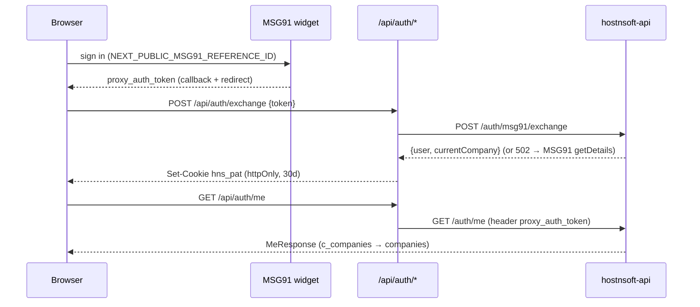

# Contracts & Data Schemas

This repo is the Next.js 15 frontend plus a thin BFF. The browser never talks to
the backend (`hostnsoft-api`, Express + Prisma, base `HOSTNSOFT_API_URL`, default
`http://localhost:4100`) directly: every backend call goes through `/api/*`
routes in this repo. The deploy service (`hostnsoft-deploy`) is reached only
through the same backend origin, one level above `/api` (`app/lib/api.ts:DEPLOY_BASE`).

Generated reference (do not duplicate here): [system map](prd/system-map.md),
[tables](prd/tables.md).

## Authoritative Type Definitions

All wire shapes live in `app/lib/types.ts`. Reference them, never copy them.

| Entity | Type | Notes |
|---|---|---|
| Signed-in identity | `app/lib/types.ts:AuthUser`, `app/lib/types.ts:MeResponse` | `MeResponse.companies` is normalized by the BFF (see Auth). `apiConnected: false` = backend down, identity from MSG91 only. `isSuperAdmin` gates `/admin`. |
| Workspace (company) | `app/lib/types.ts:Company`, `app/lib/types.ts:CompanyWithMembership`, `app/lib/types.ts:CompanyDetail`, `app/lib/types.ts:CompanyMembershipSummary` | Tenant boundary; every data path carries `companyId`. |
| App (project) | `app/lib/types.ts:Project`, `app/lib/types.ts:ProjectDetail`, `app/lib/types.ts:ProjectHealth`, `app/lib/types.ts:DeploymentStatus` | `ProjectDetail` is an alias of `Project`. |
| Slug change | `app/lib/types.ts:SlugChangeAccepted`, `app/lib/types.ts:SlugChangeStatus` | 202 `{moving:true}` vs 200 `Project`. |
| Deployment | `app/lib/types.ts:Deployment` | Rollback creates a new row, `triggeredBy` prefixed `rollback:`. |
| Env var | `app/lib/types.ts:EnvVar` | Values arrive plaintext; mask in UI. |
| Schedule | `app/lib/types.ts:Schedule`, `app/lib/types.ts:ScheduleRun`, `app/lib/types.ts:ScheduleRunsPage` | Read-only in the panel; the AI edits `embarko.json`. |
| Deploy token | `app/lib/types.ts:DeployToken`, `app/lib/types.ts:DeployTokenSecret` | Raw token returned once on create/rotate. |
| Orphan claim | `app/lib/types.ts:OrphanClaimResult` | Anonymous app kept by `{appName, code}`. |
| Custom domain | `app/lib/types.ts:Domain`, `app/lib/types.ts:DomainStatus`, `app/lib/types.ts:DomainInstructions` | `pending_dns` → `active` after verify. |
| Billing | `app/lib/types.ts:BillingPlan`, `app/lib/types.ts:BillingSubscription`, `app/lib/types.ts:BillingStatus`, `app/lib/types.ts:PaymentMethod`, `app/lib/types.ts:CouponCheck`, `app/lib/types.ts:AppliedCoupon` | Lago snake_case wire shapes passed through; cards from Stripe. Marketing copy per tier: `app/lib/plans.ts:PLAN_DETAILS`, matched by `app/lib/plans.ts:planFamily`. |
| Analytics | `app/lib/types.ts:ProjectAnalytics`, `app/lib/types.ts:AnalyticsRange` | Pre-bucketed series; 503 = pipeline down (`app/lib/hnsApi.ts:ANALYTICS_UNAVAILABLE`), not idle. |
| App logs | `app/lib/types.ts:AppLogs`, `app/lib/types.ts:LogStream` | `{available:false, reason}` for static sites. |
| Showcase (owner side) | `app/lib/types.ts:ShowcaseCollection`, `app/lib/types.ts:ShowcaseCollectionDetail`, `app/lib/types.ts:ShowcaseListing`, `app/lib/types.ts:ShowcasePage`, `app/lib/types.ts:ShowcaseSubmissionInput`, `app/lib/types.ts:AdminShowcaseCollectionPage`, `app/lib/types.ts:AdminShowcaseListingPage` | Served by the backend, not D1. |
| Showcase (public pages) | `app/lib/showcase.ts:ShowcaseApp`, `app/lib/showcase.ts:Collection` | Server-side reads of backend `/public/showcase/*`. |
| Error envelope | `app/lib/client.ts:HnsError` | See Standard Error Envelope. |

## BFF routes (`app/api/**`)

Auth column: **PAT** = session cookie `hns_pat` required (401 otherwise); **admin** = `app/lib/api.ts:currentSuperAdmin` (backend `isSuperAdmin === true`, optionally narrowed by `ADMIN_EMAILS`); **public** = no auth.

| Method & path | File | Auth | Request → Response | Forwards to |
|---|---|---|---|---|
| `POST /api/auth/exchange` | `app/api/auth/exchange/route.ts` | public | `{token}` → `{user, companies:[], currentCompany, apiConnected}`; sets cookie | `POST /auth/msg91/exchange`, fallback MSG91 `GET /api/c/getDetails` |
| `GET /api/auth/me` | `app/api/auth/me/route.ts` | PAT | → `app/lib/types.ts:MeResponse` | `GET /auth/me` (fallback MSG91 getDetails) |
| `POST /api/auth/switch-company` | `app/api/auth/switch-company/route.ts` | PAT | `{companyId}` → backend body passthrough | `POST /auth/switch-company` |
| `POST /api/auth/logout` | `app/api/auth/logout/route.ts` | PAT | → 204; deletes cookie | `POST /auth/logout` + MSG91 `DELETE /api/c/logout` |
| `GET /api/auth/widget-token` | `app/api/auth/widget-token/route.ts` | PAT | → `{authToken}` (the raw PAT, `Cache-Control: no-store`) | none |
| `GET /api/auth/connector-callback` | `app/api/auth/connector-callback/route.ts` | query `proxy_auth_token` | query passthrough → 302 to backend `Location` | `GET /auth/msg91/callback` |
| `ANY /api/hns/[...path]` | `app/api/hns/[...path]/route.ts`, `worker.ts` | PAT | JSON passthrough (status + body only) | `<API_BASE>/<path>` |
| `POST /api/apps/upload` | `app/api/apps/upload/route.ts` | PAT | multipart `source, appName, companyId, appVersion?` → deploy service body | `POST <DEPLOY_BASE>/apps` with `X-Company-Id`, `X-App-Name`, `X-App-Version` |
| `GET /api/apps/[slug]/logs?stream=` | `app/api/apps/[slug]/logs/route.ts` | PAT | → `app/lib/types.ts:AppLogs` | `GET <DEPLOY_BASE>/apps/:slug/logs` |
| `POST /api/contact` | `app/api/contact/route.ts` | public | `{email, query, type: feature\|feedback\|other}` → `{ok, id}` | `POST /public/customer-query` (`query` renamed to `message`) |
| `GET /api/contact/list` | `app/api/contact/list/route.ts` | admin | → rows of `contact_messages` (legacy) | D1 read |
| `POST /api/showcase/contact` | `app/api/showcase/contact/route.ts` | public (honeypot `website`, `openedAt` 2.5s–2h) | `{slug, name, email, message, website, openedAt}` → `{ok}` | `POST /public/customer-query` with `toEmail` = owner, `source: showcase-contact-dev` |
| `POST /api/early-access` | `app/api/early-access/route.ts` | public | `{name, email, business, app?}` → 201 `{ok, message, id}` / 422 `{fieldErrors}` | webhook `EARLY_ACCESS_WEBHOOK_URL` (default hardcoded flow.sokt.io URL) |
| `POST /api/events` | `app/api/events/route.ts` | public | `{visitor_id, variant, event, url?, user_agent?, data?}` → `{ok}` | D1 `hero_events` insert |
| `GET /api/metrics?range=` | `app/api/metrics/route.ts` | admin | `range ∈ 24h\|7d\|30d\|90d\|all` → `{range, metrics[]}` per variant | D1 aggregate of `hero_events` |
| `GET/POST/PATCH /api/feature-votes` | `app/api/feature-votes/route.ts` | PAT via `app/lib/api.ts:sessionUser` (no allowlist) | `POST {features[], companyId?}`, `PATCH {queryId, features[]}` → `{voted[]}` / `{ok}` | D1 `feature_votes` |
| `GET /api/feature-votes/summary` | `app/api/feature-votes/summary/route.ts` | admin | → `{votes[]}` with emails | D1 read |
| `GET /api/system/graph`, `GET /api/system/table?db=&name=` | `app/api/system/graph/route.ts`, `app/api/system/table/route.ts` | admin (`app/lib/system/catalogue.ts:denyUnlessSuperAdmin`: 401 anon / 403 signed-in) | → table catalogue, newest 3 rows, secret columns blanked | D1 read; other stores from scanned schema |

Admin pages also call the proxy directly with `fetch` (no `hnsApi` wrapper):
`/api/hns/admin/apps`, `/api/hns/admin/customer-query`, `/api/hns/admin/super-admins`, `/api/hns/admin/super-admins/:userId`
(`app/admin/apps/apps.tsx`, `app/admin/customer-query/queries.tsx`, `app/admin/super-admins/super-admins.tsx`).

### Proxy contract (`app/lib/hnsForward.ts`)

- Methods forwarded: `app/lib/hnsForward.ts:FORWARDED_METHODS` = GET, POST, PATCH, PUT, DELETE. OPTIONS/HEAD fall through to Next.
- Target = `API_BASE + "/" + segments.map(encodeURIComponent).join("/") + search`.
- Headers sent upstream: `proxy_auth_token: <cookie hns_pat>`; `Content-Type: application/json` when a body exists. Body read as text for every method except GET and DELETE.
- Response: status + body only. Upstream `Set-Cookie`, `Location`, and all other headers are dropped. 204 or empty body → empty 204/N response. Non-JSON body → `text/plain`.
- Timeouts (`app/lib/hnsForward.ts:timeoutFor`): GET 5s, everything else 10s. Network failure / timeout → `502 {error: "Can’t reach the Embarko API service right now."}`.
- Same function runs in `worker.ts` (production, before OpenNext boots; skipped for `www.embarko.ai`) and in the Next route (`next dev`, fallback). Edit `app/lib/hnsForward.ts` only; never let the two diverge.
- `app/lib/api.ts:upstream` is the server-side sibling used by auth helpers, logs and upload; `app/lib/api.ts:uploadToDeploy` alone gets 120s.

## Backend routes consumed via `app/lib/hnsApi.ts`

All called through `app/lib/client.ts:hns` → `/api/hns/<path>`, so every row is PAT-authenticated and tenant-scoped by `companyId` in the path. Confirmed present in `hostnsoft-api/src/routes/*.routes.ts` unless marked. <!-- verify:ignore -->

| Client function | Backend route | Types (req → res) |
|---|---|---|
| `companiesApi.create/list/get/rename` | `POST /companies`, `GET /companies`, `GET /companies/:companyId`, `PATCH /companies/:companyId` | `{name}` → `Company`; → `CompanyWithMembership[]`; → `CompanyDetail` |
| `projectsApi.create/list/get/rename/remove` | `POST/GET /companies/:companyId/projects`, `GET/PATCH/DELETE .../projects/:projectId` | `{name}` → `Project`; → `Project[]`; → `ProjectDetail` |
| `projectsApi.changeSlug` / `slugChangeStatus` | `PATCH` / `GET .../projects/:projectId/slug` | `{slug}` → `Project` (200) or `SlugChangeAccepted` (202); → `SlugChangeStatus` (404 `no_rename` when forgotten) |
| `projectsApi.setMemory` | `PATCH .../projects/:projectId/memory` | `{memoryMb}` → `Project` (applies next deploy) |
| `envVarsApi.list/set/remove` | `GET/PUT .../env-vars`, `DELETE .../env-vars/:key` | `{vars:[{key,value}]}` → `EnvVar[]` (PUT is a merge) |
| `schedulesApi.list/runs` | `GET .../schedules`, `GET .../schedules/:scheduleId/runs?page&limit&outcome&trigger` | → `{schedules, limit}`; → `ScheduleRunsPage` |
| `tokensApi.create/list/revoke/rotate` | `POST/GET /companies/:companyId/tokens`, `DELETE .../tokens/:tokenId`, `POST .../tokens/:tokenId/rotate` | `{label}` → `DeployTokenSecret`; → `DeployToken[]` (prefixes only) |
| `orphansApi.claim` | `POST /companies/:companyId/orphans/claim` | `{appName, code}` → `OrphanClaimResult`; 404 for wrong code / expired / already kept |
| `deploymentsApi.list/rollback` | `GET .../deployments`, `POST .../deployments/:deploymentId/rollback` | → `Deployment[]`; → new `Deployment` (422 if target never succeeded) |
| `domainsApi.list/register/verify/remove` | `GET/POST .../domains`, `POST .../domains/:domain/verify`, `DELETE .../domains/:domain` | `{domain}` → `Domain`; verify 422 body is a `Domain` and is returned, not thrown |
| `billingApi.plans` | `GET /billing/plans` (also unauthenticated; `app/lib/publicApi.ts:listPublicPlans` reads it server-side for `/pricing`) | → `BillingPlan[]` |
| `billingApi.status/setup/paymentMethods/checkoutUrl/removePaymentMethod/changePlan/cancel` | `GET /companies/:companyId/billing`, `POST .../billing/customer`, `GET .../billing/payment-methods`, `GET .../billing/checkout-url`, `DELETE .../billing/payment-methods/:id`, `PUT/DELETE .../billing/subscription` | `{name,email}` → `{subscription}`; `{plan_code, coupon_code?}` → `BillingSubscription`; 404 no customer, 409 `BILLING_PROVIDER_NOT_LINKED` |
| `billingApi.checkCoupon/applyCoupon/appliedCoupons` | `GET .../billing/coupons/:code?plan_code=`, `POST/GET .../billing/coupons` | → `CouponCheck`; `{coupon_code}` → `AppliedCoupon` (409 `BILLING_COUPON_REQUIRES_PAID_PLAN`, 422 `BILLING_COUPON_NOT_APPLICABLE`) |
| `customerQueryApi.create` | `POST /companies/:companyId/customer-query` | `{type: feature\|feedback, message}` → `{id}`; email comes from session |
| `analyticsApi.project` | `GET .../projects/:projectId/analytics?range=` | → `ProjectAnalytics`; 503 = pipeline down |
| `showcaseApi.*` (organiser) | `GET/POST /companies/:companyId/showcase/collections`, `GET/PATCH/DELETE .../collections/:collectionId`, `PATCH .../collections/:collectionId/projects/:listingId` with `{isPrivate}` / `{approve}` / `{reject, reason?}` / `{remove}` | → `ShowcaseCollection`, `ShowcaseCollectionDetail`, `ShowcaseListing` |
| `showcaseApi.*` (submitter) | `GET .../showcase/pages`, `GET /public/showcase/collections/:slug`, `POST/GET .../showcase/submissions?projectId=`, `DELETE .../submissions/:listingId` | `ShowcaseSubmissionInput` → `ShowcaseListing`; 404 `SHOWCASE_COLLECTION_UNKNOWN`, 403 `SHOWCASE_COLLECTION_PRIVATE`, 409 `SHOWCASE_ALREADY_LISTED` |
| `adminShowcaseApi.listCollections/listProjects/setFeatured` | `GET /admin/showcase/collections`, `GET /admin/showcase/projects`, `PATCH /admin/showcase/projects/:id` | → paged lists; `{featured}` → `ShowcaseListing`; 404 for non-admins |
| `appsApi.logs` | `GET /api/apps/:slug/logs` (BFF route above, not the proxy) | → `AppLogs` |

Server-side public reads (no session, from marketing pages): `app/lib/showcase.ts:listApps`, `getApp`, `getAppForContact`, `listCollections`, `getCollectionWithApps` → backend `GET /public/showcase`, `/public/showcase/apps/:slug`, `/public/showcase/collections`, `/public/showcase/collections/:slug`. A failed read returns `null`/`[]`, never throws.

## Standard Error Envelope

Backend errors pass through unchanged; `app/lib/client.ts:hns` turns any non-2xx into `app/lib/client.ts:HnsError` with `status`, `message` (`error` string or a status default), `details[]`, `code`, and the raw `payload`.

```json
{ "error": "Human message", "code": "app_name_taken", "details": [{ "path": "slug", "issue": "..." }] }
```

Branch on `code`, never on `message`. Codes seen in this repo: slug change
(`app_name_taken`, `app_name_reserved`, `invalid_app_name`, `deploy_in_progress`,
`no_current_deployment`, `slug_change_cooldown`, `rename_in_progress`,
`app_state_unknown`, `no_rename`), billing (`BILLING_*`), showcase (`SHOWCASE_*`).
BFF-generated errors use the same `{error}` shape; 401 is always `{error: "Not authenticated"}`.

## Authentication & Authorization



- **Session = the MSG91 proxy_auth_token (PAT).** Cookie `hns_pat` (`app/lib/api.ts:PAT_COOKIE`): httpOnly, `sameSite: lax`, `path: /`, `secure` in production, 30 days (`PAT_MAX_AGE`). No refresh cycle: the backend validates the PAT per request with caching. The browser never holds it except via `/api/auth/widget-token`.
- **Exchange** (`app/lib/api.ts:exchange`): login succeeds if either the backend or MSG91 accepts the token. 401 only when the backend actively rejects it; 502 when neither answers. Tokens are single-use; `app/lib/client.ts:wasExchanged` / `markExchanged` dedupe via sessionStorage because the widget delivers the same token twice.
- **Me** (`app/lib/api.ts:me`): backend 401/403 deletes the cookie and returns 401 (session over). Backend unreachable → MSG91 identity with `companies: []`, `apiConnected: false`. `app/lib/api.ts:normalizeMeResponse` maps backend `c_companies[{id,name}]` to `companies[{companyId, companyName}]`.
- **Workspace switch**: `POST /api/auth/switch-company` forwards to backend; the client also stores the active id in localStorage `hns.activeCompany` (`app/lib/session.tsx`). Tenant isolation is purely path-based: every data route includes `/companies/:companyId/...` and the backend's `loadCompanyContext` middleware checks membership. There is no tenant header. <!-- verify:ignore -->
- **Admin gating**: `app/lib/api.ts:currentSuperAdmin` / `superAdminAccess` require backend `/auth/me` with `isSuperAdmin === true` (strict). `ADMIN_EMAILS` (comma list) can only narrow, never widen. Fails closed when the backend is down. `app/lib/api.ts:currentUser` is the older guard (MSG91 identity + `ADMIN_EMAILS`); `sessionUser` is "anyone signed in".
- **Connector (AI tool pairing)**: `app/connector/login/page.tsx` stashes `redirect_uri`/`state`/`tool` in localStorage, runs the MSG91 widget, then `app/components/connector/ConnectorTokenPickup.tsx` sends the browser to `GET /api/auth/connector-callback?proxy_auth_token=&redirect_uri=&state=`, which calls backend `GET /auth/msg91/callback` with the token in the header and 302s to the backend's `Location` (the tool's `redirect_uri` + `code`). The tool then exchanges `code` at backend `POST /connector/token` directly (not via this repo). <!-- verify:ignore -->
- **Deploy tokens** are a separate, company-scoped credential for agents (`tokensApi`); uploads from the panel deliberately use the PAT + `X-Company-Id` instead of minting one (`app/lib/api.ts:uploadToDeploy`).

## Persistence

### D1 (site database, binding `DB`; admin reads via `DB_ADMIN`, `app/lib/db.ts:getDb` / `getAdminDb`)

| Table | Migration | Written by | Read by |
|---|---|---|---|
| `hero_events` (+ `data` JSON column) | `migrations/0001_init.sql`, `migrations/0002_event_data.sql` | `app/api/events/route.ts` | `app/api/metrics/route.ts` (visitors, not events; bots filtered on read) |
| `hero_assignments`, `variant_metrics` | `migrations/0001_init.sql` | nothing (legacy; assignment is the `lp_variant` cookie, totals now aggregated) | nothing |
| `contact_messages` | `migrations/0001_init.sql` | nothing (legacy; contact now posts to backend) | `app/api/contact/list/route.ts` |
| `showcase_apps`, `showcase_tags`, `showcase_collections`, `showcase_collection_apps` | `migrations/0003_showcase.sql` | nothing in this repo (Showcase moved to the backend) | nothing in this repo |
| `feature_votes` (+ `query_id`) | `migrations/0004_feature_votes.sql`, `migrations/0005_feature_votes_query.sql` | `app/api/feature-votes/route.ts` (PK `user_id, feature_id`; `INSERT OR IGNORE`) | same + `app/api/feature-votes/summary/route.ts` |

`feature_id` must be an id from `app/lib/features.ts:FEATURES` with `upcoming: true`; anything else is rejected with 400.

### Browser storage and cookies

| Store | Key | Owner | Purpose |
|---|---|---|---|
| cookie (httpOnly) | `hns_pat` | `app/lib/api.ts:PAT_COOKIE`, `app/lib/hnsForward.ts:PAT_COOKIE` | login session |
| cookie | `lp_variant` (90d) | `middleware.ts` (set), `app/lib/tracking.ts`, `app/lib/gtm.ts:readLpVariant` (read) | landing A/B arm; only `/` assigns it |
| cookie + localStorage | `visitor_id` (1y) | `app/lib/tracking.ts:getOrCreateVisitorId` | A/B visitor identity |
| localStorage | `hns.activeCompany` | `app/lib/session.tsx` | last workspace; removed on logout |
| localStorage | `hns.lastSeen:<key>` | `app/lib/lastSeen.ts` | first-frame cache of non-secret reads; `clearLastSeen` on logout / session end |
| localStorage | `embarko.showcase.seen.<collectionId>` | `app/lib/showcaseSeen.ts` | "new apps" badge |
| localStorage | `embarko_connector_pending_redirect_uri`, `..._state`, `..._tool` | `app/lib/connectorPendingRedirect.ts` | connector login handoff (localStorage because the widget may finish in another tab) |
| localStorage | `embarko-steps-*`, `embarko-student-*` | `app/guides/*/engine.js` | guide progress |
| sessionStorage | `hns.exchangedToken` | `app/lib/client.ts` | single-use token dedupe |
| sessionStorage | `hns.claim` | `app/claim/page.tsx` | pending orphan claim across login |
| sessionStorage | `embarko.planAfterLogin` | `app/lib/plans.ts:rememberPlanAfterLogin` / `takePlanAfterLogin` | plan picked on `/pricing` before sign-in (MSG91 rejects query strings in redirect paths) |
| sessionStorage | `pv:<pathname>` | `app/lib/tracking.ts:trackPageView` | one page_view per path per session |
| sessionStorage | `embarko-nav-depth` | `app/components/NavDepth.tsx` | back-link depth |

## Analytics & Telemetry

Two independent pipelines:

**A/B events → D1** (`app/lib/tracking.ts`, posted to `POST /api/events`, `keepalive: true`). Dropped when no variant is known (page path `/v1..` wins over the `lp_variant` cookie; `app/lib/variants.ts:variantForPath`).

| Event | Trigger | `data` |
|---|---|---|
| `page_view` | `trackPageView` on landing pages | none |
| `cta_clicked` | `trackCTA` | `{cta_type: copy\|login\|signup}` |
| `deployment` | `trackDeployment` | `{status: success\|failed, duration_ms?}` |
| `signup` | counted by `app/api/metrics/route.ts`; no caller in `app/` today | — |

Every row carries `visitor_id`, `variant`, `url`, `user_agent`. `app/api/metrics/route.ts` reads `data` with `json_extract` on `$.cta_type` and `$.status` only; new fields need a new column in that query.

**GTM dataLayer** (`app/lib/gtm.ts:pushToDataLayer`, container `GTM_ID`, empty outside production unless `NEXT_PUBLIC_GTM_ID`):

| Event | Trigger | Payload |
|---|---|---|
| `page_view` | `app/components/analytics/PageViewTracker.tsx` on every route change | `page_path`, `page_location`, `page_title`, `lp_variant` |
| `session_state` | `app/components/analytics/SessionSignals.tsx` on auth transitions | `user_state: logged_in\|logged_out`, `user_id`, `company_id` (nulled on logout) |

No PII on the dataLayer (ids only).

## Public agent-facing contracts

All built at build time from `app/lib/guide/discovery.js` and served with `app/lib/guide/respond.ts:discoveryResponse` (CORS `*`, `max-age=300`, `Link` to `/.well-known/api-catalog` and `/llms.txt`):

| Route | File | Promise |
|---|---|---|
| `GET /openapi.json` | `app/openapi.json/route.ts` | OpenAPI 3.1 of the **deploy API at `https://ship.embarko.ai`** (`app/lib/guide/site.ts`): `POST /apps`, `GET /apps/{appName}/status`, `/logs`, `/customer-query`, `/api/apps/{appName}/*` (env-vars, schedules, deployments, rollback, slug-change, domains, analytics, showcase), `/api/public/showcase/apps/{appName}`. Bearer deploy token. |
| `GET /agent.json`, `/.well-known/agent.json`, `/.well-known/agent` | `app/agent.json/route.ts`, `app/.well-known/agent.json/route.ts`, `app/.well-known/agent/route.ts` | Same manifest: what Embarko is, routes an agent can take, docs links. |
| `GET /.well-known/agent-card.json` | `app/.well-known/agent-card.json/route.ts` | A2A agent card. |
| `GET /.well-known/api-catalog` | `app/.well-known/api-catalog/route.ts` | RFC 9727 linkset pointing at `/openapi.json` and docs. |
| `GET /llms.txt`, `/llms-full.txt` | `app/llms.txt/route.ts`, `app/llms-full.txt/route.ts` | One line per guide topic, generated from the guide so it cannot name a missing page. |
| `GET /docs/*` (suffix .md / .json, or the Accept header) | `middleware.ts:guide` → `app/guide-raw/` | Same guide as Markdown/JSON for agents; `Vary: Accept`. |

These describe the **agent** surface (backend `agentApps.routes.ts`, deploy-token auth), not the panel's `/companies/:companyId/...` surface. <!-- verify:ignore --> Keep in sync when changing: `app/lib/guide/discovery.js` (schemas, error codes), `app/lib/guide/content.js` (guide text), `app/lib/guide/site.ts` (hosts), and the backend's `agentApps.routes.ts` / deploy service. There is no test that diffs `discovery.js` against the backend.

## Required / Unavailable Backend Capabilities

### Members and roles
Who is in a workspace stays MSG91's: `/app/members` still renders its user-management widget (`app/components/console/UserManagementWidget.tsx`) for adding and removing people. What each member may do is hostnsoft-api's (roles Owner, Admin, Member, Billing, plus each Member's access to each app: Can use by default, Can edit — their AI's changes wait for approval — or Full access), through `app/lib/hnsApi.ts:membersApi`:
- `list` / `get` / `update` / `setApps` → `GET|PATCH /companies/:companyId/members[/:userId]`, `PUT …/members/:userId/apps`; one `Member` shape (`app/lib/types.ts`) from all of them.
- `invite` / `cancelInvite` → `POST|DELETE /companies/:companyId/invites[/:id]` (the role someone gets when they join; the invite email itself is still the widget's).
- `myPermissions` → `GET /me/permissions?companyId=` → `MyPermissions`, read once per workspace by `app/lib/permissions.tsx:PermissionsProvider`.

Every guarded API route answers 403 `permission_denied` `{permission, role, access?, error}` (`access` is their level on the app), or 404 for an app the person can't see. `GET /companies/:companyId/projects` returns only the apps the person can see (an empty list for a Billing member), and `projectCount` on the company routes counts the same set. Owner and Admin both have billing; only an Owner can add or change Owners and Admins. Everyone in a workspace before roles is an Admin and its creator its Owner; someone added later without a role starts as a Member. Publishing (deploy, rollback, settings) needs Full access; Can edit can't publish until previews exist. Inviting people, roles and app access are Owner/Admin only.

### `signup` A/B event
- Counted by `app/api/metrics/route.ts` but never emitted from `app/` (`trackEvent('signup')` has no caller). Signups column is always 0 until something sends it.

## Footguns

> [!WARNING]
> `/api/hns/*` is answered by `worker.ts` in production before Next loads. Adding logic to `app/api/hns/[...path]/route.ts` alone changes `next dev` only. Put it in `app/lib/hnsForward.ts`.

> [!WARNING]
> The proxy drops upstream headers (`Set-Cookie`, `Location`). A backend route that relies on cookies or redirects cannot be reached through `/api/hns`; give it its own BFF route like `app/api/auth/connector-callback/route.ts`.

> [!WARNING]
> Deploy routes live at the backend origin root, not under `/api`. `hns("/apps/x/logs")` 404s; use `app/api/apps/[slug]/logs/route.ts` (`DEPLOY_BASE`) or `app/api/apps/upload/route.ts`.

> [!WARNING]
> Reads time out at 5s, writes at 10s, upload at 120s. A write that times out may still have landed upstream; re-read before retrying a create.

> [!WARNING]
> `GET /api/auth/widget-token` hands the raw session token to page JS. Only `UserManagementWidget` may call it; any new caller widens the blast radius of XSS. Related: GTM tags must block on `^/app` because `/app/tokens` renders deploy-token secrets (see `app/lib/gtm.ts`).

> [!WARNING]
> `app/lib/api.ts:currentUser` (MSG91 identity + `ADMIN_EMAILS`) is not an admin check. Admin-only data (`/api/metrics`, `/api/contact/list`, `/api/feature-votes/summary`, `/api/system/*`) must use `currentSuperAdmin`, which fails closed when the backend is down.

> [!WARNING]
> `app/api/events/route.ts` and `/api/contact`, `/api/showcase/contact`, `/api/early-access` are public and unauthenticated. Validate every field; `/api/events` rejects unknown variants so the dashboard cannot be polluted.

> [!WARNING]
> `getAdminDb()` in `next dev` reads the **production** D1 (`DB_ADMIN`). Never write through it; all writes go via `getDb()`.

> [!WARNING]
> `projectsApi.changeSlug` returns two shapes: check `moving` before treating the body as a `Project`. `domainsApi.verify` returns the 422 body as a `Domain` instead of throwing.

> [!WARNING]
> `envVarsApi.list` returns plaintext values through the panel API, while the agent OpenAPI promises keys only. Mask in UI and never log the response.
