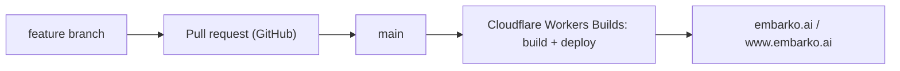

# Development & Verification Guide

Next.js 15 (App Router, React 19) built for Cloudflare Workers with
`@opennextjs/cloudflare`. One Worker serves the marketing site, the agent
guide (`/docs`), the panel (`/app`) and the admin pages (`/admin`). The panel
talks to the control plane (`hostnsoft-api`) only through this app's BFF
routes (`/api/hns/*`, `/api/auth/*`); the browser never calls the API host.

## Prerequisites & Runtime Environment

- **Node.js:** `>=20` (`package.json` `engines`); `.nvmrc` pins `22`.
  `scripts/check-node.mjs` runs before `build` and fails early on Node 18 —
  the Cloudflare toolchain pulls in a regex flag Node 18 cannot parse, while
  `next dev` would still work and hide the problem. Verified on Node 26.8.1.
- **Package manager:** npm (lockfile `package-lock.json`).
- **Wrangler:** installed as a devDependency (`wrangler`). A logged-in
  account (`npx wrangler login`) is needed for `deploy`, for `cf-typegen`,
  and for the remote `DB_ADMIN` binding in dev (see quirks below).
- **Sibling repos (optional):** `../hostnsoft-api` and `../hostnsoft-deploy`
  next to this checkout. The PRD scripts read them if present; without them
  the committed snapshot `app/lib/system/facts.repos.json` is used.

## Step-by-Step Setup

1. **Install** (`node_modules` was present at the verified commit):
   ```bash
   npm install
   ```
2. **Environment:** copy the sample file. Every .env file is gitignored.
   ```bash
   cp .env.example .env.local
   ```
   The defaults in `.env.example` already point at the live API and the
   existing MSG91 login config, so the panel works without edits.
3. **Dev server** (also the `dev` entry in `.claude/launch.json`, port 3000):
   ```bash
   npm run dev
   ```
   `predev` regenerates the Live PRD facts first (see "PRD scripts"). Open
   `http://localhost:3000`. `/app` shows the MSG91 sign-in.

## Environment Variables Reference

Document names and code defaults only. Never copy .env.local values.

| Variable | Required | Client-exposed | Default | Where read |
|---|---|---|---|---|
| `HOSTNSOFT_API_URL` | No | No | `http://localhost:4100` | `app/lib/api.ts:API_BASE`, `worker.ts`. Must include `/api`. Pinned for production in `wrangler.jsonc` `vars`; `.env.example` sets the live value for dev. |
| `NEXT_PUBLIC_MSG91_REFERENCE_ID` | No | Yes | baked-in account id | `app/components/console/LoginScreen.tsx`, `app/connector/login/page.tsx` |
| `NEXT_PUBLIC_MSG91_WIDGET_SCRIPT` | No | Yes | proxy-auth script URL | `app/components/console/LoginScreen.tsx`, `app/components/console/UserManagementWidget.tsx`, `app/connector/login/page.tsx` |
| `MSG91_ROUTES_BASE` | No | No | `https://routes.msg91.com` | `app/lib/api.ts:MSG91_BASE` — token validation base |
| `ADMIN_EMAILS` | No | No | empty (no allowlist) | `app/lib/api.ts:currentUser` and the admin check beside it. Comma list; narrows admin access, never widens it. |
| `EARLY_ACCESS_WEBHOOK_URL` | No | No | `DEFAULT_WEBHOOK_URL` in `app/api/early-access/route.ts` | Set in the Cloudflare dashboard only; `keep_vars` in `wrangler.jsonc` preserves it across deploys. |
| `NEXT_PUBLIC_GTM_ID` | No | Yes | production container pinned in `app/lib/gtm.ts:GTM_ID`; empty in dev/preview | Override only to test a container locally or to switch GTM off in production. Inlined at build time. |
| `NODE_ENV` | set by Next | — | — | `app/lib/api.ts` (secure cookies), `app/lib/gtm.ts`, `app/lib/system/load.ts` (live rescan in dev), `next.config.mjs` (dev-only workerd init). |
| `HOSTNSOFT_API_DIR` | No | No | `../hostnsoft-api` | `scripts/build-system-map.mjs` — where the PRD scanner finds the API repo |
| `HOSTNSOFT_DEPLOY_DIR` | No | No | `../hostnsoft-deploy` | `scripts/build-system-map.mjs` — same for the deploy repo |

Cloudflare bindings (not env vars, from `wrangler.jsonc`): `DB` and
`DB_ADMIN` are two bindings to the same D1 database `hostnsoft-ab`, read in
`app/lib/db.ts:getDb` and `app/lib/db.ts:getAdminDb`. In `next dev`, `DB`
is local and `DB_ADMIN` is `remote: true`. `ASSETS` serves `.open-next/assets`.

`PORT`, `DATA_DIR` and `CRON_SECRET` also appear in the inventory, but only
inside the agent guide text (`app/lib/guide/content.js`) — they describe the
apps users deploy, not this app.

> [!WARNING]
> `NEXT_PUBLIC_*` values are inlined at build time and every .env file is
> gitignored. A value that exists only in a local .env file vanishes on the
> Cloudflare build. That is why the GTM container id lives in code.

## Commands

| Task | Command | Notes |
|---|---|---|
| Dev server | `npm run dev` | `predev` runs `system:facts`. Loads workerd so D1 bindings work locally. |
| Production build | `npm run build` | `prebuild` = Node check + `system:facts`. Then `opennextjs-cloudflare build --dangerouslyUseUnsupportedNextVersion`. Verified: exit 0, two deprecation warnings. |
| Preview the Worker | `npm run preview` | Builds, then runs the Worker locally with wrangler. |
| Manual deploy | `npm run deploy` | Builds and deploys from a logged-in wrangler. Normal releases do not use this (see pipeline). |
| Typecheck | `npx tsc --noEmit` | No `typecheck` script exists. Verified: 0 errors. |
| Lint | `npm run lint` | **Gap:** no ESLint config in the repo; `next lint` prompts interactively to create one. No lint baseline. |
| Tests | none | No test script, no test files. |
| Regenerate the Live PRD | `npm run prd` | Writes `docs/prd/` from `app/lib/system/story.ts` and the code. |
| PRD freshness check | `npm run prd:check` | Exit 1 when `docs/prd/` or the facts are behind the code or the story. |
| Facts + history | `npm run system:facts` | `scripts/build-system-map.mjs` + `scripts/build-system-history.mjs`. Runs before dev/build/preview/deploy. |
| Worker env types | `npm run cf-typegen` | Writes the gitignored cloudflare-env.d.ts (`CloudflareEnv`, used by `worker.ts`). |
| Guide covers | `node scripts/guide-covers.mjs` | Manual; draws committed OG images for `/guides`. Needs `sharp`, which is not in `package.json`. <!-- verify:ignore --> |

`start` (`next start`) exists but is not how this app runs anywhere; production
is the Worker (`worker.ts` wrapping `.open-next/worker.js`).

### PRD scripts

- `scripts/build-system-map.mjs` scans this repo and the sibling repos and
  writes the gitignored `app/lib/system/facts.generated.json`, plus the
  committed sibling snapshot `app/lib/system/facts.repos.json`. A regex scan:
  on failure it keeps the previous file and exits 0, so it can never break
  `dev` or `build`.
- `scripts/build-system-history.mjs` reads git history into the committed
  `app/lib/system/history.generated.json`. Without `.git` (Cloudflare build)
  it exits 0 and keeps the file.
- `scripts/build-prd.mjs` imports the app's TypeScript through
  `scripts/ts-loader.mjs` and writes `docs/prd/`. Do not edit `docs/prd/`
  by hand.
- Running `system:facts` can leave `facts.repos.json` and
  `history.generated.json` modified. That is expected; commit them with
  your change. Full maintenance guide: `app/admin/system/README.md`.

> [!WARNING]
> `npm run prd:check` exits 1 at the verified commit even after `npm run prd`:
> 19 files and tables are "in no part" of `app/lib/system/story.ts`
> (pre-existing, accepted by the owner). Until they are assigned, read
> the check's output and make sure your change adds no new line to it.

> [!WARNING]
> `next build` and `next dev` share `.next/`. Running `npm run build` while
> the dev server is up breaks both (ENOENT `routes-manifest.json`, "Cannot
> find module for page"). Stop the dev server, build, then start it again. <!-- verify:ignore -->

## Build & Preview Verification

```bash
npx tsc --noEmit
npm run build
npm run preview
```

`open-next.config.ts` sets `buildCommand` to `next build` on purpose: the
default (`npm run build`) would recurse into `opennextjs-cloudflare build`
forever on Cloudflare's builder. It also uses the read-only static-assets
incremental cache, which is only safe because nothing in the app revalidates.

> [!WARNING]
> `next.config.mjs` calls `initOpenNextCloudflareForDev` only when `NODE_ENV`
> is `development`. Do not remove the guard: `DB_ADMIN` is remote, and an
> unguarded call makes the Cloudflare build sandbox try to open a live D1
> connection without credentials and hang until its 30-minute timeout.

## D1 Migrations

Schema lives in `migrations/` (`0001_init.sql` … `0005_feature_votes_query.sql`),
not in a migrate-on-first-use call (`app/lib/db.ts` explains why). The
`wrangler.jsonc` database is `hostnsoft-ab`; wrangler's default migrations
directory matches `migrations/`.

> [!TODO]
> No script or doc in the repo applies migrations. Nothing names
> `wrangler d1 migrations apply`, locally or remote. Confirm with the team
> how production migrations are applied, and whether a fresh dev checkout
> needs `npx wrangler d1 migrations apply hostnsoft-ab --local` before
> `/api/events` can write to the local `DB`.

## Known Dev Quirks

- **`POST /api/events` returns 500 in dev** when the logged-in wrangler
  account cannot reach the D1 database id in `wrangler.jsonc`: the remote
  `DB_ADMIN` proxy session fails to start and `getCloudflareContext` throws.
  Environment, not code. Expect it on every page view.
- **GET /media/Inter-*.ttf 404 three times per page.** No reference exists
  in `app/`, `public/` or `content/`. Origin unknown — possibly a third-party
  script. Harmless; ignore it. <!-- verify:ignore -->
- **`GET /api/auth/me` 401 on `/app` when logged out** is expected.
- **Panel and admin need a real MSG91 account.** `/app/*` and `/admin/*`
  cannot be exercised without signing in; there is no bypass.
- **Landing A/B:** `/` serves a variant chosen by `middleware.ts`; the
  baseline session saw v2.

## Safe Test-Data Guidance

- There is no seed, fixture or mock mode. Public pages need no data.
- Panel testing needs a real account; what you do there hits the live
  control plane through `HOSTNSOFT_API_URL`. Use a throwaway workspace.
- A/B metrics are safe: in dev the `DB` binding is local, so page views and
  CTA clicks on localhost never reach production numbers. The admin
  dashboard reads production through `DB_ADMIN`, so local clicks will not
  move it. Never write through `getAdminDb`.
- Early-access form submissions in dev go to the default webhook in
  `app/api/early-access/route.ts` unless `EARLY_ACCESS_WEBHOOK_URL` is set.

## How an Agent Checks Its Work

1. **Baseline first:** `npx tsc --noEmit` passes at the verified commit;
   `npm run prd:check` does not (see above). Know which failures are yours.
2. **Typecheck:** `npx tsc --noEmit` — 0 errors.
3. **Build:** `npm run build` — exit 0 (needs Node >= 20).
4. **PRD:** `npm run prd:check`. If you changed a story, a step, a table,
   or code that a story in `app/lib/system/story.ts` names, run
   `npm run prd` first and commit `docs/prd/` with the generated facts.
5. **Public pages:** follow the checklists in [SEO](SEO.md),
   [DESIGN](DESIGN.md) and, for `/docs` or `content/docs/`,
   [WRITING](WRITING.md). No generated OG image routes.
6. **Browser check:** start `npm run dev` (launch config `dev`), load the
   page, confirm no new console errors beyond the known quirks, check
   375px and 1280px.
7. **Docs:** update the `docs/*.md` that covers what you changed and bump
   its verified_at / verified_on frontmatter, then run `/ai-docs check`
   (the `create-ai-docs` skill; `docs/.ai-docs.json` is its manifest) until
   it reports 0 errors. <!-- verify:ignore -->

## PR Workflow & Deployment Pipeline

Human-confirmed flow: feature branch → pull request on GitHub
(`Walkover-Web-Solution/hostnsoft`) → merge to `main` → Cloudflare Workers
Builds auto-builds and deploys `main`. There is no CI config in the repo and
no test suite; the checklist above is the only gate before merge.



- **Branches** seen in history: `feat/<name>`, `feature/<name>`,
  `imp/ui/<name>`, `fix/<name>`, `chore/<name>`. Branch from `main`.
- **Commits** are conventional-ish: `feat(scope): …`, `fix(guides): …`,
  `docs(prd): …`, with plain sentences also common. PR titles follow the
  same style.
- **Deploy target:** `wrangler.jsonc` binds the custom domains `embarko.ai`
  and `www.embarko.ai`; `next.config.mjs` redirects www to the apex.
  Dashboard vars survive deploys because of `keep_vars`.
- **Manual deploy:** `npm run deploy` works from a logged-in wrangler but is
  an escape hatch, not the release path.

> [!TODO]
> Workers Builds settings (build command, Node version, env vars) live in the
> Cloudflare dashboard and are not in the repo. Record them here once
> confirmed.
