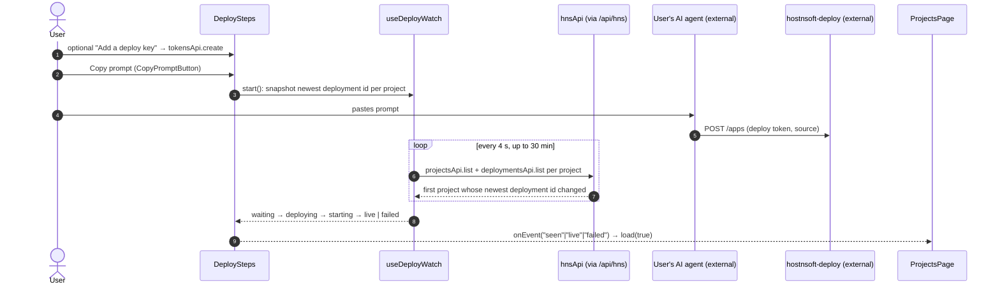

# User Flows & Critical Journeys

The step-by-step user stories live in the generated Live PRD: [docs/prd/README.md](prd/README.md) and
[docs/prd/stories/](prd/stories/). They are built from `app/lib/system/story.ts` by `npm run prd` and
list every screen, endpoint, module and table per step. **Do not retell them here.** This document adds
what the PRD does not carry: the code-level trace (route → component → client → BFF → response → state)
for the five journeys that matter most, plus guards and failure handling.

PRD ID scheme (see the README): `page:<route>` a screen, `api:<route>` an endpoint in this repo,
`api:@api/<route>` one in hostnsoft-api, `lib:<file>` a module, `table:store:<name>` a D1 table,
`<story>/<step>` a step (e.g. `sign-in/start-session`, `first-deploy/watch`). <!-- verify:ignore -->

## The shape every panel call has

```
browser component ──> app/lib/hnsApi.ts (typed, one fn per endpoint)
                  ──> app/lib/client.ts:hns  fetch("/api/hns/<path>")
                  ──> app/api/hns/[...path]/route.ts (next dev) or worker.ts (prod, same forwardRequest)
                  ──> app/lib/hnsForward.ts:forwardRequest  adds proxy_auth_token from the hns_pat cookie
                  ──> hostnsoft-api
```

- The session is one httpOnly cookie, `hns_pat` (`app/lib/api.ts:PAT_COOKIE`). The browser never sees it
  except through `GET /api/auth/widget-token` (user-management widget only).
- Auth routes (`app/api/auth/`) bypass the generic proxy because they set or clear that cookie; the
  browser calls them through `app/lib/client.ts:authExchange`, `app/lib/client.ts:authMe`,
  `app/lib/client.ts:authSwitchCompany`, `app/lib/client.ts:authLogout`.
- Non-2xx becomes `app/lib/client.ts:HnsError` with `status`, `code` (upstream machine code) and
  `payload`. `app/lib/client.ts:messageForStatus` supplies the generic 401/403/404/409 copy.
- Upstream timeouts: 5 s reads, 10 s writes (`app/lib/hnsForward.ts:timeoutFor`); a network failure is
  rewritten to a JSON 502 in `app/lib/api.ts:upstream`.

> [!WARNING]
> `worker.ts` answers `/api/hns/*` before Next loads in production. Logic added only to
> `app/api/hns/[...path]/route.ts` will work in `next dev` and silently not run in production — put it in
> `app/lib/hnsForward.ts`.

## Core journeys map

| Journey | Trigger route | Outcome | Entry component | PRD story |
|---|---|---|---|---|
| Sign in | `/app` (any panel URL) | `status === "authed"`, workspace chosen | `app/components/console/LoginScreen.tsx:LoginScreen` | `sign-in` |
| First deploy from the panel | `/app` → Host new app / empty state | App card appears, card goes Live | `app/components/console/DeploySteps.tsx:DeploySteps` | `first-deploy` |
| Check apps, open one | `/app`, `/app/projects/[projectId]` | Health label + live URL | `app/app/page.tsx:ProjectsPage`, `app/components/console/ProjectNav.tsx:ProjectNav` | `check-apps` |
| Keep a trial app / Connect AI | `/claim?app=&code=`, `/connector/login?redirect_uri=&state=` | App owned by a workspace / AI tool gets a code | `app/claim/page.tsx:ClaimPage`, `app/connector/login/page.tsx` | `try-without-account`, `connect-ai` |
| Showcase browse + list | `/showcase`, `/showcase/[...collection]`, `/app/showcase/submit` | Listing live on a public page | `app/showcase/page.tsx:ShowcasePage`, `app/app/showcase/submit/ListAppForm.tsx:ListAppForm` | `showcase-listing`, `event-page` |

---

## 1. Sign in

### Happy path

```mermaid
sequenceDiagram
    autonumber
    actor User
    participant Login as LoginScreen
    participant Widget as MSG91 widget (external)
    participant Client as client.ts
    participant BFF as /api/auth/exchange
    participant Api as lib/api.ts:exchange
    participant Session as SessionProvider

    User->>Login: opens /app (status "anon")
    Login->>Widget: initVerification({referenceId, success, failure, addInfo.redirect_path})
    Widget-->>Login: success({token})
    Login->>Client: markExchanged(token); authExchange(token)
    Client->>BFF: POST {token}
    BFF->>Api: exchange(token) → upstream POST /auth/msg91/exchange, fallback MSG91 getDetails
    Api-->>BFF: 200 {user, companies:[], currentCompany, apiConnected} + Set-Cookie hns_pat (30 d)
    BFF-->>Client: 200
    Login->>Session: reload() → authMe()
    Session-->>User: status "authed", activeCompanyId chosen, panel renders
```

### Code trace

1. **Guard.** `app/app/layout.tsx` wraps every `/app/*` page in `app/app/console-shell.tsx:ConsoleShell`.
   `Shell` reads `app/lib/session.tsx:useSession` and renders a spinner (`loading`), `LoginScreen` (`anon`),
   or the panel. There is no server-side redirect: the guard is the client shell.
2. **Boot.** `app/lib/session.tsx:SessionProvider` runs `load()` once:
   - `consumeRedirectToken` pulls a one-time token off the URL (query or hash, keys in
     `TOKEN_KEYS`), exchanges it, then strips it and the MSG91 echo keys from history.
   - Shows last visit's identity from `app/lib/lastSeen.ts:readLastSeen` (key `me`) while
     `GET /api/auth/me` answers, and starts `app/lib/earlyReads.ts:startEarlyReads` for the stored
     workspace so the projects list is already in flight.
   - `GET /api/auth/me` → `app/lib/api.ts:me`: prefers hostnsoft-api `/auth/me` (reshaped by
     `normalizeMeResponse` into `app/lib/types.ts:MeResponse` with `companies`); if the API is
     unreachable, falls back to MSG91 identity with `companies: []` and `apiConnected: false`.
   - Active workspace: previous state → `localStorage` key `hns.activeCompany` → first company.
3. **Widget.** `LoginScreen` loads `NEXT_PUBLIC_MSG91_WIDGET_SCRIPT` and calls `window.initVerification`
   with `NEXT_PUBLIC_MSG91_REFERENCE_ID`. Both the `success` callback and the redirect variant can deliver
   the same single-use token, so `app/lib/client.ts:wasExchanged` / `markExchanged` (sessionStorage key
   `hns.exchangedToken`) dedupe per tab.
4. **Exchange.** `POST /api/auth/exchange` → `app/lib/api.ts:exchange`. hostnsoft-api is best-effort:
   a 502 falls through to MSG91 `getDetails`; a 400/401 from hostnsoft-api is a hard 401.
5. **Switch workspace.** `app/app/switch-workspace/page.tsx:SwitchCompanyPage` →
   `app/lib/session.tsx:SessionProvider` `setActiveCompanyId`: optimistic state + localStorage, then
   best-effort `POST /api/auth/switch-company` (`app/lib/api.ts:switchCompany`), errors swallowed.
6. **Logout.** `app/components/console/HeaderUserMenu.tsx` → `signOut` → `POST /api/auth/logout`
   (`app/lib/api.ts:logout`: upstream `/auth/logout`, MSG91 logout, cookie deleted, 204) → state reset,
   `app/lib/lastSeen.ts:clearLastSeen`.

### Branches and guards

- **No workspace** (`companies.length === 0`): `app/app/page.tsx` renders `NoCompany`, which calls
  `app/lib/hnsApi.ts:companiesApi` `.create(name)` then `reload()`.
- **API down but signed in**: `apiConnected === false` → warning banner in `Shell`; identity persists,
  no app data.
- **Admin entry**: `isSuperAdmin` only hides the menu item. Real gate is server-side, see §6.
- **Redirect path rule**: the widget rejects a `redirect_path` with a query string (422), which is why
  `/claim` keeps its state in sessionStorage and `LoginScreen` passes a path only.

### Failures

| Scenario | Caught in | UI | Recovery |
|---|---|---|---|
| Widget script fails to load | `LoginScreen` script `error` listener | "login widget could not be loaded" | Reload |
| Widget `failure` callback | `LoginScreen` | "Verification was cancelled or failed" | Retry in widget |
| Token rejected (401) | `app/lib/api.ts:exchange` | Error from `HnsError.message` | New sign-in |
| Both backends unreachable | `exchange` → 502 | "Can't verify sign-in right now" | Retry later |
| `/auth/me` 401/403 later | `app/lib/api.ts:me` deletes cookie | `status` → `anon`, `LoginScreen` | Sign in again |
| `?auth_error=invalid_token` on return | `consumeRedirectToken` → `authErrorMessage` | Alert on `LoginScreen` | Retry |
| Any panel call 401 | `app/lib/client.ts:hns` | "Your session has expired" alert | No auto-refresh; user reloads → `anon` |

> [!WARNING]
> `hns` does not redirect on 401 and `SessionProvider` does not listen for it. A stale cookie shows
> "session has expired" on each page until the user reloads and `/api/auth/me` clears it.

---

## 2. First deploy from the panel

The panel never builds or uploads for the agent path: it hands a prompt to the user's AI and watches
deploy history until a card changes. The panel upload path (tab "Upload file") is the only in-browser
deploy.



### Code trace

1. **Entry.** `/app` with no apps renders `app/components/console/FirstAppEmpty.tsx:FirstAppEmpty`
   ("No, I'm new" → mode `new`; "keep" → mode `keep`). With apps, `CreateAppTile` opens
   `app/components/console/DeployPromptDialog.tsx:DeployPromptDialog` (title "Host new app"). The
   project page reuses the same dialog with `appSlug` set (mode `update`).
2. **Prompt.** `app/lib/deployPrompt.ts` builds the text: `CONSOLE_DEPLOY_PROMPT` (signed in, no
   token), `consoleDeployPromptWithToken`, `consoleDeployPromptFor(appSlug, token)`,
   `consoleKeepPromptWithToken`. The prompt is two lines plus the quickstart URL; technical detail
   lives in `/docs/quickstart.md`, never in the UI.
3. **Optional key.** `DeploySteps` `makeKey` → `app/lib/hnsApi.ts:tokensApi` `.create(companyId, label)`.
   Made before Copy because a clipboard write cannot await a request. Required only in mode `keep`.
4. **Copy.** `app/components/CopyPromptButton.tsx:CopyPromptButton` writes the clipboard; `onCopied`
   sets `copied` and calls `useDeployWatch.start()`. `tracking = copied && !!prompt` swaps the four steps
   for the `Tracking` view.
5. **Watch.** `app/components/console/useDeployWatch.ts:useDeployWatch` reads deploy history, not
   `project.status` (which only moves on success). Phase rules in `tick()`:
   `in_progress` → deploying; `failed` → failed/build; success + (`kind === "static"` or `health`
   running/unknown) → live; `health === "crashed"` → failed/crashed; success but not running after
   `STARTING_GRACE_MS` (3 min) → failed/not_started. `SLOW_MS` (10 min) switches the waiting copy;
   `GIVE_UP_MS` (30 min) stops polling.
6. **List refresh.** `app/app/page.tsx:ProjectsPage` `refreshAfterDeploy` re-reads at 0/2/5 s; while any
   project is `in_progress` or `starting` it polls every 5 s for up to 10 min. `load(true)` keeps cards on
   a failed poll.

### Upload branch (`Upload file` tab)

`app/components/console/UploadDeployPanel.tsx:UploadDeployPanel` packs a folder/zip with
`app/lib/pack.ts:packFolder` / `packFile` (tar.gz, `MAX_PACKED_BYTES` = 100 MB, `inspect` refuses
unbuildable layouts), then `POST /api/apps/upload` as multipart `source`, `appName`, `companyId`.
`app/api/apps/upload/route.ts:POST` re-checks size (413) and `app/lib/appName.ts:appNameError` (400), then
`app/lib/api.ts:uploadToDeploy` posts to `DEPLOY_BASE/apps` with the PAT plus `X-Company-Id` and
`X-App-Name` under a 120 s budget. 409 → "name is taken". Success only means "build queued"; the dialog
toasts and calls `onDeployed` so the list refresh above takes over.

### Failures

| Scenario | Caught in | UI | Recovery |
|---|---|---|---|
| Token create fails | `DeploySteps.makeKey` | "Couldn't create your deploy key." | Copy without key; `/app/tokens` |
| Clipboard blocked | `CopyPromptButton.copy` | Failed label | `onClicked` still runs; retry |
| Snapshot read fails | `useDeployWatch.start` catch | Phase `idle`: "Your AI takes it from here" | List polling still finds the app |
| Nothing after 10 min | `tick()` `slow: true` | "may have used a key from another workspace" + Add a deploy key | Back to steps, copy again |
| Build failed | `deploy.status === "failed"` | "The deploy didn't work — Your AI sees the error too. Ask it to fix…" | Copy again / agent redeploys |
| Crashed / never started | `health` checks | "started, then stopped" / "didn't start" | Ask AI to read logs |
| Upload 413 / 400 / 409 / 502 | `UploadDeployPanel.deploy` | Inline message per status | Re-pack or rename |

---

## 3. Check apps and the app page

1. **List.** `app/app/page.tsx:ProjectsPage` → `app/lib/hnsApi.ts:projectsApi` `.list(companyId)`
   (first read via `app/lib/earlyReads.ts:earlyProjects`, opened on `readLastSeen` key
   `projects:<companyId>`). Each `app/lib/types.ts:Project` renders through
   `app/components/console/AppTile.tsx:AppTile`.
2. **Status derivation** — one place, `app/components/console/HealthPill.tsx:HealthPill`:

   | `Project.health` / inputs | Label | Tone |
   |---|---|---|
   | `status === "in_progress"` (`deploying` prop) | Deploying | offline (animated) |
   | `running` + `schedules.failing > 0` | Needs attention | attention |
   | `running` | Running | live |
   | `starting` | Starting | offline |
   | `crashed` | Needs attention | attention |
   | `stopped`, `not_deployed` | Not online | offline |
   | `unknown` (health service unreachable) | Unknown | offline |

   `app/lib/format.ts:STATUS_LABEL` deliberately has no health entries; it covers deployment,
   membership, token and domain statuses for `app/components/console/StatusPill.tsx:StatusPill`.
3. **Open app.** The card's cover link and `ProjectNav`'s "Open live URL" both use
   `app/lib/site.ts:appUrl` (`https://<slug>.embarko.app`). Both are held back until `slug` is loaded.
4. **Detail.** `app/app/projects/[projectId]/layout.tsx` mounts `ProjectNav` above every section.
   `ProjectNav`, breadcrumbs and the page each call `app/lib/useProject.ts:useProject`, which dedupes
   concurrent reads for 2 s (`readShared`) and re-reads every mounted instance when a page calls
   `app/lib/useProject.ts:refreshProjects` after a change. `GET /companies/:id/projects/:pid` →
   `app/lib/types.ts:ProjectDetail`.
5. **Overview page** `app/app/projects/[projectId]/page.tsx:ProjectOverviewPage` shows traffic
   (`app/components/console/ProjectAnalytics.tsx`), scheduled jobs (`ProjectSchedules`, failing ones
   first, with a "Fix with your AI" copy of `app/lib/deployPrompt.ts:consoleFixSchedulePrompt`) and
   showcase pages. Deployments, domain, environment and settings are sibling tabs.
6. **Failed deploy.** `app/app/projects/[projectId]/deployments/page.tsx:DeploymentsPage` lists
   `app/lib/hnsApi.ts:deploymentsApi` `.list`, shows `errorDetail` in a side sheet, and `makeLive` →
   `deploymentsApi.rollback` re-pushes an earlier image. Logs come from `app/lib/hnsApi.ts:appsApi`
   `.logs(slug)` → `app/api/apps/[slug]/logs/route.ts` (deploy origin, not the `/api/hns` proxy).

Failures: first load error replaces cards with an `Alert` (never both "Live" and an error); a failed
re-poll keeps what is on screen; `useProject` drops last visit's copy on a failed first read only.

---

## 4. Keep a trial app, and Connect AI

### Claim (`/claim?app=<name>&code=<code>`)

1. `app/claim/layout.tsx` → `app/claim/ClaimShell.tsx:ClaimShell` provides `SessionProvider` outside
   the panel shell. `app/claim/page.tsx:ClaimPage` moves `app` + `code` into sessionStorage key `hns.claim`
   and rewrites the URL to bare `/claim` (the widget refuses a redirect path with a query).
2. `status === "anon"` → `LoginScreen` with `frame="card"` and `redirectPath="/claim"`.
3. Signed in: `ClaimForm` picks a workspace (or creates one with `companiesApi.create`), then
   `app/lib/hnsApi.ts:orphansApi` `.claim(companyId, appName, code)` →
   `POST /companies/:companyId/orphans/claim` → `app/lib/types.ts:OrphanClaimResult`.
   `setActiveCompanyId(target)`, storage cleared, `Claimed` view offers
   `app/lib/deployPrompt.ts:consoleClaimedPromptWithToken` with a fresh token.
4. Failures: 404 (wrong code, already kept, or expired — the API does not say which) → `gone` state;
   missing/invalid params → "This link is incomplete".

### Connect AI (`/connector/login?redirect_uri=&state=`)

1. `app/connector/login/page.tsx` stashes `redirect_uri`, `state` and the tool name under the
   `app/lib/connectorPendingRedirect.ts` keys (`CONNECTOR_PENDING_REDIRECT_KEY` etc.) in
   **localStorage**, then boots the MSG91 widget without `addInfo.redirect_path`.
2. `success` → browser navigates to `GET /api/auth/connector-callback?proxy_auth_token=&redirect_uri=&state=`.
   `app/api/auth/connector-callback/route.ts:GET` calls hostnsoft-api `/auth/msg91/callback` server-side
   with the token in the header and 302s the browser to the `Location` it returns (the tool's
   `redirect_uri` with `code`). No validation here; hostnsoft-api owns it.
3. If MSG91 uses its redirect mode instead, `app/components/connector/ConnectorTokenPickup.tsx:ConnectorTokenPickup`
   (mounted in `app/layout.tsx`) finds `proxy_auth_token` on whatever page it landed, reads the stashed
   keys and performs the same bridge call.
4. Failures: no `Location` from upstream → the body is returned with upstream status (3xx mapped to 502);
   widget failure → inline error. This flow never sets `hns_pat`; it does not sign the panel in.

---

## 5. Showcase: browse and list

### Public browse (no session)

- `app/showcase/page.tsx:ShowcasePage` and `app/showcase/[...collection]/page.tsx:CollectionPage` are
  server components with `dynamic = "force-dynamic"`, reading `app/lib/showcase.ts:listApps`,
  `listCollections`, `getCollectionWithApps` straight from hostnsoft-api `/public/showcase/*`
  (`API_BASE`, no cookie). `withoutOwnerEmail` strips `userEmail` before anything reaches the browser.
- Unknown collection → `notFound()`. Event pages (`type === "event"`) get a "List your app here" prompt
  from `app/lib/showcasePrompt.ts:showcaseListPrompt` and a share kit; company pages do not.
- **Custom HTML** (organiser or creator supplied) renders only through
  `app/components/CustomHtml.tsx:CustomHtml`: a `srcDoc` iframe with `sandbox` lacking `allow-scripts`.
  Never inject `customHtml` with `dangerouslySetInnerHTML`.
- **Contact dev**: `app/showcase/app/[slug]/ContactDev.tsx` → `POST /api/showcase/contact`
  (`app/api/showcase/contact/route.ts:POST`) looks up the owner email server-side via
  `app/lib/showcase.ts:getAppForContact`; 404 when the app or owner email is missing.

### List an app from the panel

1. Entry points: `/app/showcase/submit` (`app/app/showcase/submit/ListAppForm.tsx:ListAppForm`),
   the project page (`app/components/console/showcase/ListOnShowcaseDialog.tsx:ListOnShowcaseDialog`),
   and `app/components/console/showcase/ProjectShowcasePages.tsx:ProjectShowcasePages`.
2. Pages the company may list on: `app/lib/hnsApi.ts:showcaseApi` `.listPages(companyId)`; a typed
   event slug is resolved with `showcaseApi.lookupPage(slug)` (open, 404 if unknown).
3. Submit: `showcaseApi.submit(companyId, app/lib/types.ts:ShowcaseSubmissionInput)` →
   `POST /companies/:companyId/showcase/submissions`. A wrong event `code` yields a pending listing,
   not an error. Error codes branch on `HnsError.code`: `SHOWCASE_COLLECTION_PRIVATE` (403),
   `SHOWCASE_COLLECTION_UNKNOWN` (404), `SHOWCASE_ALREADY_LISTED` (409); `details[]` maps to fields.
4. After success the form offers `showcaseListPrompt(collection, slug)` so the user's AI fills in
   description, screenshot and tags.
5. Organiser side: `app/app/showcase/new/NewShowcaseForm.tsx:NewShowcaseForm` →
   `showcaseApi.createCollection` (409 `SHOWCASE_SLUG_TAKEN`), then `router.replace` to
   `/app/showcase/<id>?new=1`; `app/app/showcase/[collectionId]/page.tsx` approves, rejects, hides or
   removes listings and toggles auto-approve via the same `showcaseApi`.

---

## 6. Smaller flows

- **Admin gate.** Every `app/admin/*` page calls `app/admin/guard.tsx:requireAdmin` →
  `app/lib/api.ts:currentSuperAdmin`: asks hostnsoft-api `/auth/me` and requires `isSuperAdmin === true`.
  `ADMIN_EMAILS` can only narrow, never widen. Fails closed when the API is down (no MSG91 fallback here,
  unlike `app/lib/api.ts:currentUser`). API routes guard themselves again (`app/api/metrics/route.ts`,
  `app/api/contact/list/route.ts`). `app/lib/api.ts:superAdminAccess` tells `anon` / `removed` / `denied`
  apart for pages that explain why.
- **Landing A/B.** `middleware.ts` assigns `lp_variant` on `/` only (random arm from
  `app/lib/variants.ts:VARIANT_NAMES`, rewrite to `VARIANTS[arm]`, header `x-lp-variant`). Direct
  `/v1..` hits are `noindex`. `app/lib/tracking.ts:trackEvent` posts
  `{visitor_id, variant, event, url, user_agent, data}` to `POST /api/events`
  (`app/api/events/route.ts:POST` → D1 `hero_events`; unknown variant → 400, no variant → not sent).
  `GET /api/metrics` is admin-only. Visitor id: cookie + localStorage `visitor_id`.
- **Feature votes.** `app/components/console/FeedbackWidget.tsx` → `GET|POST /api/feature-votes`
  (`app/api/feature-votes/route.ts`), guarded by `app/lib/api.ts:sessionUser` (any signed-in user,
  no allowlist).
- **Support / contact.** `app/components/SupportForm.tsx` → `POST /api/contact`
  (`app/api/contact/route.ts:POST`): validates email/type, forwards to hostnsoft-api, which rate-limits
  10 per email per hour.

## Known drift from the UX instructions

The PRD and `CLAUDE.md` describe the intended language; the code at this commit still differs:

- Button copy is "Host new app" (`app/app/page.tsx`) and "Open live URL" / "Prompt to update this app"
  (`ProjectNav`), not "Deploy an app" / "Open app" / "Ask AI to redeploy".
- `HealthPill` says "Running", not "Live"; the deploy tracker says "is live".
- There is no "Latest activity" block on the app page; the overview is traffic, jobs and showcase pages.
- The panel still offers the upload tab (`SHOW_UPLOAD` in `DeployPromptDialog`) for chat-only agents.
- `app/lib/connectorPendingRedirect.ts` is documented as sessionStorage keys but is used with localStorage.
- A trial app can be claimed two ways, both intended (owner, 2026-10-22): on the next deploy with the
  account's token, or by one-time code on the `/claim` page through `orphansApi.claim`.
