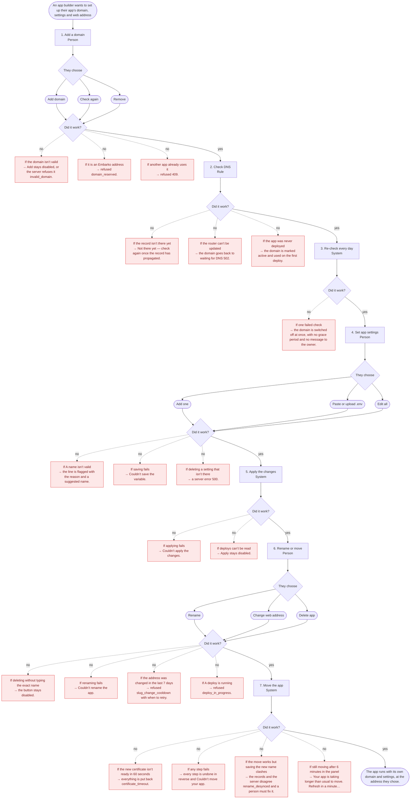

# Story 8: App Settings

<!-- Generated by scripts/build-prd.mjs from app/lib/system/story.ts and the code. Do not edit by hand — run npm run prd. -->

- **ID:** `app-settings` (steps are `app-settings/<step>`)
- **Story:** A builder sets a domain, settings or a new address
- **Who:** An app builder
- **Wants to:** set up their app's domain, settings and web address
- **Ends with:** The app runs with its own domain and settings, at the address they chose.
- **Steps:** 7 · 0 by AI · 7 can go wrong
- **Last change to its code:** v116, 6 Oct 2026 — feat(showcase): organiser custom HTML on event pages

[← All stories](../README.md)

## Steps

| # | Step ID | Step | Who acts | What happens |
|---|---|---|---|---|
| 1 | `app-settings/domain` | Add a domain | Person | They type their own domain and get the DNS record to add. |
| 2 | `app-settings/check-dns` | Check DNS | Rule | Embarko checks the record points at the platform, then tells the router to serve the domain. |
| 3 | `app-settings/recheck` | Re-check every day | System | Once a day every active domain is checked again. |
| 4 | `app-settings/settings` | Set app settings | Person | They add settings one by one, or paste or upload a whole .env file. |
| 5 | `app-settings/apply` | Apply the changes | System | Saved settings reach the app only when it is deployed again, so Apply re-deploys the newest working version. |
| 6 | `app-settings/address` | Rename or move | Person | They rename the app, move it to a new web address, or delete it. |
| 7 | `app-settings/move` | Move the app | System | The app is copied to the new address, waits for its certificate, then the old one is removed. |

## Flow

## Each step in detail

### 1. Add a domain

- **ID:** `app-settings/domain`
- **Who acts:** Person
- **What happens:** They type their own domain and get the DNS record to add.
- **Choices:** Add domain · Check again · Remove
- **If it goes wrong:**
  - If the domain isn't valid → Add stays disabled, or the server refuses it (invalid_domain).
  - If it is an Embarko address → refused (domain_reserved).
  - If another app already uses it → refused (409).
- **Parts:** App builders (`builders`), Your apps panel (`console`), Settings and domains (`app-config`)
- **Keeps:** `AuditLog`, `Domain`
- **Looks up:** `Project`
- **Code:** `page:/app/projects/[projectId]/domain` → `app/app/projects/[projectId]/domain/page.tsx`, `api:@api/companies/:companyId/projects/:projectId/domains` → `@api/src/routes/domains.routes.ts`
- **Outside services:** Redis

### 2. Check DNS

- **ID:** `app-settings/check-dns`
- **Who acts:** Rule
- **What happens:** Embarko checks the record points at the platform, then tells the router to serve the domain.
- **If it goes wrong:**
  - If the record isn't there yet → "Not there yet — check again once the record has propagated."
  - If the router can't be updated → the domain goes back to waiting for DNS (502).
  - If the app was never deployed → the domain is marked active and used on the first deploy.
- **Parts:** Settings and domains (`app-config`), App runner (`runner`), Traffic router (`router`)
- **Keeps:** `AuditLog`, `Domain`
- **Looks up:** `Deployment`, `EnvVar`, `Project`
- **Code:** `api:@api/companies/:companyId/projects/:projectId/domains/:domain/verify` → `@api/src/routes/domains.routes.ts`, `lib:@api/src/lib/dnsVerify` → `@api/src/lib/dnsVerify.ts`, `lib:@api/src/services/customDomainActivation` → `@api/src/services/customDomainActivation.ts`, `api:@deploy/internal/apps/:appName/config` → `@deploy/server.js`
- **Outside services:** Docker, Lago, Redis, Stripe, Traefik

### 3. Re-check every day

- **ID:** `app-settings/recheck`
- **Who acts:** System
- **What happens:** Once a day every active domain is checked again.
- **If it goes wrong:**
  - If one failed check → the domain is switched off at once, with no grace period and no message to the owner.
- **Parts:** Cleanup and re-checks (`cleanup`), Settings and domains (`app-config`)
- **Keeps:** `Domain`
- **Code:** `lib:@api/src/services/domainReverification` → `@api/src/services/domainReverification.ts`

### 4. Set app settings

- **ID:** `app-settings/settings`
- **Who acts:** Person
- **What happens:** They add settings one by one, or paste or upload a whole .env file.
- **Choices:** Add one · Paste or upload .env · Edit all
- **If it goes wrong:**
  - If A name isn't valid → the line is flagged with the reason and a suggested name.
  - If saving fails → "Couldn't save the variable."
  - If deleting a setting that isn't there → a server error (500).
- **Parts:** Your apps panel (`console`), Settings and domains (`app-config`), Apps and deploys (`apps-data`)
- **Keeps:** `AuditLog`, `EnvVar`
- **Looks up:** `Project`
- **Code:** `page:/app/projects/[projectId]/environment` → `app/app/projects/[projectId]/environment/page.tsx`, `lib:app/components/console/BulkEnvDialog` → `app/components/console/BulkEnvDialog.tsx`, `lib:app/lib/envFile` → `app/lib/envFile.ts`, `api:@api/companies/:companyId/projects/:projectId/env-vars` → `@api/src/routes/envVars.routes.ts`
- **Outside services:** Redis

### 5. Apply the changes

- **ID:** `app-settings/apply`
- **Who acts:** System
- **What happens:** Saved settings reach the app only when it is deployed again, so Apply re-deploys the newest working version.
- **If it goes wrong:**
  - If applying fails → "Couldn't apply the changes."
  - If deploys can't be read → Apply stays disabled.
- **Parts:** Deploy history (`deploy-history`), App runner (`runner`)
- **Keeps:** `Deployment`
- **Looks up:** `Domain`, `EnvVar`
- **Code:** `page:/app/projects/[projectId]/environment` → `app/app/projects/[projectId]/environment/page.tsx`, `lib:@api/src/services/redeploy` → `@api/src/services/redeploy.ts`, `api:@deploy/internal/apps/:appName/config` → `@deploy/server.js`
- **Outside services:** Docker, Traefik

### 6. Rename or move

- **ID:** `app-settings/address`
- **Who acts:** Person
- **What happens:** They rename the app, move it to a new web address, or delete it.
- **Choices:** Rename · Change web address · Delete app
- **If it goes wrong:**
  - If deleting without typing the exact name → the button stays disabled.
  - If renaming fails → "Couldn't rename the app."
  - If the address was changed in the last 7 days → refused (slug_change_cooldown) with when to retry.
  - If A deploy is running → refused (deploy_in_progress).
- **Parts:** Your apps panel (`console`), App records (`app-records`)
- **Keeps:** `AppDetails`, `AuditLog`, `Deployment`, `Project`, `ShowcaseEvent`, `ShowcaseEventListing`
- **Looks up:** `Domain`, `EnvVar`
- **Code:** `page:/app/projects/[projectId]/settings` → `app/app/projects/[projectId]/settings/page.tsx`, `api:@api/companies/:companyId/projects/:projectId/slug` → `@api/src/routes/projects.routes.ts`, `lib:@api/src/services/slugChangeFlow` → `@api/src/services/slugChangeFlow.ts`
- **Outside services:** Lago, Redis, Stripe, viaSocket webhook

### 7. Move the app

- **ID:** `app-settings/move`
- **Who acts:** System
- **What happens:** The app is copied to the new address, waits for its certificate, then the old one is removed.
- **If it goes wrong:**
  - If the new certificate isn't ready in 60 seconds → everything is put back (certificate_timeout).
  - If any step fails → every step is undone in reverse and "Couldn't move your app."
  - If the move works but saving the new name clashes → the records and the server disagree (rename_desynced) and a person must fix it.
  - If still moving after 6 minutes in the panel → "Your app is taking longer than usual to move. Refresh in a minute…"
- **Parts:** App records (`app-records`), App runner (`runner`), Traffic router (`router`), Status refresh (`refresh`)
- **Looks up:** `Deployment`, `Domain`, `EnvVar`
- **Code:** `lib:@api/src/services/appRename` → `@api/src/services/appRename.ts`, `api:@deploy/internal/apps/:appName/rename` → `@deploy/server.js`, `lib:@deploy/rename-app` → `@deploy/rename-app.js`
- **Outside services:** Docker, Nomad, Traefik

## Parts involved

| Part | Lane | What it does |
|---|---|---|
| App builders (`builders`) | People | People whose AI agent builds an app, who want it online and healthy. |
| Your apps panel (`console`) | Screens | Where builders see their apps, whether each is live, and what to do next. |
| Settings and domains (`app-config`) | Engine | Stores an app's settings and custom domains, and checks the domain's DNS. |
| App runner (`runner`) | Engine | Runs each app, gives it its address and domains, and moves or removes it when asked. |
| Traffic router (`router`) | Outside | Traefik: sends each address to the right app and gets its certificate. |
| Cleanup and re-checks (`cleanup`) | Background | Deletes trial apps nobody claimed, and re-checks custom domains every day. |
| Apps and deploys (`apps-data`) | Data | Each app, its versions, settings and custom domains. |
| Deploy history (`deploy-history`) | Engine | Records every deploy as a numbered version, and puts an earlier one back on request. |
| App records (`app-records`) | Engine | Keeps the list of apps: who owns each, its name and address, and whether it is live. |
| Status refresh (`refresh`) | Background | Checks again every few seconds while something is changing, then stops. |

See [system-map.md](../system-map.md) for how the parts connect.

## Tables

- **Keeps** `AppDetails` — Public-facing details of a deployed app.
- **Keeps** `AuditLog` — Every mutating action: who, what, when.
- **Keeps** `Deployment` — Versioned deploy history — one row per deploy attempt.
- **Keeps** `Domain` — A client-owned domain (or subdomain) attached to a project — see docs/Customdomain-req.md.
- **Keeps** `EnvVar`
- **Keeps** `Project` — One Project == one deployed app on hostnsoft-deploy.
- **Keeps** `ShowcaseEvent` — An event page, /showcase/<slug>: a hackathon, a demo day.
- **Keeps** `ShowcaseEventListing` — One app shown on one event page.

See [tables.md](../tables.md).

## Recent changes

| Version | Date | Change | Steps changed |
|---|---|---|---|
| v116 (23a0fb8) | 6 Oct 2026 | feat(showcase): organiser custom HTML on event pages | — |
| v115 (3ae7dff) | 5 Oct 2026 | Now Checking with exact name not from prefixes (#20) | check-dns, apply, move |
| v114 (f298654) | 3 Oct 2026 | feat: accepting multiple email for the app contibutors | — |
| v113 (0a4cace) | 1 Oct 2026 | API - Showcase version 2 (#26) | — |
| v112 (b7ede50) | 29 Sept 2026 | Wait up to 5 seconds for a static site to publish | check-dns, apply, move |

## Open questions

- This story was written from the code; treat "wants to" as an assumption until a user confirms it.
