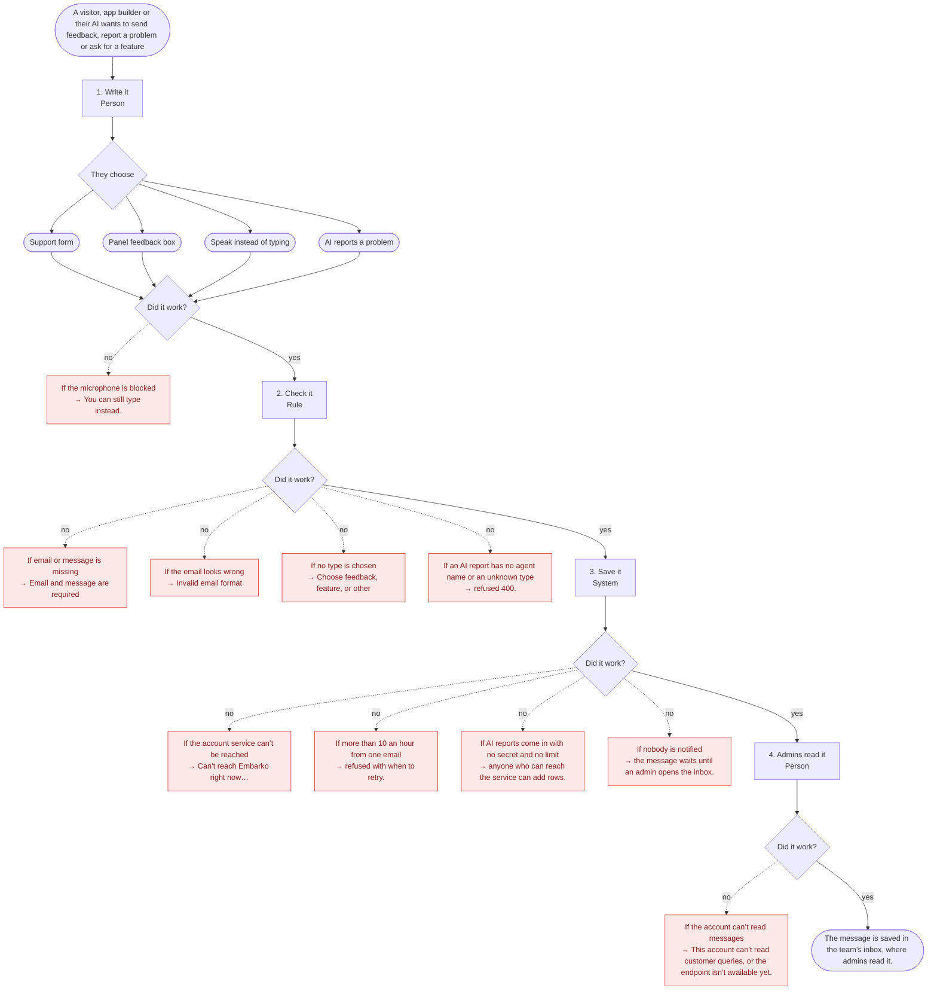

# Story 14: Ask For Help

<!-- Generated by scripts/build-prd.mjs from app/lib/system/story.ts and the code. Do not edit by hand — run npm run prd. -->

- **ID:** `ask-for-help` (steps are `ask-for-help/<step>`)
- **Story:** Someone tells the team what's missing
- **Who:** A visitor, app builder or their AI
- **Wants to:** send feedback, report a problem or ask for a feature
- **Ends with:** The message is saved in the team's inbox, where admins read it.
- **Steps:** 4 · 0 by AI · 4 can go wrong
- **Last change to its code:** v104, 23 Oct 2026 — Re-point the registry tag at every new build

[← All stories](../README.md)

## Steps

| # | Step ID | Step | Who acts | What happens |
|---|---|---|---|---|
| 1 | `ask-for-help/write` | Write it | Person | A person uses the support form or the "What's missing?" box; an AI agent reports a problem straight from a deploy. |
| 2 | `ask-for-help/check` | Check it | Rule | The email, the message and the type are checked. |
| 3 | `ask-for-help/save` | Save it | System | The message is saved in the feedback inbox. |
| 4 | `ask-for-help/read` | Admins read it | Person | Platform admins read every message in the admin pages. |

## Flow

## Each step in detail

### 1. Write it

- **ID:** `ask-for-help/write`
- **Who acts:** Person
- **What happens:** A person uses the support form or the "What's missing?" box; an AI agent reports a problem straight from a deploy.
- **Choices:** Support form · Panel feedback box · Speak instead of typing · AI reports a problem
- **If it goes wrong:**
  - If the microphone is blocked → "You can still type instead."
- **Parts:** Visitors (`visitors`), App builders (`builders`), Your AI agent (`ai-agent`), Info pages (`site-pages`), Your apps panel (`console`), Messages in (`messages`)
- **Code:** `page:/support` → `app/support/page.tsx`, `lib:app/components/SupportForm` → `app/components/SupportForm.tsx`, `lib:app/components/console/FeedbackWidget` → `app/components/console/FeedbackWidget.tsx`, `lib:app/components/ui/dictation` → `app/components/ui/dictation.tsx`, `lib:app/lib/speech` → `app/lib/speech.ts`, `api:@deploy/apps/:appName/customer-query` → `@deploy/server.js`

### 2. Check it

- **ID:** `ask-for-help/check`
- **Who acts:** Rule
- **What happens:** The email, the message and the type are checked.
- **If it goes wrong:**
  - If email or message is missing → "Email and message are required"
  - If the email looks wrong → "Invalid email format"
  - If no type is chosen → "Choose feedback, feature, or other"
  - If an AI report has no agent name or an unknown type → refused (400).
- **Parts:** Messages in (`messages`), Feedback inbox (`inbox`)
- **Code:** `api:/api/contact` → `app/api/contact/route.ts`, `lib:@deploy/customer-query` → `@deploy/customer-query.js`
- **Outside services:** MSG91

### 3. Save it

- **ID:** `ask-for-help/save`
- **Who acts:** System
- **What happens:** The message is saved in the feedback inbox.
- **If it goes wrong:**
  - If the account service can't be reached → "Can't reach Embarko right now…"
  - If more than 10 an hour from one email → refused with when to retry.
  - If AI reports come in with no secret and no limit → anyone who can reach the service can add rows.
  - If nobody is notified → the message waits until an admin opens the inbox.
- **Parts:** Feedback inbox (`inbox`), Feedback records (`feedback-data`)
- **Keeps:** `FeatureRequest`
- **Code:** `api:@api/public/customer-query` → `@api/src/routes/publicCustomerQuery.routes.ts`, `api:@api/companies/:companyId/customer-query` → `@api/src/routes/customerQuery.routes.ts`, `api:@api/internal/customer-query` → `@api/src/routes/internalCustomerQuery.routes.ts`, `lib:@api/src/services/featureRequests` → `@api/src/services/featureRequests.ts`
- **Outside services:** Redis

### 4. Admins read it

- **ID:** `ask-for-help/read`
- **Who acts:** Person
- **What happens:** Platform admins read every message in the admin pages.
- **If it goes wrong:**
  - If the account can't read messages → "This account can't read customer queries, or the endpoint isn't available yet."
- **Parts:** Platform admins (`admins`), Admin pages (`admin`), Admin service (`admin-service`)
- **Looks up:** `FeatureRequest`
- **Code:** `page:/admin/customer-query` → `app/admin/customer-query/page.tsx`, `lib:app/admin/customer-query/queries` → `app/admin/customer-query/queries.tsx`, `api:@api/admin/customer-query` → `@api/src/routes/admin.routes.ts`

## Parts involved

| Part | Lane | What it does |
|---|---|---|
| Visitors (`visitors`) | People | People who land on embarko.ai, read about it and browse the Showcase. |
| App builders (`builders`) | People | People whose AI agent builds an app, who want it online and healthy. |
| Your AI agent (`ai-agent`) | Outside | The builder's own AI (Claude, ChatGPT, Cursor…) that builds and deploys the app. |
| Info pages (`site-pages`) | Screens | Pricing, use cases, events, status, support and the legal pages. |
| Your apps panel (`console`) | Screens | Where builders see their apps, whether each is live, and what to do next. |
| Messages in (`messages`) | Engine | Checks feedback, support and contact messages before passing them on. |
| Feedback inbox (`inbox`) | Engine | Saves every message from people and AI agents for the team to read. |
| Feedback records (`feedback-data`) | Data | Every message, feature request and bug report from people and AI agents. |
| Platform admins (`admins`) | People | The Embarko team, who see every app, message and test result. |
| Admin pages (`admin`) | Screens | Internal pages for the Embarko team: test results, every app, messages. |
| Admin service (`admin-service`) | Engine | Lists every app and message for admins, and grants or removes admin rights. |

See [system-map.md](../system-map.md) for how the parts connect.

## Tables

- **Keeps** `FeatureRequest` — One submission from either path — see docs/request-feature-req.md.

See [tables.md](../tables.md).

## Recent changes

| Version | Date | Change | Steps changed |
|---|---|---|---|
| v104 (073a0af) | 23 Oct 2026 | Re-point the registry tag at every new build | write |
| v103 (e367e80) | 23 Oct 2026 | Run apps from the image registry, pull back a missing image | write |
| v102 (75dc404) | 21 Oct 2026 | feat: relay app_moved and no_access; ask the API for per-app access | write |
| v101 (23a3409) | 21 Oct 2026 | feat: X-App-Id and embarko.json appId on deploy | write |
| v100 (bffa93d) | 19 Oct 2026 | Report the real cause when an app crashes on startup | write |

## Open questions

- This story was written from the code; treat "wants to" as an assumption until a user confirms it.
