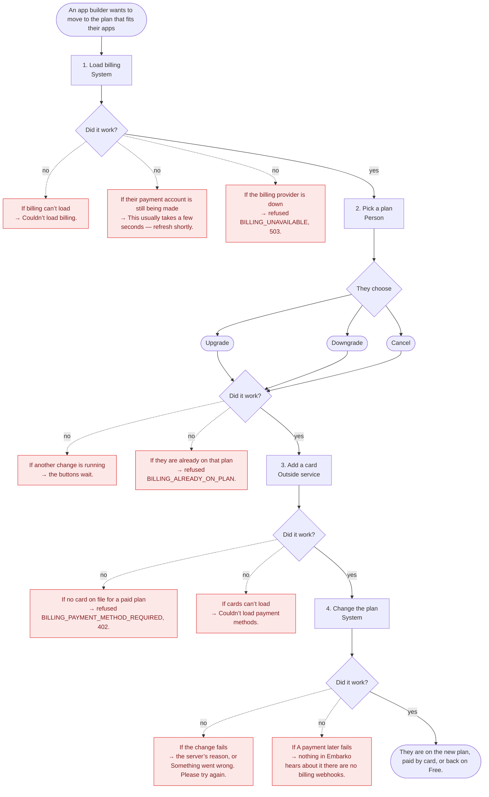

# Story 15: Change Plan

<!-- Generated by scripts/build-prd.mjs from app/lib/system/story.ts and the code. Do not edit by hand — run npm run prd. -->

- **ID:** `change-plan` (steps are `change-plan/<step>`)
- **Story:** A builder upgrades or cancels their plan
- **Who:** An app builder
- **Wants to:** move to the plan that fits their apps
- **Ends with:** They are on the new plan, paid by card, or back on Free.
- **Steps:** 4 · 0 by AI · 4 can go wrong
- **Last change to its code:** v49, 17 Oct 2026 — feat(companies): add PATCH /companies/:id to rename a workspace via proxy (#44)

[← All stories](../README.md)

## Steps

| # | Step ID | Step | Who acts | What happens |
|---|---|---|---|---|
| 1 | `change-plan/load` | Load billing | System | The panel shows their plan and cards. |
| 2 | `change-plan/choose` | Pick a plan | Person | They choose monthly or yearly, then a plan — here or from the pricing page. |
| 3 | `change-plan/card` | Add a card | Outside service | A paid plan needs a card; with none on file they go to the payment page to add one. |
| 4 | `change-plan/apply` | Change the plan | System | An upgrade starts now; a downgrade waits for the end of the billing period. Plans don't limit anything yet. |

## Flow

## Each step in detail

### 1. Load billing

- **ID:** `change-plan/load`
- **Who acts:** System
- **What happens:** The panel shows their plan and cards.
- **If it goes wrong:**
  - If billing can't load → "Couldn't load billing."
  - If their payment account is still being made → "This usually takes a few seconds — refresh shortly."
  - If the billing provider is down → refused (BILLING_UNAVAILABLE, 503).
- **Parts:** Your apps panel (`console`), Panel bridge (`bridge`), Billing (`billing`), Billing providers (`payments`)
- **Keeps:** `Company`
- **Code:** `page:/app/billing` → `app/app/billing/page.tsx`, `lib:app/lib/billing` → `app/lib/billing.tsx`, `lib:app/lib/plans` → `app/lib/plans.ts`, `lib:app/components/console/HeaderPlanBadge` → `app/components/console/HeaderPlanBadge.tsx`, `api:@api/companies/:companyId/billing` → `@api/src/routes/billing.routes.ts`, `lib:@api/src/lib/lago` → `@api/src/lib/lago.ts`
- **Outside services:** Lago, Redis, Stripe

### 2. Pick a plan

- **ID:** `change-plan/choose`
- **Who acts:** Person
- **What happens:** They choose monthly or yearly, then a plan — here or from the pricing page.
- **Choices:** Upgrade · Downgrade · Cancel
- **If it goes wrong:**
  - If another change is running → the buttons wait.
  - If they are already on that plan → refused (BILLING_ALREADY_ON_PLAN).
- **Parts:** App builders (`builders`), Your apps panel (`console`), Info pages (`site-pages`)
- **Keeps:** `Company`
- **Code:** `page:/app/billing` → `app/app/billing/page.tsx`, `page:/pricing` → `app/pricing/page.tsx`, `api:@api/billing/plans` → `@api/src/routes/publicBilling.routes.ts`
- **Outside services:** Lago, Stripe

### 3. Add a card

- **ID:** `change-plan/card`
- **Who acts:** Outside service
- **What happens:** A paid plan needs a card; with none on file they go to the payment page to add one.
- **If it goes wrong:**
  - If no card on file for a paid plan → refused (BILLING_PAYMENT_METHOD_REQUIRED, 402).
  - If cards can't load → "Couldn't load payment methods."
- **Parts:** Billing (`billing`), Billing providers (`payments`)
- **Keeps:** `AppGrant`, `AuditLog`, `Company`, `PendingInvite`, `WorkspaceMember`
- **Looks up:** `DeployToken`, `Project`
- **Code:** `page:/app/billing` → `app/app/billing/page.tsx`, `api:@api/companies/:companyId/billing/checkout-url` → `@api/src/routes/billing.routes.ts`, `lib:@api/src/lib/stripe` → `@api/src/lib/stripe.ts`
- **Outside services:** Lago, Redis, Stripe

### 4. Change the plan

- **ID:** `change-plan/apply`
- **Who acts:** System
- **What happens:** An upgrade starts now; a downgrade waits for the end of the billing period. Plans don't limit anything yet.
- **If it goes wrong:**
  - If the change fails → the server's reason, or "Something went wrong. Please try again."
  - If A payment later fails → nothing in Embarko hears about it; there are no billing webhooks.
- **Parts:** Panel bridge (`bridge`), Billing (`billing`), Billing providers (`payments`)
- **Keeps:** `AppGrant`, `AuditLog`, `Company`, `Domain`, `PendingInvite`, `WorkspaceMember`
- **Looks up:** `DeployToken`, `Deployment`, `EnvVar`, `Project`
- **Code:** `api:@api/companies/:companyId/billing/subscription` → `@api/src/routes/billing.routes.ts`, `lib:@api/src/services/billingCustomer` → `@api/src/services/billingCustomer.ts`
- **Outside services:** Lago, Redis, Stripe

## Parts involved

| Part | Lane | What it does |
|---|---|---|
| Your apps panel (`console`) | Screens | Where builders see their apps, whether each is live, and what to do next. |
| Panel bridge (`bridge`) | Engine | Passes every panel request to the account service as the signed-in person. |
| Billing (`billing`) | Engine | Keeps each workspace's plan and card, through the billing and payment providers. |
| Billing providers (`payments`) | Outside | Lago keeps plans and invoices; Stripe keeps cards. |
| App builders (`builders`) | People | People whose AI agent builds an app, who want it online and healthy. |
| Info pages (`site-pages`) | Screens | Pricing, use cases, events, status, support and the legal pages. |

See [system-map.md](../system-map.md) for how the parts connect.

## Tables

- **Keeps** `AppGrant` — One app a developer/viewer with appScope "selected" may reach, and how far: "manage" (deploy, change settings) or "view" (status, logs, history).
- **Keeps** `AuditLog` — Every mutating action: who, what, when.
- **Keeps** `Company` — Local mirror of the few company facts the proxy doesn't hold.
- **Keeps** `Domain` — A client-owned domain (or subdomain) attached to a project — see docs/Customdomain-req.md.
- **Keeps** `PendingInvite` — A role chosen for someone before they are a member.
- **Keeps** `WorkspaceMember` — A member's role in one workspace.
- **Looks up** `DeployToken` — A deploy token.
- **Looks up** `Deployment` — Versioned deploy history — one row per deploy attempt.
- **Looks up** `EnvVar`
- **Looks up** `Project` — One Project == one deployed app on hostnsoft-deploy.

See [tables.md](../tables.md).

## Recent changes

| Version | Date | Change | Steps changed |
|---|---|---|---|
| v49 (9246658) | 17 Oct 2026 | feat(companies): add PATCH /companies/:id to rename a workspace via proxy (#44) | load, card, apply |
| v48 (dc830b8) | 13 Oct 2026 | feat: add Company model to mirror billing state and fallback when Lago is unreachable | load, apply |
| v47 (c85241c) | 13 Oct 2026 | feat(orphan): claim link — keep a temporary app by signing in, no redeploy | — |
| v46 (d24ce6a) | 12 Oct 2026 | fix: improve case-insensitive coupon resolution and update rate limit window duration | load, card, apply |
| v45 (b73325d) | 12 Oct 2026 | Coupon integration with Lago + DB dash | load, choose, card |

## Open questions

- This story was written from the code; treat "wants to" as an assumption until a user confirms it.
