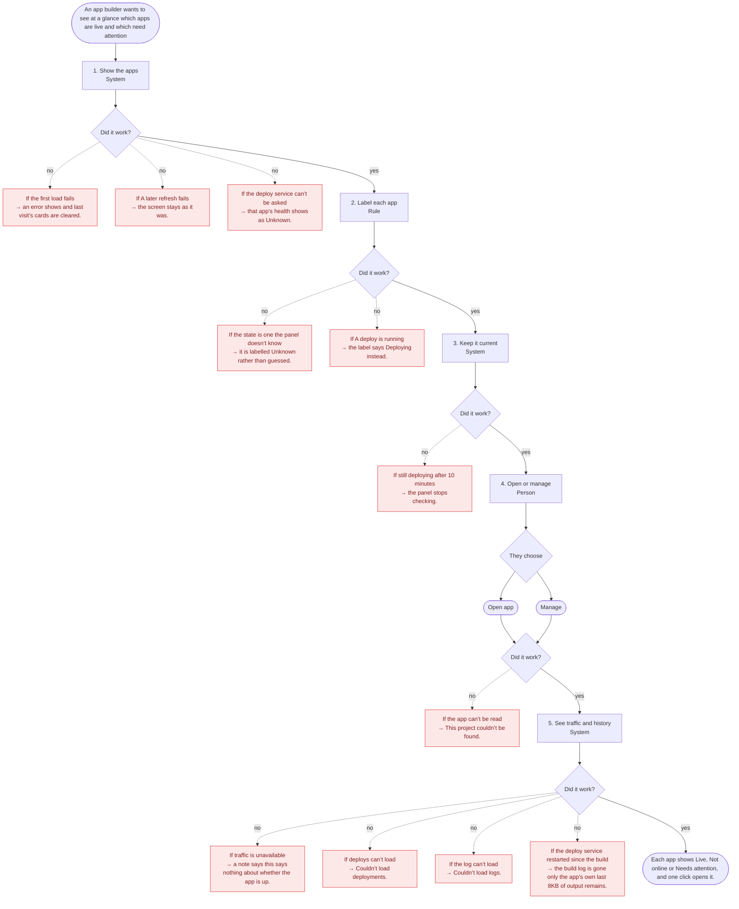

# Story 4: Check Apps

<!-- Generated by scripts/build-prd.mjs from app/lib/system/story.ts and the code. Do not edit by hand — run npm run prd. -->

- **ID:** `check-apps` (steps are `check-apps/<step>`)
- **Story:** A builder checks whether their apps are live
- **Who:** An app builder
- **Wants to:** see at a glance which apps are live and which need attention
- **Ends with:** Each app shows Live, Not online or Needs attention, and one click opens it.
- **Steps:** 5 · 0 by AI · 5 can go wrong
- **Last change to its code:** v151, 19 Oct 2026 — Read embarko.json on deploy for schedules, warn about in-process timers

[← All stories](../README.md)

## Steps

| # | Step ID | Step | Who acts | What happens |
|---|---|---|---|---|
| 1 | `check-apps/list` | Show the apps | System | The panel shows last visit's list at once, then the fresh one with each app's health. |
| 2 | `check-apps/label` | Label each app | Rule | Each app gets one clear label from its state: Live, Starting, Not online or Needs attention. |
| 3 | `check-apps/keep-current` | Keep it current | System | While an app is deploying or starting, the panel checks again every 5 seconds. |
| 4 | `check-apps/open` | Open or manage | Person | They open the live app, or open its page in the panel. |
| 5 | `check-apps/details` | See traffic and history | System | The app's page shows its traffic, its deploys and the last log. |

## Flow

## Each step in detail

### 1. Show the apps

- **ID:** `check-apps/list`
- **Who acts:** System
- **What happens:** The panel shows last visit's list at once, then the fresh one with each app's health.
- **If it goes wrong:**
  - If the first load fails → an error shows and last visit's cards are cleared.
  - If A later refresh fails → the screen stays as it was.
  - If the deploy service can't be asked → that app's health shows as Unknown.
- **Parts:** Your apps panel (`console`), Panel bridge (`bridge`), App records (`app-records`), App runner (`runner`)
- **Keeps:** `AuditLog`, `Project`
- **Looks up:** `Deployment`
- **Code:** `page:/app` → `app/app/page.tsx`, `lib:app/lib/lastSeen` → `app/lib/lastSeen.ts`, `lib:app/lib/earlyReads` → `app/lib/earlyReads.ts`, `api:@api/companies/:companyId/projects` → `@api/src/routes/projects.routes.ts`, `lib:@api/src/services/appHealth` → `@api/src/services/appHealth.ts`, `api:@deploy/internal/apps/:appName/status` → `@deploy/server.js`, `lib:@deploy/app-health` → `@deploy/app-health.js`
- **Outside services:** Docker, Nomad, Redis

### 2. Label each app

- **ID:** `check-apps/label`
- **Who acts:** Rule
- **What happens:** Each app gets one clear label from its state: Live, Starting, Not online or Needs attention.
- **If it goes wrong:**
  - If the state is one the panel doesn't know → it is labelled Unknown rather than guessed.
  - If A deploy is running → the label says Deploying instead.
- **Parts:** Your apps panel (`console`)
- **Code:** `lib:app/components/console/HealthPill` → `app/components/console/HealthPill.tsx`, `lib:app/components/console/StatusPill` → `app/components/console/StatusPill.tsx`, `lib:app/components/console/AppTile` → `app/components/console/AppTile.tsx`

### 3. Keep it current

- **ID:** `check-apps/keep-current`
- **Who acts:** System
- **What happens:** While an app is deploying or starting, the panel checks again every 5 seconds.
- **If it goes wrong:**
  - If still deploying after 10 minutes → the panel stops checking.
- **Parts:** Status refresh (`refresh`), Panel bridge (`bridge`)
- **Code:** `page:/app` → `app/app/page.tsx`

### 4. Open or manage

- **ID:** `check-apps/open`
- **Who acts:** Person
- **What happens:** They open the live app, or open its page in the panel.
- **Choices:** Open app · Manage
- **If it goes wrong:**
  - If the app can't be read → "This project couldn't be found."
- **Parts:** App builders (`builders`), Your apps panel (`console`)
- **Code:** `lib:app/components/console/AppTile` → `app/components/console/AppTile.tsx`, `page:/app/projects/[projectId]` → `app/app/projects/[projectId]/page.tsx`, `lib:app/components/console/ProjectNav` → `app/components/console/ProjectNav.tsx`, `lib:app/lib/useProject` → `app/lib/useProject.ts`

### 5. See traffic and history

- **ID:** `check-apps/details`
- **Who acts:** System
- **What happens:** The app's page shows its traffic, its deploys and the last log.
- **If it goes wrong:**
  - If traffic is unavailable → a note says this says nothing about whether the app is up.
  - If deploys can't load → "Couldn't load deployments."
  - If the log can't load → "Couldn't load logs."
  - If the deploy service restarted since the build → the build log is gone; only the app's own last 8KB of output remains.
- **Parts:** Your apps panel (`console`), App records (`app-records`), Traffic recorder (`traffic-recorder`), Traffic records (`traffic-data`), App runner (`runner`)
- **Keeps:** `request_log`, `resource_sample`, `tail_state`
- **Looks up:** `Project`
- **Code:** `lib:app/components/console/ProjectAnalytics` → `app/components/console/ProjectAnalytics.tsx`, `page:/app/projects/[projectId]/deployments` → `app/app/projects/[projectId]/deployments/page.tsx`, `api:@api/companies/:companyId/projects/:projectId/analytics` → `@api/src/routes/analytics.routes.ts`, `api:@deploy/internal/apps/:appName/analytics` → `@deploy/server.js`, `api:/api/apps/[slug]/logs` → `app/api/apps/[slug]/logs/route.ts`, `api:@deploy/apps/:appName/logs` → `@deploy/server.js`
- **Outside services:** Docker, MSG91, Nomad, Redis, Traefik

## Parts involved

| Part | Lane | What it does |
|---|---|---|
| Your apps panel (`console`) | Screens | Where builders see their apps, whether each is live, and what to do next. |
| Panel bridge (`bridge`) | Engine | Passes every panel request to the account service as the signed-in person. |
| App records (`app-records`) | Engine | Keeps the list of apps: who owns each, its name and address, and whether it is live. |
| App runner (`runner`) | Engine | Runs each app, gives it its address and domains, and moves or removes it when asked. |
| Status refresh (`refresh`) | Background | Checks again every few seconds while something is changing, then stops. |
| App builders (`builders`) | People | People whose AI agent builds an app, who want it online and healthy. |
| Traffic recorder (`traffic-recorder`) | Background | Records every request and each app's CPU and memory, and forgets them after 100 days. |
| Traffic records (`traffic-data`) | Data | Each app's requests and resource use, for its traffic charts and for sleep decisions. |

See [system-map.md](../system-map.md) for how the parts connect.

## Tables

- **Keeps** `AuditLog` — Every mutating action: who, what, when.
- **Keeps** `Project` — One Project == one deployed app on hostnsoft-deploy.
- **Keeps** `request_log`
- **Keeps** `resource_sample`
- **Keeps** `tail_state` — One row, keyed by the log file's own path — lets the tailer resume from where it left off across restarts, and detect rotation (a changed inode, or a file that's now smaller than our last offset).
- **Looks up** `Deployment` — Versioned deploy history — one row per deploy attempt.

See [tables.md](../tables.md).

## Recent changes

| Version | Date | Change | Steps changed |
|---|---|---|---|
| v151 (52cc384) | 19 Oct 2026 | Read embarko.json on deploy for schedules, warn about in-process timers | list, details |
| v150 (b3e21dd) | 14 Oct 2026 | feat: add zero-downtime graceful shutdown, unref intervals, and live migration script | list, details |
| v149 (1b7b79b) | 14 Oct 2026 | Redirect /capabilities to the agent guide | list, details |
| v148 (6fd5e0c) | 13 Oct 2026 | fix(orphan): refuse an orphan-cleanup teardown while a deploy is in flight | list, details |
| v147 (3f6cbf4) | 13 Oct 2026 | fix(orphan): never let cleanup tear down an app someone just redeployed | list |

## Open questions

- This story was written from the code; treat "wants to" as an assumption until a user confirms it.
