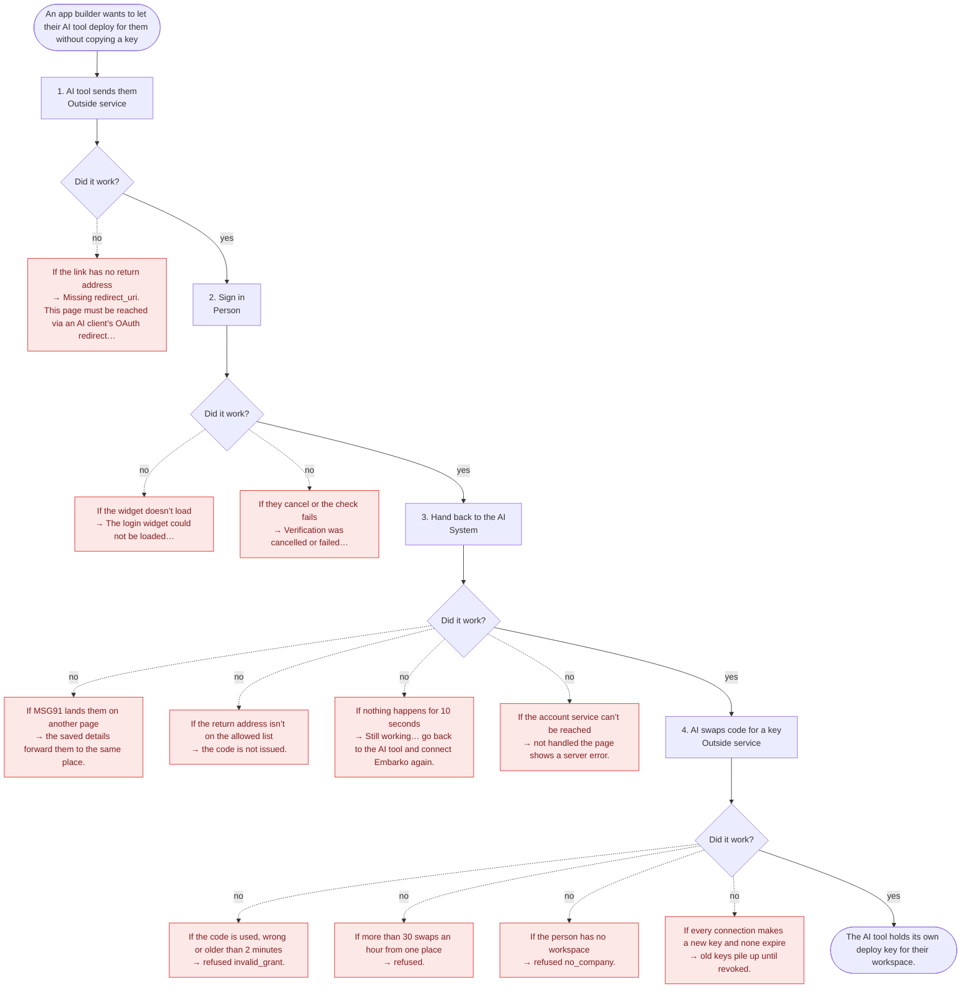

# Story 10: Connect AI

<!-- Generated by scripts/build-prd.mjs from app/lib/system/story.ts and the code. Do not edit by hand — run npm run prd. -->

- **ID:** `connect-ai` (steps are `connect-ai/<step>`)
- **Story:** A builder connects Embarko to their AI tool
- **Who:** An app builder
- **Wants to:** let their AI tool deploy for them without copying a key
- **Ends with:** The AI tool holds its own deploy key for their workspace.
- **Steps:** 4 · 0 by AI · 4 can go wrong
- **Last change to its code:** v25, 21 Oct 2026 — feat: personal deploy tokens and moving apps between workspaces

[← All stories](../README.md)

## Steps

| # | Step ID | Step | Who acts | What happens |
|---|---|---|---|---|
| 1 | `connect-ai/arrive` | AI tool sends them | Outside service | Their AI tool opens Embarko's sign-in page and says where to return. |
| 2 | `connect-ai/sign-in` | Sign in | Person | They sign in with MSG91 as usual. |
| 3 | `connect-ai/hand-back` | Hand back to the AI | System | Embarko makes a one-time code that lasts 2 minutes and sends them back to the AI tool with it. |
| 4 | `connect-ai/get-key` | AI swaps code for a key | Outside service | The AI tool trades the code for its own deploy key for the workspace. |

## Flow

## Each step in detail

### 1. AI tool sends them

- **ID:** `connect-ai/arrive`
- **Who acts:** Outside service
- **What happens:** Their AI tool opens Embarko's sign-in page and says where to return.
- **If it goes wrong:**
  - If the link has no return address → "Missing redirect_uri. This page must be reached via an AI client's OAuth redirect…"
- **Parts:** Your AI agent (`ai-agent`), Sign-in (`sign-in`)
- **Code:** `page:/connector/login` → `app/connector/login/page.tsx`, `lib:app/lib/connectorPendingRedirect` → `app/lib/connectorPendingRedirect.ts`

### 2. Sign in

- **ID:** `connect-ai/sign-in`
- **Who acts:** Person
- **What happens:** They sign in with MSG91 as usual.
- **If it goes wrong:**
  - If the widget doesn't load → "The login widget could not be loaded…"
  - If they cancel or the check fails → "Verification was cancelled or failed…"
- **Parts:** App builders (`builders`), Sign-in (`sign-in`), MSG91 (`msg91`)
- **Code:** `page:/connector/login` → `app/connector/login/page.tsx`
- **Outside services:** MSG91

### 3. Hand back to the AI

- **ID:** `connect-ai/hand-back`
- **Who acts:** System
- **What happens:** Embarko makes a one-time code that lasts 2 minutes and sends them back to the AI tool with it.
- **If it goes wrong:**
  - If MSG91 lands them on another page → the saved details forward them to the same place.
  - If the return address isn't on the allowed list → the code is not issued.
  - If nothing happens for 10 seconds → "Still working… go back to the AI tool and connect Embarko again."
  - If the account service can't be reached → not handled; the page shows a server error.
- **Parts:** Sign-in (`sign-in`), Account checks (`accounts`), Redis (`redis`)
- **Code:** `api:/api/auth/connector-callback` → `app/api/auth/connector-callback/route.ts`, `lib:app/components/connector/ConnectorRedirecting` → `app/components/connector/ConnectorRedirecting.tsx`, `lib:app/components/connector/ConnectorTokenPickup` → `app/components/connector/ConnectorTokenPickup.tsx`, `api:@api/auth/msg91/callback` → `@api/src/routes/auth.routes.ts`, `lib:@api/src/lib/connectorPendingLogin` → `@api/src/lib/connectorPendingLogin.ts`, `lib:@api/src/lib/connectorRedirect` → `@api/src/lib/connectorRedirect.ts`
- **Outside services:** MSG91, Redis

### 4. AI swaps code for a key

- **ID:** `connect-ai/get-key`
- **Who acts:** Outside service
- **What happens:** The AI tool trades the code for its own deploy key for the workspace.
- **If it goes wrong:**
  - If the code is used, wrong or older than 2 minutes → refused (invalid_grant).
  - If more than 30 swaps an hour from one place → refused.
  - If the person has no workspace → refused (no_company).
  - If every connection makes a new key and none expire → old keys pile up until revoked.
- **Parts:** Your AI agent (`ai-agent`), Account checks (`accounts`), Deploy keys (`tokens`), Keys and audit (`access-data`)
- **Keeps:** `AuditLog`, `DeployToken`
- **Code:** `api:@api/connector/token` → `@api/src/routes/connectorAuth.routes.ts`, `lib:@api/src/services/connectorToken` → `@api/src/services/connectorToken.ts`
- **Outside services:** Redis

## Parts involved

| Part | Lane | What it does |
|---|---|---|
| Your AI agent (`ai-agent`) | Outside | The builder's own AI (Claude, ChatGPT, Cursor…) that builds and deploys the app. |
| Sign-in (`sign-in`) | Screens | Where people prove who they are, in the panel or for an AI tool. |
| App builders (`builders`) | People | People whose AI agent builds an app, who want it online and healthy. |
| MSG91 (`msg91`) | Outside | Checks who a person is, holds workspaces and members, and sends email templates. |
| Account checks (`accounts`) | Engine | Confirms who someone is, which workspaces they belong to, and whether they are an admin. |
| Redis (`redis`) | Outside | Short-lived memory for sign-in checks, one-time codes and rate limits. |
| Deploy keys (`tokens`) | Engine | Makes, checks, rotates and revokes the keys an AI uses to deploy, and decides which apps each key may reach. |
| Keys and audit (`access-data`) | Data | Deploy keys (hashed), who the admins are, and a log of important actions. |

See [system-map.md](../system-map.md) for how the parts connect.

## Tables

- **Keeps** `AuditLog` — Every mutating action: who, what, when.
- **Keeps** `DeployToken` — A deploy token.

See [tables.md](../tables.md).

## Recent changes

| Version | Date | Change | Steps changed |
|---|---|---|---|
| v25 (b7f1799) | 21 Oct 2026 | feat: personal deploy tokens and moving apps between workspaces | get-key |
| v24 (104abda) | 13 Oct 2026 | Say workspace instead of company in API messages; rollback error no longer mentions images | hand-back, get-key |
| v23 (85bafee) | 8 Oct 2026 | feat: allow mcp.embarko.ai OAuth callback as connector redirect_uri | hand-back |
| v22 (db159cf) | 1 Oct 2026 | fix(connector): name the AI tool, never the connector proxy | arrive, sign-in, hand-back |
| v21 (ce3edc2) | 1 Oct 2026 | feat(connector): show 'Connecting Embarko to <tool>…' while sign-in hands off | arrive, sign-in, hand-back |

## Open questions

- This story was written from the code; treat "wants to" as an assumption until a user confirms it.
