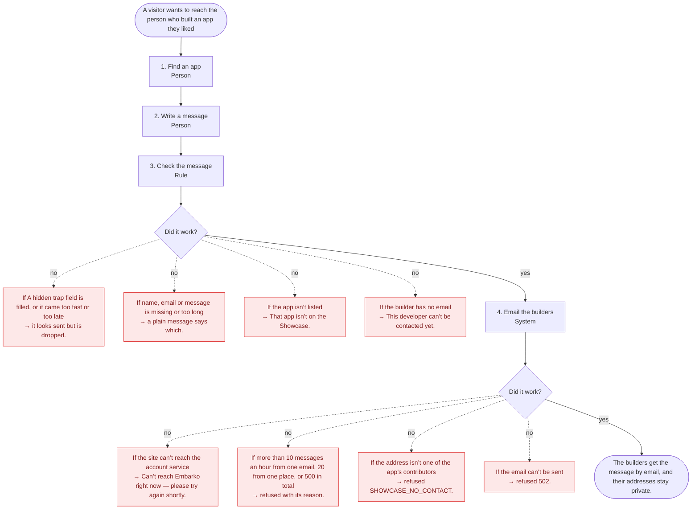

# Story 12: Contact Dev

<!-- Generated by scripts/build-prd.mjs from app/lib/system/story.ts and the code. Do not edit by hand — run npm run prd. -->

- **ID:** `contact-dev` (steps are `contact-dev/<step>`)
- **Story:** A visitor writes to an app's builder
- **Who:** A visitor
- **Wants to:** reach the person who built an app they liked
- **Ends with:** The builders get the message by email, and their addresses stay private.
- **Steps:** 4 · 0 by AI · 2 can go wrong
- **Last change to its code:** v37, 8 Oct 2026 — feat(showcase): custom HTML on event pages- #15 (#15)

[← All stories](../README.md)

## Steps

| # | Step ID | Step | Who acts | What happens |
|---|---|---|---|---|
| 1 | `contact-dev/browse` | Find an app | Person | The visitor browses the Showcase and opens an app's page. |
| 2 | `contact-dev/write` | Write a message | Person | They add their name, email and a short message. |
| 3 | `contact-dev/check` | Check the message | Rule | The site checks the message and looks up the builder's email itself. |
| 4 | `contact-dev/send` | Email the builders | System | The account service emails every contributor of the app and saves the message. |

## Flow

## Each step in detail

### 1. Find an app

- **ID:** `contact-dev/browse`
- **Who acts:** Person
- **What happens:** The visitor browses the Showcase and opens an app's page.
- **Parts:** Visitors (`visitors`), Public Showcase (`showcase-public`)
- **Code:** `page:/showcase` → `app/showcase/page.tsx`, `page:/showcase/app/[slug]` → `app/showcase/app/[slug]/page.tsx`, `lib:app/showcase/SearchGallery` → `app/showcase/SearchGallery.tsx`

### 2. Write a message

- **ID:** `contact-dev/write`
- **Who acts:** Person
- **What happens:** They add their name, email and a short message.
- **Parts:** Visitors (`visitors`), Public Showcase (`showcase-public`)
- **Code:** `lib:app/showcase/app/[slug]/ContactDev` → `app/showcase/app/[slug]/ContactDev.tsx`

### 3. Check the message

- **ID:** `contact-dev/check`
- **Who acts:** Rule
- **What happens:** The site checks the message and looks up the builder's email itself.
- **If it goes wrong:**
  - If A hidden trap field is filled, or it came too fast or too late → it looks sent but is dropped.
  - If name, email or message is missing or too long → a plain message says which.
  - If the app isn't listed → "That app isn't on the Showcase."
  - If the builder has no email → "This developer can't be contacted yet."
- **Parts:** Messages in (`messages`), Showcase reader (`showcase-reader`)
- **Code:** `api:/api/showcase/contact` → `app/api/showcase/contact/route.ts`, `lib:app/lib/showcase` → `app/lib/showcase.ts`
- **Outside services:** MSG91

### 4. Email the builders

- **ID:** `contact-dev/send`
- **Who acts:** System
- **What happens:** The account service emails every contributor of the app and saves the message.
- **If it goes wrong:**
  - If the site can't reach the account service → "Can't reach Embarko right now — please try again shortly."
  - If more than 10 messages an hour from one email, 20 from one place, or 500 in total → refused with its reason.
  - If the address isn't one of the app's contributors → refused (SHOWCASE_NO_CONTACT).
  - If the email can't be sent → refused (502).
- **Parts:** Feedback inbox (`inbox`), viaSocket (`webhook`), Feedback records (`feedback-data`)
- **Keeps:** `FeatureRequest`
- **Code:** `api:@api/public/customer-query` → `@api/src/routes/publicCustomerQuery.routes.ts`, `lib:@api/src/services/featureRequests` → `@api/src/services/featureRequests.ts`
- **Outside services:** viaSocket webhook

## Parts involved

| Part | Lane | What it does |
|---|---|---|
| Visitors (`visitors`) | People | People who land on embarko.ai, read about it and browse the Showcase. |
| Public Showcase (`showcase-public`) | Screens | Public pages of apps people built on Embarko, grouped by event, tool and topic. |
| Messages in (`messages`) | Engine | Checks feedback, support and contact messages before passing them on. |
| Showcase reader (`showcase-reader`) | Engine | Reads the public Showcase listings, without the builders' email addresses. |
| Feedback inbox (`inbox`) | Engine | Saves every message from people and AI agents for the team to read. |
| viaSocket (`webhook`) | Outside | Receives early-access requests and sends Embarko's emails (keys, Showcase notices). |
| Feedback records (`feedback-data`) | Data | Every message, feature request and bug report from people and AI agents. |

See [system-map.md](../system-map.md) for how the parts connect.

## Tables

- **Keeps** `FeatureRequest` — One submission from either path — see docs/request-feature-req.md.

See [tables.md](../tables.md).

## Recent changes

| Version | Date | Change | Steps changed |
|---|---|---|---|
| v37 (67cbcf0) | 8 Oct 2026 | feat(showcase): custom HTML on event pages- #15 (#15) | browse, check |
| v36 (8da531b) | 6 Oct 2026 | feat: listing all the showcase pages (#14) | browse, check |
| v35 (2e9bdb3) | 6 Oct 2026 | feat(showcase): one-action header, wordmark-only app pages | browse |
| v34 (f10b4e1) | 5 Oct 2026 | feat(ui): magic wand icon on every copy-prompt button | browse |
| v33 (7613e83) | 3 Oct 2026 | feat(showcase): remove Open app button from the app detail page | browse |

## Open questions

- This story was written from the code; treat "wants to" as an assumption until a user confirms it.
