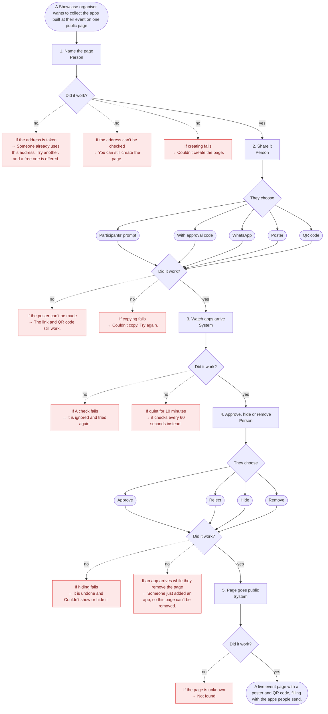

# Story 12: Event Page

<!-- Generated by scripts/build-prd.mjs from app/lib/system/story.ts and the code. Do not edit by hand — run npm run prd. -->

- **ID:** `event-page` (steps are `event-page/<step>`)
- **Story:** An organiser runs a Showcase page for an event
- **Who:** A Showcase organiser
- **Wants to:** collect the apps built at their event on one public page
- **Ends with:** A live event page with a poster and QR code, filling with the apps people send.
- **Steps:** 5 · 0 by AI · 5 can go wrong
- **Last change to its code:** v54, 21 Oct 2026 — feat: add auto-approve configuration option for showcase events

[← All stories](../README.md)

## Steps

| # | Step ID | Step | Who acts | What happens |
|---|---|---|---|---|
| 1 | `event-page/create` | Name the page | Person | They name the page; its address is made from the name and checked. The page gets its own approval code. |
| 2 | `event-page/share` | Share it | Person | They share a prompt for participants' AIs, a poster, a QR code or a WhatsApp link. |
| 3 | `event-page/watch` | Watch apps arrive | System | While the page is open it checks for new apps every 30 seconds. |
| 4 | `event-page/review` | Approve, hide or remove | Person | They approve or turn down requests, and hide or remove apps. |
| 5 | `event-page/public` | Page goes public | System | Anyone can open the event page and see its apps. |

## Flow

## Each step in detail

### 1. Name the page

- **ID:** `event-page/create`
- **Who acts:** Person
- **What happens:** They name the page; its address is made from the name and checked. The page gets its own approval code.
- **If it goes wrong:**
  - If the address is taken → "Someone already uses this address. Try another." and a free one is offered.
  - If the address can't be checked → "You can still create the page."
  - If creating fails → "Couldn't create the page."
- **Parts:** Showcase organisers (`organisers`), Showcase manager (`showcase-manage`), Showcase service (`showcase-service`), Showcase records (`showcase-data`)
- **Keeps:** `AppDetails`, `AppGrant`, `AuditLog`, `PendingInvite`, `Project`, `ShowcaseEvent`, `ShowcaseEventListing`, `WorkspaceMember`
- **Looks up:** `DeployToken`, `Domain`
- **Code:** `page:/app/showcase/new` → `app/app/showcase/new/page.tsx`, `lib:app/app/showcase/new/NewShowcaseForm` → `app/app/showcase/new/NewShowcaseForm.tsx`, `lib:app/lib/showcaseAddress` → `app/lib/showcaseAddress.ts`, `api:@api/companies/:companyId/showcase/collections` → `@api/src/routes/showcase.routes.ts`
- **Outside services:** Redis, viaSocket webhook

### 2. Share it

- **ID:** `event-page/share`
- **Who acts:** Person
- **What happens:** They share a prompt for participants' AIs, a poster, a QR code or a WhatsApp link.
- **Choices:** Participants' prompt · With approval code · WhatsApp · Poster · QR code
- **If it goes wrong:**
  - If the poster can't be made → "The link and QR code still work."
  - If copying fails → "Couldn't copy. Try again."
- **Parts:** Showcase manager (`showcase-manage`), Sharing and video (`sharing`)
- **Code:** `lib:app/components/console/showcase/ShareKit` → `app/components/console/showcase/ShareKit.tsx`, `lib:app/components/console/showcase/InviteCard` → `app/components/console/showcase/InviteCard.tsx`, `lib:app/lib/poster` → `app/lib/poster.ts`, `lib:app/lib/qr` → `app/lib/qr.ts`, `lib:app/lib/showcaseShare` → `app/lib/showcaseShare.ts`
- **Outside services:** Social share links

### 3. Watch apps arrive

- **ID:** `event-page/watch`
- **Who acts:** System
- **What happens:** While the page is open it checks for new apps every 30 seconds.
- **If it goes wrong:**
  - If A check fails → it is ignored and tried again.
  - If quiet for 10 minutes → it checks every 60 seconds instead.
- **Parts:** Showcase manager (`showcase-manage`), Status refresh (`refresh`)
- **Code:** `page:/app/showcase/[collectionId]` → `app/app/showcase/[collectionId]/page.tsx`, `lib:app/lib/showcaseSeen` → `app/lib/showcaseSeen.ts`

### 4. Approve, hide or remove

- **ID:** `event-page/review`
- **Who acts:** Person
- **What happens:** They approve or turn down requests, and hide or remove apps.
- **Choices:** Approve · Reject · Hide · Remove
- **If it goes wrong:**
  - If hiding fails → it is undone and "Couldn't show or hide it."
  - If an app arrives while they remove the page → "Someone just added an app, so this page can't be removed."
- **Parts:** Showcase organisers (`organisers`), Showcase manager (`showcase-manage`), Showcase service (`showcase-service`)
- **Keeps:** `AppDetails`, `AppGrant`, `AuditLog`, `PendingInvite`, `Project`, `ShowcaseEvent`, `ShowcaseEventListing`, `WorkspaceMember`
- **Looks up:** `DeployToken`, `Domain`
- **Code:** `lib:app/components/console/showcase/RequestRows` → `app/components/console/showcase/RequestRows.tsx`, `lib:app/components/console/showcase/ListingRows` → `app/components/console/showcase/ListingRows.tsx`, `api:@api/companies/:companyId/showcase/collections/:collectionId/projects/:listingId` → `@api/src/routes/showcase.routes.ts`
- **Outside services:** Redis, viaSocket webhook

### 5. Page goes public

- **ID:** `event-page/public`
- **Who acts:** System
- **What happens:** Anyone can open the event page and see its apps.
- **If it goes wrong:**
  - If the page is unknown → Not found.
- **Parts:** Public Showcase (`showcase-public`), Showcase reader (`showcase-reader`), Showcase service (`showcase-service`)
- **Keeps:** `AppDetails`, `Project`, `ShowcaseEvent`, `ShowcaseEventListing`
- **Looks up:** `Domain`
- **Code:** `page:/showcase/[...collection]` → `app/showcase/[...collection]/page.tsx`, `lib:app/lib/showcase` → `app/lib/showcase.ts`, `api:@api/public/showcase/collections/:slug` → `@api/src/routes/publicShowcase.routes.ts`
- **Outside services:** Redis, viaSocket webhook

## Parts involved

| Part | Lane | What it does |
|---|---|---|
| Showcase organisers (`organisers`) | People | People who run a Showcase page for an event and choose which apps go on it. |
| Showcase manager (`showcase-manage`) | Screens | Where builders list apps and organisers run their event pages. |
| Showcase service (`showcase-service`) | Engine | Stores Showcase pages and listings, decides what needs approval, and emails people about it. |
| Showcase records (`showcase-data`) | Data | Each app's Showcase details, the event pages, and which apps are on which page. |
| Sharing and video (`sharing`) | Outside | WhatsApp, X and LinkedIn share links, and YouTube videos on app pages. |
| Status refresh (`refresh`) | Background | Checks again every few seconds while something is changing, then stops. |
| Public Showcase (`showcase-public`) | Screens | Public pages of apps people built on Embarko, grouped by event, tool and topic. |
| Showcase reader (`showcase-reader`) | Engine | Reads the public Showcase listings, without the builders' email addresses. |

See [system-map.md](../system-map.md) for how the parts connect.

## Tables

- **Keeps** `AppDetails` — Public-facing details of a deployed app.
- **Keeps** `AppGrant` — One app a developer/viewer with appScope "selected" may reach, and how far: "manage" (deploy, change settings) or "view" (status, logs, history).
- **Keeps** `AuditLog` — Every mutating action: who, what, when.
- **Keeps** `PendingInvite` — A role chosen for someone before they are a member.
- **Keeps** `Project` — One Project == one deployed app on hostnsoft-deploy.
- **Keeps** `ShowcaseEvent` — An event page, /showcase/<slug>: a hackathon, a demo day.
- **Keeps** `ShowcaseEventListing` — One app shown on one event page.
- **Keeps** `WorkspaceMember` — A member's role in one workspace.
- **Looks up** `DeployToken` — A deploy token.
- **Looks up** `Domain` — A client-owned domain (or subdomain) attached to a project — see docs/Customdomain-req.md.

See [tables.md](../tables.md).

## Recent changes

| Version | Date | Change | Steps changed |
|---|---|---|---|
| v54 (dd89bfd) | 21 Oct 2026 | feat: add auto-approve configuration option for showcase events | create, review |
| v53 (ee930c9) | 21 Oct 2026 | feat: add auto-approve setting for showcase collections and submission flow | create, share, watch |
| v52 (c85241c) | 13 Oct 2026 | feat(orphan): claim link — keep a temporary app by signing in, no redeploy | — |
| v51 (b362cfe) | 13 Oct 2026 | feat(guides): move to /guides, 4 new guides, share launcher, llms.txt | public |
| v50 (dd7f1da) | 12 Oct 2026 | feat(blog): Guides layout with covers, share, reading rail | public |

## Open questions

- This story was written from the code; treat "wants to" as an assumption until a user confirms it.
