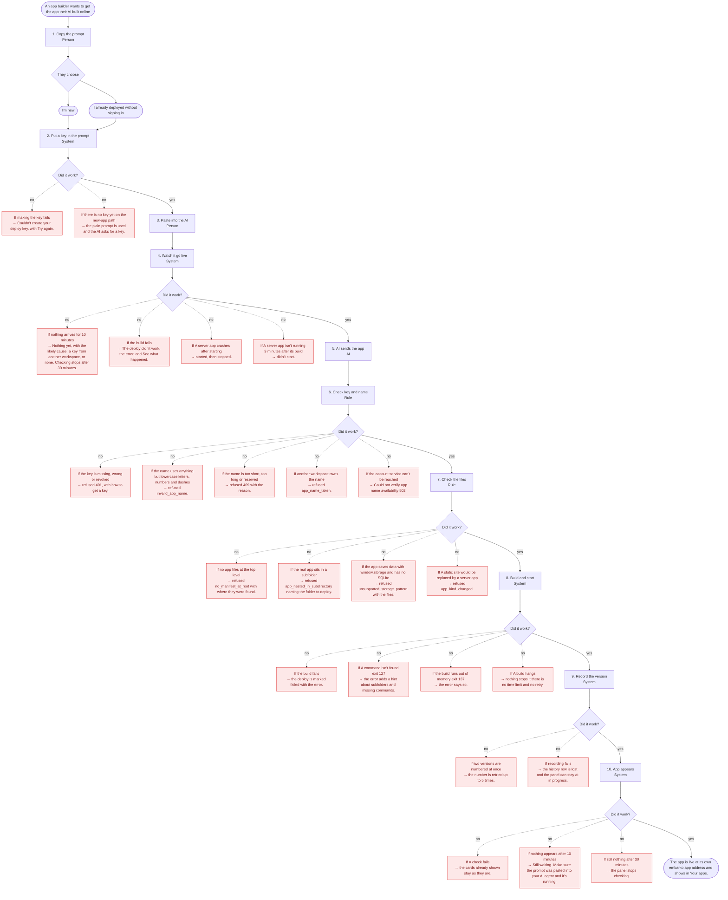

# Story 2: First Deploy

<!-- Generated by scripts/build-prd.mjs from app/lib/system/story.ts and the code. Do not edit by hand — run npm run prd. -->

- **ID:** `first-deploy` (steps are `first-deploy/<step>`)
- **Story:** A builder's AI puts their app online
- **Who:** An app builder
- **Wants to:** get the app their AI built online
- **Ends with:** The app is live at its own embarko.app address and shows in Your apps.
- **Steps:** 10 · 1 by AI · 7 can go wrong
- **Last change to its code:** v223, 23 Oct 2026 — feat: one Members page: invite with role and access, remove people

[← All stories](../README.md)

## Steps

| # | Step ID | Step | Who acts | What happens |
|---|---|---|---|---|
| 1 | `first-deploy/copy-prompt` | Copy the prompt | Person | In the panel the builder says whether they are new, then follows the same four steps as Host new app and copies the Embarko prompt. |
| 2 | `first-deploy/make-token` | Put a key in the prompt | System | On a click, the panel makes a Just me deploy key and writes it into the prompt, so the AI can deploy as them, in any of their workspaces. Optional for a new app; required to keep an app deployed before signing in. |
| 3 | `first-deploy/paste` | Paste into the AI | Person | The builder pastes the prompt into their AI agent and asks it to deploy. |
| 4 | `first-deploy/watch` | Watch it go live | System | After the copy, the steps fold into "Prompt copied" and the view shows the deploy's state instead, checking every few seconds. It follows whichever app the AI deploys — new or existing, since the AI picks the name — through Waiting, Deploying, Starting, then Live with Open app. |
| 5 | `first-deploy/ai-deploys` | AI sends the app | AI | The AI reads the quickstart and the rules, then sends the app's files to Embarko. |
| 6 | `first-deploy/check-key` | Check key and name | Rule | Embarko checks the key, then claims the app's name for this workspace. |
| 7 | `first-deploy/check-files` | Check the files | Rule | Embarko finds the app's root and refuses patterns it can't run, saying what to do instead. |
| 8 | `first-deploy/build-run` | Build and start | System | Embarko builds the app, starts it, and gives it its address with a certificate. |
| 9 | `first-deploy/record` | Record the version | System | The result is saved as the app's next version, and becomes the live one if it worked. |
| 10 | `first-deploy/app-appears` | App appears | System | The panel checks every 5 seconds until the new app shows up, then shows it as Live. |

## Flow

## Each step in detail

### 1. Copy the prompt

- **ID:** `first-deploy/copy-prompt`
- **Who acts:** Person
- **What happens:** In the panel the builder says whether they are new, then follows the same four steps as Host new app and copies the Embarko prompt.
- **Choices:** I'm new · I already deployed without signing in
- **Parts:** App builders (`builders`), Your apps panel (`console`), Embarko prompt (`prompt`)
- **Code:** `page:/app` → `app/app/page.tsx`, `lib:app/components/console/FirstAppEmpty` → `app/components/console/FirstAppEmpty.tsx`, `lib:app/components/console/DeployPromptDialog` → `app/components/console/DeployPromptDialog.tsx`, `lib:app/components/console/DeploySteps` → `app/components/console/DeploySteps.tsx`, `lib:app/lib/deployPrompt` → `app/lib/deployPrompt.ts`

### 2. Put a key in the prompt

- **ID:** `first-deploy/make-token`
- **Who acts:** System
- **What happens:** On a click, the panel makes a Just me deploy key and writes it into the prompt, so the AI can deploy as them, in any of their workspaces. Optional for a new app; required to keep an app deployed before signing in.
- **If it goes wrong:**
  - If making the key fails → "Couldn't create your deploy key." with Try again.
  - If there is no key yet on the new-app path → the plain prompt is used and the AI asks for a key.
- **Parts:** Panel bridge (`bridge`), Deploy keys (`tokens`), Keys and audit (`access-data`)
- **Keeps:** `AppGrant`, `AuditLog`, `DeployToken`, `PendingInvite`, `WorkspaceMember`, `WorkspaceRoleSetup`
- **Looks up:** `Company`, `Project`
- **Code:** `lib:app/lib/hnsApi` → `app/lib/hnsApi.ts`, `lib:app/components/console/DeploySteps` → `app/components/console/DeploySteps.tsx`, `api:@api/companies/:companyId/tokens` → `@api/src/routes/tokens.routes.ts`
- **Outside services:** Redis

### 3. Paste into the AI

- **ID:** `first-deploy/paste`
- **Who acts:** Person
- **What happens:** The builder pastes the prompt into their AI agent and asks it to deploy.
- **Parts:** App builders (`builders`), Your AI agent (`ai-agent`)

### 4. Watch it go live

- **ID:** `first-deploy/watch`
- **Who acts:** System
- **What happens:** After the copy, the steps fold into "Prompt copied" and the view shows the deploy's state instead, checking every few seconds. It follows whichever app the AI deploys — new or existing, since the AI picks the name — through Waiting, Deploying, Starting, then Live with Open app.
- **If it goes wrong:**
  - If nothing arrives for 10 minutes → "Nothing yet", with the likely cause: a key from another workspace, or none. Checking stops after 30 minutes.
  - If the build fails → "The deploy didn't work", the error, and See what happened.
  - If A server app crashes after starting → "started, then stopped".
  - If A server app isn't running 3 minutes after its build → "didn't start".
- **Parts:** Your apps panel (`console`), Deploy history (`deploy-history`)
- **Keeps:** `AppDetails`, `AppGrant`, `AuditLog`, `PendingInvite`, `Project`, `ShowcaseEvent`, `ShowcaseEventListing`, `WorkspaceMember`, `WorkspaceRoleSetup`
- **Looks up:** `Company`, `DeployToken`, `Deployment`, `Domain`, `Schedule`, `ScheduleRun`
- **Code:** `lib:app/components/console/DeploySteps` → `app/components/console/DeploySteps.tsx`, `lib:app/components/console/useDeployWatch` → `app/components/console/useDeployWatch.ts`, `api:@api/companies/:companyId/projects/:projectId/deployments` → `@api/src/routes/deployments.routes.ts`, `api:@api/companies/:companyId/projects` → `@api/src/routes/projects.routes.ts`
- **Outside services:** Redis, viaSocket webhook

### 5. AI sends the app

- **ID:** `first-deploy/ai-deploys`
- **Who acts:** AI
- **What happens:** The AI reads the quickstart and the rules, then sends the app's files to Embarko.
- **If it goes wrong:** not written down yet — open question.
- **Parts:** Your AI agent (`ai-agent`), Agent docs (`docs`), Deploy intake (`intake`)
- **Code:** `page:/docs/[slug]` → `app/docs/[slug]/page.tsx`, `api:@deploy/apps` → `@deploy/server.js`
- **Outside services:** Docker, Nomad, Railpack

### 6. Check key and name

- **ID:** `first-deploy/check-key`
- **Who acts:** Rule
- **What happens:** Embarko checks the key, then claims the app's name for this workspace.
- **If it goes wrong:**
  - If the key is missing, wrong or revoked → refused (401), with how to get a key.
  - If the name uses anything but lowercase letters, numbers and dashes → refused (invalid_app_name).
  - If the name is too short, too long or reserved → refused (409) with the reason.
  - If another workspace owns the name → refused (app_name_taken).
  - If the account service can't be reached → "Could not verify app name availability" (502).
- **Parts:** Deploy intake (`intake`), Deploy keys (`tokens`), App records (`app-records`), Apps and deploys (`apps-data`)
- **Keeps:** `AppDetails`, `AppGrant`, `AuditLog`, `Company`, `DeployToken`, `Deployment`, `EnvVar`, `PendingInvite`, `Project`, `Schedule`, `ShowcaseEvent`, `ShowcaseEventListing`, `SlugAlias`, `WorkspaceMember`, `WorkspaceRoleSetup`
- **Looks up:** `Domain`, `ScheduleRun`
- **Code:** `lib:@deploy/deploy-credential` → `@deploy/deploy-credential.js`, `lib:@deploy/validate-deploy-token` → `@deploy/validate-deploy-token.js`, `api:@api/internal/deploy-tokens/validate` → `@api/src/routes/internalTokens.routes.ts`, `lib:@deploy/claim-project` → `@deploy/claim-project.js`, `api:@api/internal/projects/claim` → `@api/src/routes/internalProjects.routes.ts`, `lib:@api/src/services/projectClaim` → `@api/src/services/projectClaim.ts`
- **Outside services:** Lago, Redis, Stripe, viaSocket webhook

### 7. Check the files

- **ID:** `first-deploy/check-files`
- **Who acts:** Rule
- **What happens:** Embarko finds the app's root and refuses patterns it can't run, saying what to do instead.
- **If it goes wrong:**
  - If no app files at the top level → refused (no_manifest_at_root) with where they were found.
  - If the real app sits in a subfolder → refused (app_nested_in_subdirectory) naming the folder to deploy.
  - If the app saves data with window.storage and has no SQLite → refused (unsupported_storage_pattern) with the files.
  - If A static site would be replaced by a server app → refused (app_kind_changed).
- **Parts:** App builder (`builder`)
- **Code:** `lib:@deploy/detect-manifest-root` → `@deploy/detect-manifest-root.js`, `lib:@deploy/detect-storage-usage` → `@deploy/detect-storage-usage.js`, `lib:@deploy/build-plan` → `@deploy/build-plan.js`, `lib:@deploy/app-kind` → `@deploy/app-kind.js`
- **Outside services:** Nomad, Railpack

### 8. Build and start

- **ID:** `first-deploy/build-run`
- **Who acts:** System
- **What happens:** Embarko builds the app, starts it, and gives it its address with a certificate.
- **If it goes wrong:**
  - If the build fails → the deploy is marked failed with the error.
  - If A command isn't found (exit 127) → the error adds a hint about subfolders and missing commands.
  - If the build runs out of memory (exit 137) → the error says so.
  - If A build hangs → nothing stops it; there is no time limit and no retry.
- **Parts:** App builder (`builder`), App runner (`runner`), Container platform (`containers`), Traffic router (`router`)
- **Code:** `lib:@deploy/build-diagnostics` → `@deploy/build-diagnostics.js`, `lib:@deploy/nomad-job-spec` → `@deploy/nomad-job-spec.js`, `lib:@deploy/nomad-job` → `@deploy/nomad-job.js`, `lib:@deploy/traefik-router-file` → `@deploy/traefik-router-file.js`, `lib:@deploy/static-site` → `@deploy/static-site.js`, `lib:@deploy/image-retention` → `@deploy/image-retention.js`
- **Outside services:** Docker, Nomad, Railpack, Traefik

### 9. Record the version

- **ID:** `first-deploy/record`
- **Who acts:** System
- **What happens:** The result is saved as the app's next version, and becomes the live one if it worked.
- **If it goes wrong:**
  - If two versions are numbered at once → the number is retried up to 5 times.
  - If recording fails → the history row is lost and the panel can stay at "in progress".
- **Parts:** Deploy history (`deploy-history`), Apps and deploys (`apps-data`)
- **Keeps:** `AppDetails`, `AppGrant`, `AuditLog`, `Company`, `DeployToken`, `Deployment`, `EnvVar`, `PendingInvite`, `Project`, `Schedule`, `ShowcaseEvent`, `ShowcaseEventListing`, `SlugAlias`, `WorkspaceMember`, `WorkspaceRoleSetup`
- **Looks up:** `Domain`, `ScheduleRun`
- **Code:** `lib:@deploy/record-deployment` → `@deploy/record-deployment.js`, `api:@api/internal/deployments/record` → `@api/src/routes/internalDeployments.routes.ts`, `lib:@api/src/services/deploymentVersioning` → `@api/src/services/deploymentVersioning.ts`
- **Outside services:** Lago, Redis, Stripe, viaSocket webhook

### 10. App appears

- **ID:** `first-deploy/app-appears`
- **Who acts:** System
- **What happens:** The panel checks every 5 seconds until the new app shows up, then shows it as Live.
- **If it goes wrong:**
  - If A check fails → the cards already shown stay as they are.
  - If nothing appears after 10 minutes → "Still waiting. Make sure the prompt was pasted into your AI agent and it's running."
  - If still nothing after 30 minutes → the panel stops checking.
- **Parts:** Your apps panel (`console`), Status refresh (`refresh`), Panel bridge (`bridge`)
- **Code:** `page:/app` → `app/app/page.tsx`, `lib:app/lib/lastSeen` → `app/lib/lastSeen.ts`, `lib:app/components/console/AppTile` → `app/components/console/AppTile.tsx`

## Parts involved

| Part | Lane | What it does |
|---|---|---|
| App builders (`builders`) | People | People whose AI agent builds an app, who want it online and healthy. |
| Your apps panel (`console`) | Screens | Where builders see their apps, whether each is live, and what to do next. |
| Embarko prompt (`prompt`) | Engine | The text people copy into their AI so it knows how to deploy to Embarko. |
| Panel bridge (`bridge`) | Engine | Passes every panel request to the account service as the signed-in person. |
| Deploy keys (`tokens`) | Engine | Makes, checks, rotates and revokes the keys an AI uses to deploy, and decides which apps each key may reach. |
| Keys and audit (`access-data`) | Data | Deploy keys (hashed), who the admins are, and a log of important actions. |
| Your AI agent (`ai-agent`) | Outside | The builder's own AI (Claude, ChatGPT, Cursor…) that builds and deploys the app. |
| Deploy history (`deploy-history`) | Engine | Records every deploy as a numbered version, and puts an earlier one back on request. |
| Agent docs (`docs`) | Screens | The instructions an AI agent reads before it deploys. |
| Deploy intake (`intake`) | Engine | Takes an app from an AI, checks the key and the name, and starts the build. |
| App records (`app-records`) | Engine | Keeps the list of apps: who owns each, its name and address, and whether it is live. |
| Apps and deploys (`apps-data`) | Data | Each app, its versions, settings, custom domains and old names. |
| App builder (`builder`) | Engine | Checks the files, works out what kind of app it is, builds it and reports the result. |
| App runner (`runner`) | Engine | Runs each app, gives it its address and domains, and moves or removes it when asked. |
| Container platform (`containers`) | Outside | The tools that build app images and run them as containers. |
| Traffic router (`router`) | Outside | Traefik: sends each address to the right app and gets its certificate. |
| Status refresh (`refresh`) | Background | Checks again every few seconds while something is changing, then stops. |

See [system-map.md](../system-map.md) for how the parts connect.

## Tables

- **Keeps** `AppDetails` — Public-facing details of a deployed app.
- **Keeps** `AppGrant` — One app a Member with appAccess "chosen" can reach, and how far: "use", "edit" (have their AI make changes as a preview; logs) or "full" (approve and publish, settings, delete, move) — ACCESS_LEVELS in permissions.ts.
- **Keeps** `AuditLog` — Every mutating action: who, what, when.
- **Keeps** `Company` — Local mirror of the few company facts the proxy doesn't hold.
- **Keeps** `DeployToken` — A deploy token.
- **Keeps** `Deployment` — Versioned deploy history — one row per deploy attempt.
- **Keeps** `EnvVar`
- **Keeps** `PendingInvite` — A role chosen for someone before they are a member: the invite adds them on proxy and emails them (services/workspaceRoles.ts createInvite); this remembers what they should be allowed to do.
- **Keeps** `Project` — One Project == one deployed app on hostnsoft-deploy.
- **Keeps** `Schedule` — A timed HTTP call into the app — see docs/schedules.md.
- **Keeps** `ShowcaseEvent` — An event page, /showcase/<slug>: a hackathon, a demo day.
- **Keeps** `ShowcaseEventListing` — One app shown on one event page.
- **Keeps** `SlugAlias` — A name an app used to have — one row per previous slug, written on every successful address change (services/projectSlugChange.ts).
- **Keeps** `WorkspaceMember` — A member's role in one workspace.
- **Keeps** `WorkspaceRoleSetup` — How far a workspace's roles have been set up (permissions.ts setUpWorkspaceRoles).
- **Looks up** `Domain` — A client-owned domain (or subdomain) attached to a project — see docs/Customdomain-req.md.
- **Looks up** `ScheduleRun` — One call the runner made (or chose not to make).

See [tables.md](../tables.md).

## Recent changes

| Version | Date | Change | Steps changed |
|---|---|---|---|
| v223 (e19e29b) | 23 Oct 2026 | feat: one Members page: invite with role and access, remove people | make-token |
| v222 (3be464c) | 23 Oct 2026 | feat: invite and remove people through the API; per-member app access | — |
| v221 (8b5e212) | 23 Oct 2026 | feat: schedule alerts wait for 3 failures in a row or a 6h failing streak | — |
| v220 (dbddf65) | 22 Oct 2026 | refactor: lower default CPU allocation from 100 to 50 in job spec and documentation | build-run |
| v219 (782798d) | 22 Oct 2026 | feat: dashboard and guide for Owner, Admin, Member, Billing and per-app access | copy-prompt, make-token, watch, app-appears |

## Open questions

- Step `first-deploy/ai-deploys` (AI sends the app) runs on its own but has no failure written down.
- This story was written from the code; treat "wants to" as an assumption until a user confirms it.
