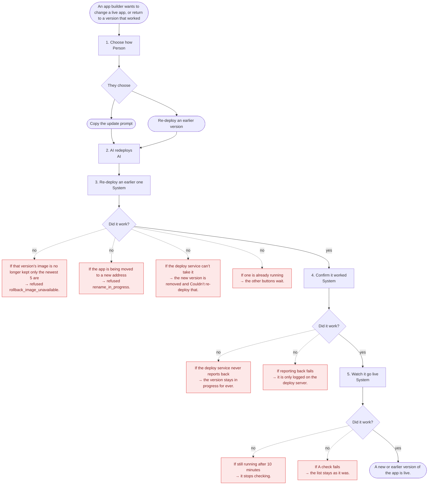

# Story 6: Fix Or Update

<!-- Generated by scripts/build-prd.mjs from app/lib/system/story.ts and the code. Do not edit by hand — run npm run prd. -->

- **ID:** `fix-or-update` (steps are `fix-or-update/<step>`)
- **Story:** A builder changes a live app or goes back
- **Who:** An app builder
- **Wants to:** change a live app, or return to a version that worked
- **Ends with:** A new or earlier version of the app is live.
- **Steps:** 5 · 1 by AI · 3 can go wrong
- **Last change to its code:** v146, 21 Oct 2026 — doc improvements

[← All stories](../README.md)

## Steps

| # | Step ID | Step | Who acts | What happens |
|---|---|---|---|---|
| 1 | `fix-or-update/choose` | Choose how | Person | They copy a prompt that tells their AI to update this exact app, or pick an earlier version. |
| 2 | `fix-or-update/ai-updates` | AI redeploys | AI | The AI changes the code and deploys it again under the same app name. |
| 3 | `fix-or-update/rollback` | Re-deploy an earlier one | System | Any of the newest 3 working versions can be put back live as a new version. |
| 4 | `fix-or-update/confirm` | Confirm it worked | System | The deploy service reports back, and the version becomes the live one. |
| 5 | `fix-or-update/watch` | Watch it go live | System | The deploy list checks every second while a deploy runs. |

## Flow

## Each step in detail

### 1. Choose how

- **ID:** `fix-or-update/choose`
- **Who acts:** Person
- **What happens:** They copy a prompt that tells their AI to update this exact app, or pick an earlier version.
- **Choices:** Copy the update prompt · Re-deploy an earlier version
- **Parts:** App builders (`builders`), Your apps panel (`console`), Embarko prompt (`prompt`)
- **Code:** `lib:app/components/console/ProjectNav` → `app/components/console/ProjectNav.tsx`, `lib:app/components/console/DeployPromptDialog` → `app/components/console/DeployPromptDialog.tsx`, `lib:app/lib/deployPrompt` → `app/lib/deployPrompt.ts`

### 2. AI redeploys

- **ID:** `fix-or-update/ai-updates`
- **Who acts:** AI
- **What happens:** The AI changes the code and deploys it again under the same app name.
- **If it goes wrong:** not written down yet — open question.
- **Parts:** Your AI agent (`ai-agent`), Deploy intake (`intake`)
- **Code:** `api:@deploy/apps` → `@deploy/server.js`
- **Outside services:** Docker, Nomad, Railpack

### 3. Re-deploy an earlier one

- **ID:** `fix-or-update/rollback`
- **Who acts:** System
- **What happens:** Any of the newest 3 working versions can be put back live as a new version.
- **If it goes wrong:**
  - If that version's image is no longer kept (only the newest 5 are) → refused (rollback_image_unavailable).
  - If the app is being moved to a new address → refused (rename_in_progress).
  - If the deploy service can't take it → the new version is removed and "Couldn't re-deploy that."
  - If one is already running → the other buttons wait.
- **Parts:** Your apps panel (`console`), Deploy history (`deploy-history`), App runner (`runner`)
- **Keeps:** `AuditLog`, `Company`, `Deployment`, `Domain`, `Project`
- **Looks up:** `EnvVar`
- **Code:** `page:/app/projects/[projectId]/deployments` → `app/app/projects/[projectId]/deployments/page.tsx`, `api:@api/companies/:companyId/projects/:projectId/deployments/:deploymentId/rollback` → `@api/src/routes/deployments.routes.ts`, `lib:@api/src/services/redeploy` → `@api/src/services/redeploy.ts`, `api:@deploy/internal/apps/:appName/config` → `@deploy/server.js`
- **Outside services:** Docker, Lago, Redis, Stripe, Traefik

### 4. Confirm it worked

- **ID:** `fix-or-update/confirm`
- **Who acts:** System
- **What happens:** The deploy service reports back, and the version becomes the live one.
- **If it goes wrong:**
  - If the deploy service never reports back → the version stays "in progress" for ever.
  - If reporting back fails → it is only logged on the deploy server.
- **Parts:** App runner (`runner`), Deploy history (`deploy-history`), Apps and deploys (`apps-data`)
- **Keeps:** `Deployment`, `Project`
- **Code:** `lib:@deploy/report-config-push` → `@deploy/report-config-push.js`, `api:@api/internal/deployments/:deploymentId/complete` → `@api/src/routes/internalDeployments.routes.ts`

### 5. Watch it go live

- **ID:** `fix-or-update/watch`
- **Who acts:** System
- **What happens:** The deploy list checks every second while a deploy runs.
- **If it goes wrong:**
  - If still running after 10 minutes → it stops checking.
  - If A check fails → the list stays as it was.
- **Parts:** Status refresh (`refresh`), Your apps panel (`console`)
- **Code:** `page:/app/projects/[projectId]/deployments` → `app/app/projects/[projectId]/deployments/page.tsx`

## Parts involved

| Part | Lane | What it does |
|---|---|---|
| App builders (`builders`) | People | People whose AI agent builds an app, who want it online and healthy. |
| Your apps panel (`console`) | Screens | Where builders see their apps, whether each is live, and what to do next. |
| Embarko prompt (`prompt`) | Engine | The text people copy into their AI so it knows how to deploy to Embarko. |
| Your AI agent (`ai-agent`) | Outside | The builder's own AI (Claude, ChatGPT, Cursor…) that builds and deploys the app. |
| Deploy intake (`intake`) | Engine | Takes an app from an AI, checks the key and the name, and starts the build. |
| Deploy history (`deploy-history`) | Engine | Records every deploy as a numbered version, and puts an earlier one back on request. |
| App runner (`runner`) | Engine | Runs each app, gives it its address and domains, and moves or removes it when asked. |
| Apps and deploys (`apps-data`) | Data | Each app, its versions, settings and custom domains. |
| Status refresh (`refresh`) | Background | Checks again every few seconds while something is changing, then stops. |

See [system-map.md](../system-map.md) for how the parts connect.

## Tables

- **Keeps** `AuditLog` — Every mutating action: who, what, when.
- **Keeps** `Company` — Local mirror of the few company facts the proxy doesn't hold.
- **Keeps** `Deployment` — Versioned deploy history — one row per deploy attempt.
- **Keeps** `Domain` — A client-owned domain (or subdomain) attached to a project — see docs/Customdomain-req.md.
- **Keeps** `Project` — One Project == one deployed app on hostnsoft-deploy.
- **Looks up** `EnvVar`

See [tables.md](../tables.md).

## Recent changes

| Version | Date | Change | Steps changed |
|---|---|---|---|
| v146 (ceac79b) | 21 Oct 2026 | doc improvements | choose |
| v145 (bffa93d) | 19 Oct 2026 | Report the real cause when an app crashes on startup | ai-updates, rollback |
| v144 (36b6871) | 19 Oct 2026 | Show an app's scheduled jobs in the panel | choose |
| v143 (0d035d5) | 19 Oct 2026 | Report the running commit on /health and check it after deploy | ai-updates, rollback |
| v142 (52cc384) | 19 Oct 2026 | Read embarko.json on deploy for schedules, warn about in-process timers | ai-updates, rollback |

## Open questions

- Step `fix-or-update/ai-updates` (AI redeploys) runs on its own but has no failure written down.
- This story was written from the code; treat "wants to" as an assumption until a user confirms it.
