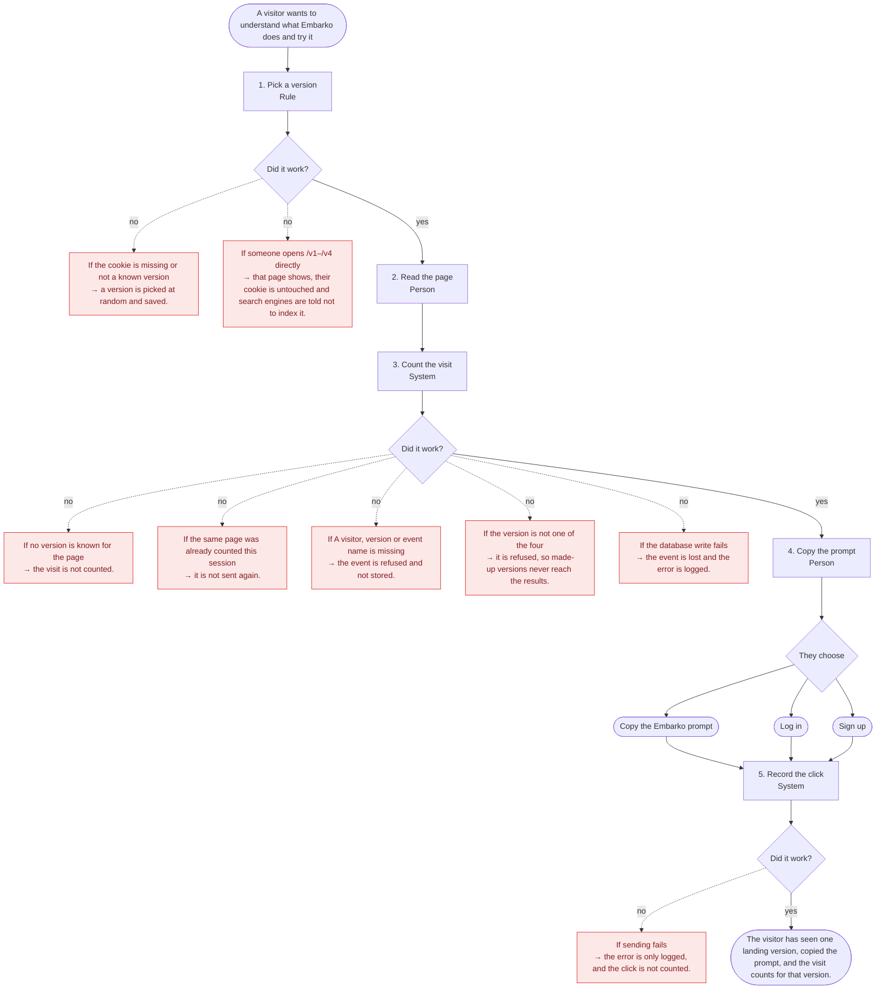

# Story 1: Landing Visit

<!-- Generated by scripts/build-prd.mjs from app/lib/system/story.ts and the code. Do not edit by hand — run npm run prd. -->

- **ID:** `landing-visit` (steps are `landing-visit/<step>`)
- **Story:** A visitor lands on embarko.ai
- **Who:** A visitor
- **Wants to:** understand what Embarko does and try it
- **Ends with:** The visitor has seen one landing version, copied the prompt, and the visit counts for that version.
- **Steps:** 5 · 0 by AI · 3 can go wrong
- **Last change to its code:** v72, 22 Oct 2026 — docs: canonical AI-agent doc set and evidence-based cleanup

[← All stories](../README.md)

## Steps

| # | Step ID | Step | Who acts | What happens |
|---|---|---|---|---|
| 1 | `landing-visit/pick-version` | Pick a version | Rule | The site gives the visitor one of four landing versions and keeps them on it for 90 days. |
| 2 | `landing-visit/read-page` | Read the page | Person | The visitor reads the version they were given. |
| 3 | `landing-visit/count-view` | Count the visit | System | The page view is saved against the visitor's version, and sent to analytics. |
| 4 | `landing-visit/copy-prompt` | Copy the prompt | Person | The visitor copies the Embarko prompt, or chooses to sign in. |
| 5 | `landing-visit/count-click` | Record the click | System | The click is saved against the visitor's version so the versions can be compared. |

## Flow

## Each step in detail

### 1. Pick a version

- **ID:** `landing-visit/pick-version`
- **Who acts:** Rule
- **What happens:** The site gives the visitor one of four landing versions and keeps them on it for 90 days.
- **If it goes wrong:**
  - If the cookie is missing or not a known version → a version is picked at random and saved.
  - If someone opens /v1–/v4 directly → that page shows, their cookie is untouched and search engines are told not to index it.
- **Parts:** Landing split test (`split`), Landing pages (`landing`)
- **Code:** `lib:middleware` → `middleware.ts`, `lib:app/lib/variants` → `app/lib/variants.ts`

### 2. Read the page

- **ID:** `landing-visit/read-page`
- **Who acts:** Person
- **What happens:** The visitor reads the version they were given.
- **Parts:** Visitors (`visitors`), Landing pages (`landing`)
- **Code:** `page:/v1` → `app/v1/page.tsx`, `page:/v2` → `app/v2/page.tsx`, `page:/v3` → `app/v3/page.tsx`, `page:/v4` → `app/v4/page.tsx`

### 3. Count the visit

- **ID:** `landing-visit/count-view`
- **Who acts:** System
- **What happens:** The page view is saved against the visitor's version, and sent to analytics.
- **If it goes wrong:**
  - If no version is known for the page → the visit is not counted.
  - If the same page was already counted this session → it is not sent again.
  - If A visitor, version or event name is missing → the event is refused and not stored.
  - If the version is not one of the four → it is refused, so made-up versions never reach the results.
  - If the database write fails → the event is lost and the error is logged.
- **Parts:** Visit tracking (`tracking`), Visit records (`visit-records`), Google Tag Manager (`gtm`)
- **Keeps:** `hero_events`
- **Code:** `lib:app/lib/tracking` → `app/lib/tracking.ts`, `api:/api/events` → `app/api/events/route.ts`, `lib:app/components/analytics/PageViewTracker` → `app/components/analytics/PageViewTracker.tsx`, `lib:app/lib/gtm` → `app/lib/gtm.ts`
- **Outside services:** Google Tag Manager

### 4. Copy the prompt

- **ID:** `landing-visit/copy-prompt`
- **Who acts:** Person
- **What happens:** The visitor copies the Embarko prompt, or chooses to sign in.
- **Choices:** Copy the Embarko prompt · Log in · Sign up
- **Parts:** Landing pages (`landing`), Embarko prompt (`prompt`)
- **Code:** `lib:app/components/CopyPromptButton` → `app/components/CopyPromptButton.tsx`, `lib:app/lib/deployPrompt` → `app/lib/deployPrompt.ts`, `lib:app/components/Header` → `app/components/Header.tsx`

### 5. Record the click

- **ID:** `landing-visit/count-click`
- **Who acts:** System
- **What happens:** The click is saved against the visitor's version so the versions can be compared.
- **If it goes wrong:**
  - If sending fails → the error is only logged, and the click is not counted.
- **Parts:** Visit tracking (`tracking`), Visit records (`visit-records`)
- **Keeps:** `hero_events`
- **Code:** `lib:app/lib/tracking` → `app/lib/tracking.ts`, `api:/api/events` → `app/api/events/route.ts`

## Parts involved

| Part | Lane | What it does |
|---|---|---|
| Landing split test (`split`) | Engine | Gives each visitor one landing version and keeps them on it. |
| Landing pages (`landing`) | Screens | The five versions of the home page a visitor may see. |
| Visitors (`visitors`) | People | People who land on embarko.ai, read about it and browse the Showcase. |
| Visit tracking (`tracking`) | Background | Quietly records page views and button clicks for the split test and analytics. |
| Visit records (`visit-records`) | Data | Every page view and click, tagged with the landing version that produced it. |
| Google Tag Manager (`gtm`) | Outside | Site analytics. |
| Embarko prompt (`prompt`) | Engine | The text people copy into their AI so it knows how to deploy to Embarko. |

See [system-map.md](../system-map.md) for how the parts connect.

## Tables

- **Keeps** `hero_events`

See [tables.md](../tables.md).

## Recent changes

| Version | Date | Change | Steps changed |
|---|---|---|---|
| v72 (7513559) | 22 Oct 2026 | docs: canonical AI-agent doc set and evidence-based cleanup | copy-prompt |
| v71 (105ccbb) | 21 Oct 2026 | feat(v5): new landing page built on v1's scenes | pick-version |
| v70 (26013d4) | 21 Oct 2026 | Use one hero subtitle on every landing page | read-page |
| v69 (36b6871) | 19 Oct 2026 | Show an app's scheduled jobs in the panel | copy-prompt |
| v68 (e19113b) | 14 Oct 2026 | Replace the docs with the agent guide | pick-version, copy-prompt |

## Open questions

- This story was written from the code; treat "wants to" as an assumption until a user confirms it.
