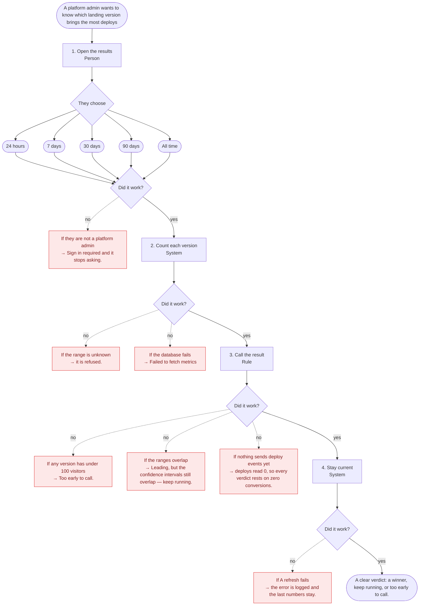

# Story 16: Pick A Winner

<!-- Generated by scripts/build-prd.mjs from app/lib/system/story.ts and the code. Do not edit by hand — run npm run prd. -->

- **ID:** `pick-a-winner` (steps are `pick-a-winner/<step>`)
- **Story:** An admin checks which landing page works best
- **Who:** A platform admin
- **Wants to:** know which landing version brings the most deploys
- **Ends with:** A clear verdict: a winner, keep running, or too early to call.
- **Steps:** 4 · 0 by AI · 4 can go wrong
- **Last change to its code:** v8, 22 Sept 2026 — feat: follow the OS theme, and drop the in-app picker

[← All stories](../README.md)

## Steps

| # | Step ID | Step | Who acts | What happens |
|---|---|---|---|---|
| 1 | `pick-a-winner/open` | Open the results | Person | They open the admin page and pick a time range. |
| 2 | `pick-a-winner/count` | Count each version | System | Unique visitors per version, leaving out bots. |
| 3 | `pick-a-winner/verdict` | Call the result | Rule | A version wins only with 100+ visitors on every version and no overlap at 95% confidence. |
| 4 | `pick-a-winner/refresh` | Stay current | System | The numbers refresh every 5 seconds while the page is open. |

## Flow

## Each step in detail

### 1. Open the results

- **ID:** `pick-a-winner/open`
- **Who acts:** Person
- **What happens:** They open the admin page and pick a time range.
- **Choices:** 24 hours · 7 days · 30 days · 90 days · All time
- **If it goes wrong:**
  - If they are not a platform admin → "Sign in required" and it stops asking.
- **Parts:** Platform admins (`admins`), Admin pages (`admin`)
- **Code:** `page:/admin` → `app/admin/page.tsx`, `lib:app/admin/dashboard` → `app/admin/dashboard.tsx`

### 2. Count each version

- **ID:** `pick-a-winner/count`
- **Who acts:** System
- **What happens:** Unique visitors per version, leaving out bots.
- **If it goes wrong:**
  - If the range is unknown → it is refused.
  - If the database fails → "Failed to fetch metrics"
- **Parts:** Test results (`results`), Visit records (`visit-records`)
- **Keeps:** `hero_events`
- **Code:** `api:/api/metrics` → `app/api/metrics/route.ts`
- **Outside services:** MSG91

### 3. Call the result

- **ID:** `pick-a-winner/verdict`
- **Who acts:** Rule
- **What happens:** A version wins only with 100+ visitors on every version and no overlap at 95% confidence.
- **If it goes wrong:**
  - If any version has under 100 visitors → "Too early to call".
  - If the ranges overlap → "Leading, but the confidence intervals still overlap — keep running."
  - If nothing sends deploy events yet → deploys read 0, so every verdict rests on zero conversions.
- **Parts:** Test results (`results`)
- **Code:** `lib:app/admin/dashboard` → `app/admin/dashboard.tsx`

### 4. Stay current

- **ID:** `pick-a-winner/refresh`
- **Who acts:** System
- **What happens:** The numbers refresh every 5 seconds while the page is open.
- **If it goes wrong:**
  - If A refresh fails → the error is logged and the last numbers stay.
- **Parts:** Test results (`results`), Status refresh (`refresh`)
- **Code:** `lib:app/admin/dashboard` → `app/admin/dashboard.tsx`

## Parts involved

| Part | Lane | What it does |
|---|---|---|
| Platform admins (`admins`) | People | The Embarko team, who see every app, message and test result. |
| Admin pages (`admin`) | Screens | Internal pages for the Embarko team: test results, every app, messages. |
| Test results (`results`) | Engine | Counts visitors per landing version and says whether one is winning. |
| Visit records (`visit-records`) | Data | Every page view and click, tagged with the landing version that produced it. |
| Status refresh (`refresh`) | Background | Checks again every few seconds while something is changing, then stops. |

See [system-map.md](../system-map.md) for how the parts connect.

## Tables

- **Keeps** `hero_events`

See [tables.md](../tables.md).

## Recent changes

| Version | Date | Change | Steps changed |
|---|---|---|---|
| v8 (9e7f267) | 22 Sept 2026 | feat: follow the OS theme, and drop the in-app picker | open |
| v7 (d4050a6) | 12 Sept 2026 | Put the admin panel on the console's theme | open, verdict, refresh |
| v6 (1b0c07f) | 11 Sept 2026 | Make the A/B numbers mean what the dashboard says they mean | open, count, verdict, refresh |
| v5 (c08b790) | 11 Sept 2026 | Read production metrics in dev without writing to them | count |
| v4 (ed4d929) | 11 Sept 2026 | Move the A/B store from better-sqlite3 to D1 | count |

## Open questions

- This story was written from the code; treat "wants to" as an assumption until a user confirms it.
