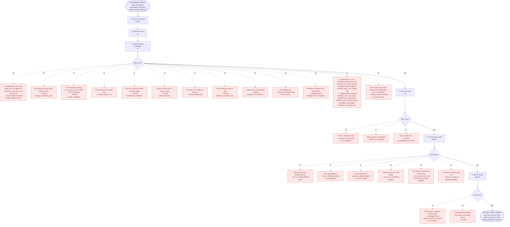

# Story 9: Scheduled Task

<!-- Generated by scripts/build-prd.mjs from app/lib/system/story.ts and the code. Do not edit by hand — run npm run prd. -->

- **ID:** `scheduled-task` (steps are `scheduled-task/<step>`)
- **Story:** An app does a job on a timer
- **Who:** An app builder
- **Wants to:** have their app do something at set times without anyone visiting it
- **Ends with:** The app's route is called at each due time; the owner hears only when it starts failing and when it recovers.
- **Steps:** 6 · 3 by AI · 4 can go wrong
- **Last change to its code:** v128, 19 Oct 2026 — Read embarko.json on deploy for schedules, warn about in-process timers

[← All stories](../README.md)

## Steps

| # | Step ID | Step | Who acts | What happens |
|---|---|---|---|---|
| 1 | `scheduled-task/ask` | Ask for a timed job | Person | They tell their AI what should happen and when, such as a report every Monday at 9. |
| 2 | `scheduled-task/write` | Write the route | AI | The AI adds a route that does the job and refuses any call without the app's CRON_SECRET as a bearer token. |
| 3 | `scheduled-task/deploy` | Deploy with the schedules | AI | The AI lists the schedules under "schedules" in embarko.json, in the app's top folder, and deploys any usual way. The list is the app's full set; no file or no schedules key leaves them unchanged, [] removes all. They are checked before the build and a CRON_SECRET setting is created if the app has none; when the deploy succeeds, listed schedules are created or updated by path, unlisted ones deleted. |
| 4 | `scheduled-task/test` | Run each once | AI | Once the app is live the AI runs every schedule once and checks each answer, so a broken route shows before the first real time. The skill's deploy script does this itself. |
| 5 | `scheduled-task/call` | Call the app on time | System | Every 30 seconds due schedules are taken and their route is called on the app's own address; a sleeping app is woken first. |
| 6 | `scheduled-task/alert` | Tell the owner | System | On the first failed run the owner gets an email, and the optional webhook a schedule.failed message; on the next good run, one recovery message each. |

## Flow

## Each step in detail

### 1. Ask for a timed job

- **ID:** `scheduled-task/ask`
- **Who acts:** Person
- **What happens:** They tell their AI what should happen and when, such as a report every Monday at 9.
- **Parts:** App builders (`builders`), Your AI agent (`ai-agent`)

### 2. Write the route

- **ID:** `scheduled-task/write`
- **Who acts:** AI
- **What happens:** The AI adds a route that does the job and refuses any call without the app's CRON_SECRET as a bearer token.
- **If it goes wrong:** not written down yet — open question.
- **Parts:** Your AI agent (`ai-agent`)

### 3. Deploy with the schedules

- **ID:** `scheduled-task/deploy`
- **Who acts:** AI
- **What happens:** The AI lists the schedules under "schedules" in embarko.json, in the app's top folder, and deploys any usual way. The list is the app's full set; no file or no schedules key leaves them unchanged, [] removes all. They are checked before the build and a CRON_SECRET setting is created if the app has none; when the deploy succeeds, listed schedules are created or updated by path, unlisted ones deleted.
- **If it goes wrong:**
  - If embarko.json isn't valid JSON, isn't one object, its schedules isn't a list, or it's over 64 KB → refused before the build (invalid_embarko_json).
  - If embarko.json looks like it holds a secret → refused (secrets_in_embarko_json).
  - If A schedule is missing cron or path, or has a field of the wrong type → refused (invalid_schedules).
  - If the timing isn't five-field cron → refused (invalid_cron).
  - If two runs would be under 5 minutes apart → refused (schedule_too_frequent).
  - If the time zone isn't a known name → refused (invalid_timezone).
  - If the path isn't a path on the app → refused (invalid_path).
  - If two schedules share a path → refused (duplicate_schedule_path).
  - If more than 5 are declared → refused (schedule_limit_reached).
  - If the deploy fails → the app's schedules stay as they were.
  - If the app is temporary (not yet claimed) → it deploys, but its schedules are not applied.
  - If embarko.json is in a subfolder, misnamed or has unknown keys; or the app has schedules and the upload declares none; or it is a static site → it deploys with a warning (embarko_json_not_at_top, embarko_json_misnamed, embarko_json_unknown_keys, schedules_unchanged, schedules_on_static_site).
  - If the code uses a timer library and embarko.json lists no schedules → it deploys with a warning (in_process_timer).
- **Parts:** Your AI agent (`ai-agent`), App records (`app-records`), Schedules and runs (`schedule-data`)
- **Keeps:** `AppDetails`, `AuditLog`, `Company`, `DeployToken`, `Deployment`, `EnvVar`, `Project`, `Schedule`, `ShowcaseEvent`, `ShowcaseEventListing`
- **Looks up:** `Domain`
- **Code:** `api:@deploy/apps` → `@deploy/server.js`, `api:@api/internal/projects/claim` → `@api/src/routes/internalProjects.routes.ts`, `api:@api/internal/deployments/record` → `@api/src/routes/internalDeployments.routes.ts`, `lib:@deploy/server` → `@deploy/server.js`, `lib:@deploy/claim-project` → `@deploy/claim-project.js`, `lib:@deploy/record-deployment` → `@deploy/record-deployment.js`, `lib:@deploy/deploy-response` → `@deploy/deploy-response.js`, `lib:@deploy/json-source` → `@deploy/json-source.js`, `lib:@deploy/embarko-config` → `@deploy/embarko-config.js`, `lib:@deploy/detect-timers` → `@deploy/detect-timers.js`, `lib:@api/src/routes/internalProjects.routes` → `@api/src/routes/internalProjects.routes.ts`, `lib:@api/src/routes/internalDeployments.routes` → `@api/src/routes/internalDeployments.routes.ts`, `lib:@api/src/services/deployActor` → `@api/src/services/deployActor.ts`, `lib:@api/src/services/scheduleSync` → `@api/src/services/scheduleSync.ts`, `lib:@api/src/services/schedules` → `@api/src/services/schedules.ts`
- **Outside services:** Docker, Lago, Nomad, Railpack, Redis, Stripe, Traefik, viaSocket webhook

### 4. Run each once

- **ID:** `scheduled-task/test`
- **Who acts:** AI
- **What happens:** Once the app is live the AI runs every schedule once and checks each answer, so a broken route shows before the first real time. The skill's deploy script does this itself.
- **If it goes wrong:**
  - If one is already running → that one is not started (run_in_progress).
  - If the app has no schedules → refused (no_schedules).
  - If it is a static site → refused (not_supported_for_static).
- **Parts:** Your AI agent (`ai-agent`), Schedules (`schedules`), Schedules and runs (`schedule-data`)
- **Keeps:** `AppDetails`, `AuditLog`, `Domain`, `EnvVar`, `Project`, `Schedule`, `ScheduleRun`, `ShowcaseEvent`, `ShowcaseEventListing`
- **Looks up:** `Deployment`
- **Code:** `api:@api/apps/:appName/schedules/run` → `@api/src/routes/agentApps.routes.ts`, `api:@api/apps/:appName/schedules/:scheduleId/run` → `@api/src/routes/agentApps.routes.ts`, `api:@api/apps/:appName/schedules/:scheduleId/runs/:runId` → `@api/src/routes/agentApps.routes.ts`, `lib:@api/src/routes/agentApps.routes` → `@api/src/routes/agentApps.routes.ts`, `lib:@api/src/services/scheduleRunner` → `@api/src/services/scheduleRunner.ts`
- **Outside services:** Redis, viaSocket webhook

### 5. Call the app on time

- **ID:** `scheduled-task/call`
- **Who acts:** System
- **What happens:** Every 30 seconds due schedules are taken and their route is called on the app's own address; a sleeping app is woken first.
- **If it goes wrong:**
  - If the app answers anything but 2xx → the run is failed with the status.
  - If the app redirects → the run is failed; redirects are not followed.
  - If no full answer in 5 minutes, waking included → the run is failed.
  - If the previous run is still going → this one is recorded as skipped.
  - If the service was down at the due time → it runs once when it can; missed times are not replayed.
  - If the service restarts mid-run → that run is closed as failed ("Interrupted").
- **Parts:** Schedules (`schedules`), Traffic router (`router`), Sleep and wake (`sleep-wake`), Schedules and runs (`schedule-data`)
- **Keeps:** `Schedule`, `ScheduleRun`
- **Looks up:** `EnvVar`
- **Code:** `lib:@api/src/services/scheduleRunner` → `@api/src/services/scheduleRunner.ts`, `lib:@api/src/lib/scheduleConfig` → `@api/src/lib/scheduleConfig.ts`, `lib:@deploy/activator` → `@deploy/activator.js`
- **Outside services:** Nomad

### 6. Tell the owner

- **ID:** `scheduled-task/alert`
- **Who acts:** System
- **What happens:** On the first failed run the owner gets an email, and the optional webhook a schedule.failed message; on the next good run, one recovery message each.
- **If it goes wrong:**
  - If the email or webhook can't be sent → only logged; never retried, and the run's result is unchanged.
  - If the webhook address now points somewhere private → not sent.
- **Parts:** Schedules (`schedules`), viaSocket (`webhook`)
- **Code:** `lib:@api/src/services/scheduleAlerts` → `@api/src/services/scheduleAlerts.ts`, `lib:@api/src/lib/publicHttpsUrl` → `@api/src/lib/publicHttpsUrl.ts`
- **Outside services:** viaSocket webhook

## Parts involved

| Part | Lane | What it does |
|---|---|---|
| App builders (`builders`) | People | People whose AI agent builds an app, who want it online and healthy. |
| Your AI agent (`ai-agent`) | Outside | The builder's own AI (Claude, ChatGPT, Cursor…) that builds and deploys the app. |
| App records (`app-records`) | Engine | Keeps the list of apps: who owns each, its name and address, and whether it is live. |
| Schedules and runs (`schedule-data`) | Data | Each app's schedules, and the last 100 runs of each with what the app answered. |
| Schedules (`schedules`) | Background | Calls a route of an app at the times listed in the app's embarko.json, keeps a record of each run, and emails the owner when a schedule starts failing or recovers. |
| Traffic router (`router`) | Outside | Traefik: sends each address to the right app and gets its certificate. |
| Sleep and wake (`sleep-wake`) | Background | Stops apps nobody has used for hours, and starts them again on the next visit. |
| viaSocket (`webhook`) | Outside | Receives early-access requests and sends Embarko's emails (keys, Showcase notices). |

See [system-map.md](../system-map.md) for how the parts connect.

## Tables

- **Keeps** `AppDetails` — Public-facing details of a deployed app.
- **Keeps** `AuditLog` — Every mutating action: who, what, when.
- **Keeps** `Company` — Local mirror of the few company facts the proxy doesn't hold.
- **Keeps** `DeployToken` — Company-wide deploy token.
- **Keeps** `Deployment` — Versioned deploy history — one row per deploy attempt.
- **Keeps** `Domain` — A client-owned domain (or subdomain) attached to a project — see docs/Customdomain-req.md.
- **Keeps** `EnvVar`
- **Keeps** `Project` — One Project == one deployed app on hostnsoft-deploy.
- **Keeps** `Schedule` — A timed HTTP call into the app — see docs/schedules.md.
- **Keeps** `ScheduleRun` — One call the runner made (or chose not to make).
- **Keeps** `ShowcaseEvent` — An event page, /showcase/<slug>: a hackathon, a demo day.
- **Keeps** `ShowcaseEventListing` — One app shown on one event page.

See [tables.md](../tables.md).

## Recent changes

| Version | Date | Change | Steps changed |
|---|---|---|---|
| v128 (52cc384) | 19 Oct 2026 | Read embarko.json on deploy for schedules, warn about in-process timers | deploy |
| v127 (4602272) | 19 Oct 2026 | Add schedules: timed calls into apps | deploy, test, call, alert |
| v126 (b3e21dd) | 14 Oct 2026 | feat: add zero-downtime graceful shutdown, unref intervals, and live migration script | deploy |
| v125 (cb62ebd) | 14 Oct 2026 | Point doc links at the agent guide topics | test |
| v124 (1b7b79b) | 14 Oct 2026 | Redirect /capabilities to the agent guide | deploy |

## Open questions

- Step `scheduled-task/write` (Write the route) runs on its own but has no failure written down.
- This story was written from the code; treat "wants to" as an assumption until a user confirms it.
