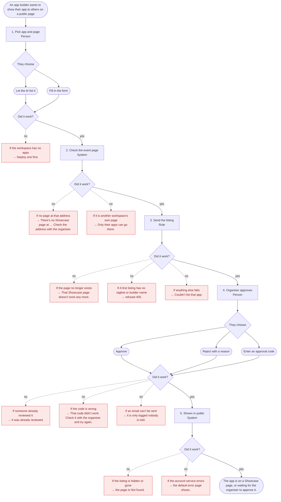

# Story 11: Showcase Listing

<!-- Generated by scripts/build-prd.mjs from app/lib/system/story.ts and the code. Do not edit by hand — run npm run prd. -->

- **ID:** `showcase-listing` (steps are `showcase-listing/<step>`)
- **Story:** A builder puts their app on the Showcase
- **Who:** An app builder
- **Wants to:** show their app to others on a public page
- **Ends with:** The app is on a Showcase page, or waiting for the organiser to approve it.
- **Steps:** 5 · 0 by AI · 5 can go wrong
- **Last change to its code:** v63, 21 Oct 2026 — feat: add auto-approve configuration option for showcase events

[← All stories](../README.md)

## Steps

| # | Step ID | Step | Who acts | What happens |
|---|---|---|---|---|
| 1 | `showcase-listing/choose` | Pick app and page | Person | They choose the app and the page, and let the AI fill it in or use the form. |
| 2 | `showcase-listing/check-address` | Check the event page | System | If they name an event page, its address is checked as they type. |
| 3 | `showcase-listing/send` | Send the listing | Rule | The listing is saved. The public gallery shows it at once; an event page waits for approval unless the event's code was used. |
| 4 | `showcase-listing/approve` | Organiser approves | Person | On an event page the organiser is emailed and approves or turns it down. |
| 5 | `showcase-listing/public` | Shown in public | System | The app gets its own public Showcase page. |

## Flow

## Each step in detail

### 1. Pick app and page

- **ID:** `showcase-listing/choose`
- **Who acts:** Person
- **What happens:** They choose the app and the page, and let the AI fill it in or use the form.
- **Choices:** Let the AI list it · Fill in the form
- **If it goes wrong:**
  - If the workspace has no apps → "Deploy one first."
- **Parts:** App builders (`builders`), Showcase manager (`showcase-manage`)
- **Code:** `page:/app/showcase/submit` → `app/app/showcase/submit/page.tsx`, `lib:app/app/showcase/submit/ListAppForm` → `app/app/showcase/submit/ListAppForm.tsx`, `lib:app/lib/showcasePrompt` → `app/lib/showcasePrompt.ts`

### 2. Check the event page

- **ID:** `showcase-listing/check-address`
- **Who acts:** System
- **What happens:** If they name an event page, its address is checked as they type.
- **If it goes wrong:**
  - If no page at that address → "There's no Showcase page at … Check the address with the organiser."
  - If it is another workspace's own page → "Only their apps can go there."
- **Parts:** Showcase manager (`showcase-manage`), Panel bridge (`bridge`), Showcase service (`showcase-service`)
- **Keeps:** `AppDetails`, `Project`, `ShowcaseEvent`, `ShowcaseEventListing`
- **Looks up:** `Domain`
- **Code:** `lib:app/lib/showcaseAddress` → `app/lib/showcaseAddress.ts`, `api:@api/public/showcase/collections/:slug` → `@api/src/routes/publicShowcase.routes.ts`
- **Outside services:** Redis, viaSocket webhook

### 3. Send the listing

- **ID:** `showcase-listing/send`
- **Who acts:** Rule
- **What happens:** The listing is saved. The public gallery shows it at once; an event page waits for approval unless the event's code was used.
- **If it goes wrong:**
  - If the page no longer exists → "That Showcase page doesn't exist any more."
  - If A first listing has no tagline or builder name → refused (400).
  - If anything else fails → "Couldn't list that app."
- **Parts:** Panel bridge (`bridge`), Showcase service (`showcase-service`), Showcase records (`showcase-data`)
- **Keeps:** `AppDetails`, `AppGrant`, `AuditLog`, `PendingInvite`, `Project`, `ShowcaseEvent`, `ShowcaseEventListing`, `WorkspaceMember`, `WorkspaceRoleSetup`
- **Looks up:** `Company`, `DeployToken`, `Domain`
- **Code:** `api:@api/companies/:companyId/showcase/submissions` → `@api/src/routes/showcase.routes.ts`, `lib:@api/src/services/showcase` → `@api/src/services/showcase.ts`
- **Outside services:** Redis, viaSocket webhook

### 4. Organiser approves

- **ID:** `showcase-listing/approve`
- **Who acts:** Person
- **What happens:** On an event page the organiser is emailed and approves or turns it down.
- **Choices:** Approve · Reject with a reason · Enter an approval code
- **If it goes wrong:**
  - If someone already reviewed it → "It was already reviewed."
  - If the code is wrong → "That code didn't work. Check it with the organiser and try again."
  - If an email can't be sent → it is only logged; nobody is told.
- **Parts:** Showcase organisers (`organisers`), Showcase manager (`showcase-manage`), Showcase service (`showcase-service`), viaSocket (`webhook`)
- **Keeps:** `AppDetails`, `AppGrant`, `AuditLog`, `PendingInvite`, `Project`, `ShowcaseEvent`, `ShowcaseEventListing`, `WorkspaceMember`, `WorkspaceRoleSetup`
- **Looks up:** `Company`, `DeployToken`, `Domain`
- **Code:** `page:/app/showcase/[collectionId]` → `app/app/showcase/[collectionId]/page.tsx`, `lib:app/components/console/showcase/RequestRows` → `app/components/console/showcase/RequestRows.tsx`, `lib:app/components/console/showcase/ApprovalCodeDialog` → `app/components/console/showcase/ApprovalCodeDialog.tsx`, `api:@api/companies/:companyId/showcase/collections/:collectionId/projects/:listingId` → `@api/src/routes/showcase.routes.ts`, `lib:@api/src/services/showcaseMail` → `@api/src/services/showcaseMail.ts`
- **Outside services:** Redis, viaSocket webhook

### 5. Shown in public

- **ID:** `showcase-listing/public`
- **Who acts:** System
- **What happens:** The app gets its own public Showcase page.
- **If it goes wrong:**
  - If the listing is hidden or gone → the page is Not found.
  - If the account service errors → the default error page shows.
- **Parts:** Public Showcase (`showcase-public`), Showcase reader (`showcase-reader`), Showcase service (`showcase-service`)
- **Keeps:** `AppDetails`, `Project`, `ShowcaseEvent`, `ShowcaseEventListing`
- **Looks up:** `Domain`
- **Code:** `page:/showcase/app/[slug]` → `app/showcase/app/[slug]/page.tsx`, `lib:app/lib/showcase` → `app/lib/showcase.ts`, `api:@api/public/showcase/apps/:slug` → `@api/src/routes/publicShowcase.routes.ts`
- **Outside services:** Redis, viaSocket webhook

## Parts involved

| Part | Lane | What it does |
|---|---|---|
| App builders (`builders`) | People | People whose AI agent builds an app, who want it online and healthy. |
| Showcase manager (`showcase-manage`) | Screens | Where builders list apps and organisers run their event pages. |
| Panel bridge (`bridge`) | Engine | Passes every panel request to the account service as the signed-in person. |
| Showcase service (`showcase-service`) | Engine | Stores Showcase pages and listings, decides what needs approval, and emails people about it. |
| Showcase records (`showcase-data`) | Data | Each app's Showcase details, the event pages, and which apps are on which page. |
| Showcase organisers (`organisers`) | People | People who run a Showcase page for an event and choose which apps go on it. |
| viaSocket (`webhook`) | Outside | Receives early-access requests and sends Embarko's emails (keys, Showcase notices). |
| Public Showcase (`showcase-public`) | Screens | Public pages of apps people built on Embarko, grouped by event, tool and topic. |
| Showcase reader (`showcase-reader`) | Engine | Reads the public Showcase listings, without the builders' email addresses. |

See [system-map.md](../system-map.md) for how the parts connect.

## Tables

- **Keeps** `AppDetails` — Public-facing details of a deployed app.
- **Keeps** `AppGrant` — A Member's access to one project, above the default "use": "edit" (have their AI make changes as a preview; logs) or "full" (approve and publish, settings, delete, move) — ACCESS_LEVELS in permissions.ts.
- **Keeps** `AuditLog` — Every mutating action: who, what, when.
- **Keeps** `PendingInvite` — A role chosen for someone before they are a member.
- **Keeps** `Project` — One Project == one deployed app on hostnsoft-deploy.
- **Keeps** `ShowcaseEvent` — An event page, /showcase/<slug>: a hackathon, a demo day.
- **Keeps** `ShowcaseEventListing` — One app shown on one event page.
- **Keeps** `WorkspaceMember` — A member's role in one workspace.
- **Keeps** `WorkspaceRoleSetup` — How far a workspace's roles have been set up (permissions.ts setUpWorkspaceRoles).
- **Looks up** `Company` — Local mirror of the few company facts the proxy doesn't hold.
- **Looks up** `DeployToken` — A deploy token.
- **Looks up** `Domain` — A client-owned domain (or subdomain) attached to a project — see docs/Customdomain-req.md.

See [tables.md](../tables.md).

## Recent changes

| Version | Date | Change | Steps changed |
|---|---|---|---|
| v63 (dd89bfd) | 21 Oct 2026 | feat: add auto-approve configuration option for showcase events | send, approve |
| v62 (ee930c9) | 21 Oct 2026 | feat: add auto-approve setting for showcase collections and submission flow | choose, approve |
| v61 (e19113b) | 14 Oct 2026 | Replace the docs with the agent guide | choose |
| v60 (dc830b8) | 13 Oct 2026 | feat: add Company model to mirror billing state and fallback when Lago is unreachable | — |
| v59 (c85241c) | 13 Oct 2026 | feat(orphan): claim link — keep a temporary app by signing in, no redeploy | — |

## Open questions

- This story was written from the code; treat "wants to" as an assumption until a user confirms it.
