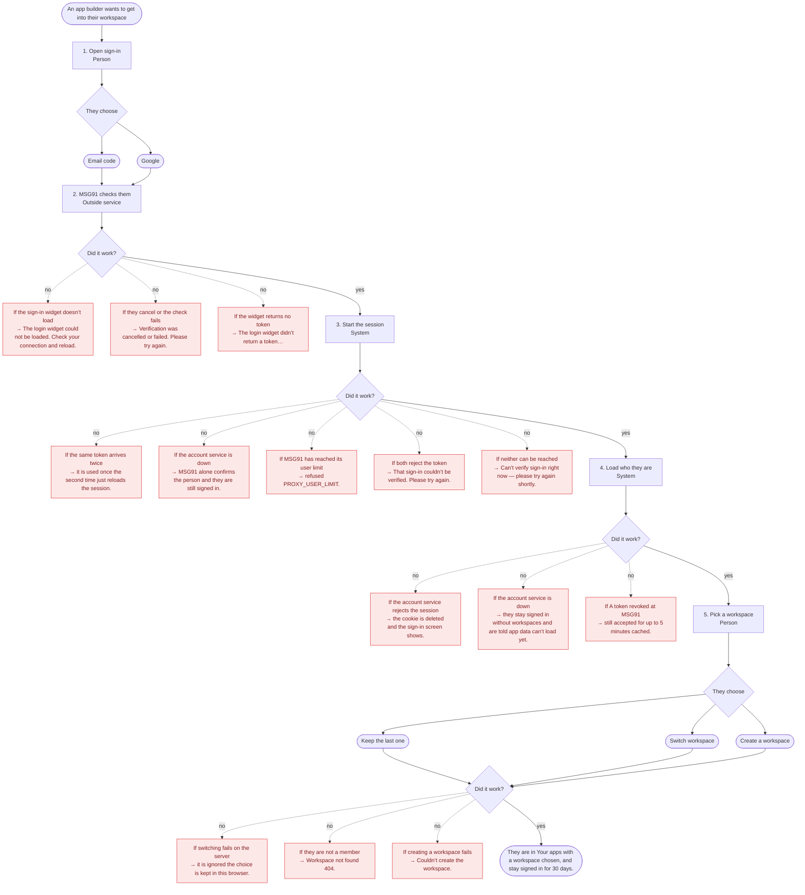

# Story 7: Sign In

<!-- Generated by scripts/build-prd.mjs from app/lib/system/story.ts and the code. Do not edit by hand — run npm run prd. -->

- **ID:** `sign-in` (steps are `sign-in/<step>`)
- **Story:** Someone signs in to the panel
- **Who:** An app builder
- **Wants to:** get into their workspace
- **Ends with:** They are in Your apps with a workspace chosen, and stay signed in for 30 days.
- **Steps:** 5 · 0 by AI · 4 can go wrong
- **Last change to its code:** v49, 23 Oct 2026 — feat: one Members page: invite with role and access, remove people

[← All stories](../README.md)

## Steps

| # | Step ID | Step | Who acts | What happens |
|---|---|---|---|---|
| 1 | `sign-in/open` | Open sign-in | Person | They open sign-in from the site header or the panel. |
| 2 | `sign-in/verify` | MSG91 checks them | Outside service | MSG91 confirms who they are and hands back a sign-in token. |
| 3 | `sign-in/start-session` | Start the session | System | The account service checks the token with MSG91, sets up billing for new workspaces, and the site keeps it as the session. |
| 4 | `sign-in/load-me` | Load who they are | System | The panel shows last visit's details at once, then their workspaces and admin rights. |
| 5 | `sign-in/workspace` | Pick a workspace | Person | They land in their last workspace, or switch to another one. |

## Flow

## Each step in detail

### 1. Open sign-in

- **ID:** `sign-in/open`
- **Who acts:** Person
- **What happens:** They open sign-in from the site header or the panel.
- **Choices:** Email code · Google
- **Parts:** App builders (`builders`), Sign-in (`sign-in`)
- **Code:** `lib:app/components/LoginModal` → `app/components/LoginModal.tsx`, `lib:app/components/console/LoginScreen` → `app/components/console/LoginScreen.tsx`
- **Outside services:** MSG91

### 2. MSG91 checks them

- **ID:** `sign-in/verify`
- **Who acts:** Outside service
- **What happens:** MSG91 confirms who they are and hands back a sign-in token.
- **If it goes wrong:**
  - If the sign-in widget doesn't load → "The login widget could not be loaded. Check your connection and reload."
  - If they cancel or the check fails → "Verification was cancelled or failed. Please try again."
  - If the widget returns no token → "The login widget didn't return a token…"
- **Parts:** MSG91 (`msg91`), Sign-in (`sign-in`)
- **Code:** `lib:app/components/console/LoginScreen` → `app/components/console/LoginScreen.tsx`
- **Outside services:** MSG91

### 3. Start the session

- **ID:** `sign-in/start-session`
- **Who acts:** System
- **What happens:** The account service checks the token with MSG91, sets up billing for new workspaces, and the site keeps it as the session.
- **If it goes wrong:**
  - If the same token arrives twice → it is used once; the second time just reloads the session.
  - If the account service is down → MSG91 alone confirms the person and they are still signed in.
  - If MSG91 has reached its user limit → refused (PROXY_USER_LIMIT).
  - If both reject the token → "That sign-in couldn't be verified. Please try again."
  - If neither can be reached → "Can't verify sign-in right now — please try again shortly."
- **Parts:** Session (`session`), Account checks (`accounts`), Billing (`billing`), MSG91 (`msg91`), Redis (`redis`)
- **Looks up:** `SuperAdmin`
- **Code:** `api:/api/auth/exchange` → `app/api/auth/exchange/route.ts`, `lib:app/lib/api` → `app/lib/api.ts`, `lib:app/lib/client` → `app/lib/client.ts`, `api:@api/auth/msg91/exchange` → `@api/src/routes/auth.routes.ts`, `lib:@api/src/lib/msg91` → `@api/src/lib/msg91.ts`, `lib:@api/src/services/billingCustomer` → `@api/src/services/billingCustomer.ts`
- **Outside services:** MSG91, Redis

### 4. Load who they are

- **ID:** `sign-in/load-me`
- **Who acts:** System
- **What happens:** The panel shows last visit's details at once, then their workspaces and admin rights.
- **If it goes wrong:**
  - If the account service rejects the session → the cookie is deleted and the sign-in screen shows.
  - If the account service is down → they stay signed in without workspaces and are told app data can't load yet.
  - If A token revoked at MSG91 → still accepted for up to 5 minutes (cached).
- **Parts:** Session (`session`), Account checks (`accounts`)
- **Keeps:** `SuperAdmin`
- **Code:** `api:/api/auth/me` → `app/api/auth/me/route.ts`, `lib:app/lib/session` → `app/lib/session.tsx`, `lib:app/lib/lastSeen` → `app/lib/lastSeen.ts`, `api:@api/auth/me` → `@api/src/routes/auth.routes.ts`, `lib:@api/src/middleware/proxyToken` → `@api/src/middleware/proxyToken.ts`
- **Outside services:** MSG91, Redis

### 5. Pick a workspace

- **ID:** `sign-in/workspace`
- **Who acts:** Person
- **What happens:** They land in their last workspace, or switch to another one.
- **Choices:** Keep the last one · Switch workspace · Create a workspace
- **If it goes wrong:**
  - If switching fails on the server → it is ignored; the choice is kept in this browser.
  - If they are not a member → "Workspace not found" (404).
  - If creating a workspace fails → "Couldn't create the workspace."
- **Parts:** Your apps panel (`console`), Session (`session`), Account checks (`accounts`)
- **Keeps:** `AuditLog`
- **Code:** `page:/app/switch-workspace` → `app/app/switch-workspace/page.tsx`, `api:/api/auth/switch-company` → `app/api/auth/switch-company/route.ts`, `api:@api/auth/switch-company` → `@api/src/routes/auth.routes.ts`, `lib:app/components/console/CompanyDialog` → `app/components/console/CompanyDialog.tsx`
- **Outside services:** MSG91, Redis

## Parts involved

| Part | Lane | What it does |
|---|---|---|
| App builders (`builders`) | People | People whose AI agent builds an app, who want it online and healthy. |
| Sign-in (`sign-in`) | Screens | Where people prove who they are, in the panel or for an AI tool. |
| MSG91 (`msg91`) | Outside | Checks who a person is, holds workspaces and members, and sends email templates. |
| Session (`session`) | Engine | Keeps a person signed in and knows which workspace they are in. |
| Account checks (`accounts`) | Engine | Confirms who someone is, which workspaces they belong to, and whether they are an admin. |
| Billing (`billing`) | Engine | Keeps each workspace's plan and card, through the billing and payment providers. |
| Redis (`redis`) | Outside | Short-lived memory for sign-in checks, one-time codes and rate limits. |
| Your apps panel (`console`) | Screens | Where builders see their apps, whether each is live, and what to do next. |

See [system-map.md](../system-map.md) for how the parts connect.

## Tables

- **Keeps** `AuditLog` — Every mutating action: who, what, when.
- **Keeps** `SuperAdmin` — Internal admin flag, gating /admin/* routes — see docs/admin-panel.md.

See [tables.md](../tables.md).

## Recent changes

| Version | Date | Change | Steps changed |
|---|---|---|---|
| v49 (e19e29b) | 23 Oct 2026 | feat: one Members page: invite with role and access, remove people | start-session |
| v48 (3be464c) | 23 Oct 2026 | feat: invite and remove people through the API; per-member app access | start-session |
| v47 (28bcc06) | 22 Oct 2026 | feat: roles for an AI workspace: Owner, Admin, Member, Billing; per-app Can use / Can edit / Full access | start-session |
| v46 (d2813cc) | 21 Oct 2026 | feat: workspace roles and per-app access | start-session |
| v45 (9246658) | 17 Oct 2026 | feat(companies): add PATCH /companies/:id to rename a workspace via proxy (#44) | start-session |

## Open questions

- This story was written from the code; treat "wants to" as an assumption until a user confirms it.
