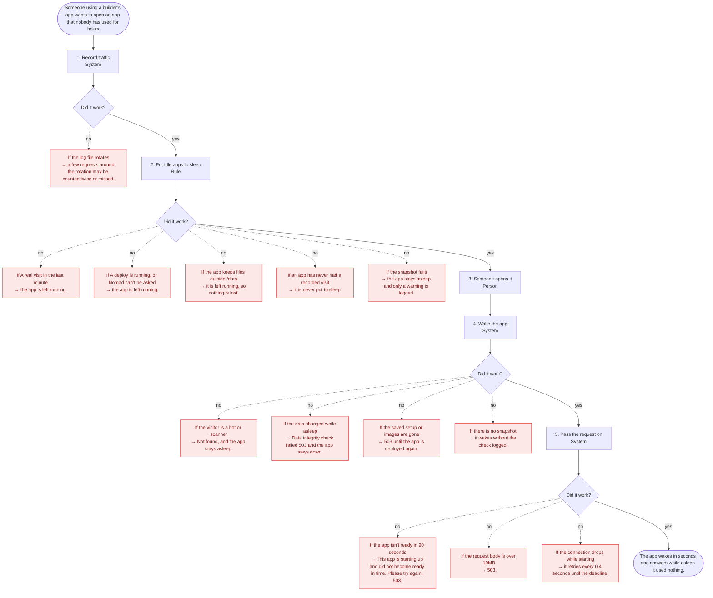

# Story 5: Sleep And Wake

<!-- Generated by scripts/build-prd.mjs from app/lib/system/story.ts and the code. Do not edit by hand — run npm run prd. -->

- **ID:** `sleep-and-wake` (steps are `sleep-and-wake/<step>`)
- **Story:** A quiet app sleeps and wakes for its next visitor
- **Who:** Someone using a builder's app
- **Wants to:** open an app that nobody has used for hours
- **Ends with:** The app wakes in seconds and answers; while asleep it used nothing.
- **Steps:** 5 · 0 by AI · 4 can go wrong
- **Last change to its code:** v44, 19 Oct 2026 — Let webhooks from HTTP client libraries wake sleeping apps

[← All stories](../README.md)

## Steps

| # | Step ID | Step | Who acts | What happens |
|---|---|---|---|---|
| 1 | `sleep-and-wake/record` | Record traffic | System | Every request to every app is written down, with whether it came from a bot. |
| 2 | `sleep-and-wake/sleep` | Put idle apps to sleep | Rule | Every 10 minutes, apps with no real visitor for 6 hours are stopped and their data is snapshotted. |
| 3 | `sleep-and-wake/visit` | Someone opens it | Person | A visitor opens the sleeping app's address. |
| 4 | `sleep-and-wake/wake` | Wake the app | System | The app's data is checked against the snapshot, then it is started again. |
| 5 | `sleep-and-wake/answer` | Pass the request on | System | Once the app is up, the waiting request is handed to it. |

## Flow

## Each step in detail

### 1. Record traffic

- **ID:** `sleep-and-wake/record`
- **Who acts:** System
- **What happens:** Every request to every app is written down, with whether it came from a bot.
- **If it goes wrong:**
  - If the log file rotates → a few requests around the rotation may be counted twice or missed.
- **Parts:** Traffic recorder (`traffic-recorder`), Traffic records (`traffic-data`), Traffic router (`router`)
- **Keeps:** `request_log`, `tail_state`
- **Code:** `lib:@deploy/analytics/access-log-tailer` → `@deploy/analytics/access-log-tailer.js`
- **Outside services:** Traefik

### 2. Put idle apps to sleep

- **ID:** `sleep-and-wake/sleep`
- **Who acts:** Rule
- **What happens:** Every 10 minutes, apps with no real visitor for 6 hours are stopped and their data is snapshotted.
- **If it goes wrong:**
  - If A real visit in the last minute → the app is left running.
  - If A deploy is running, or Nomad can't be asked → the app is left running.
  - If the app keeps files outside /data → it is left running, so nothing is lost.
  - If an app has never had a recorded visit → it is never put to sleep.
  - If the snapshot fails → the app stays asleep and only a warning is logged.
- **Parts:** Sleep and wake (`sleep-wake`), Traffic records (`traffic-data`), Container platform (`containers`)
- **Looks up:** `request_log`
- **Code:** `lib:@deploy/idle-report` → `@deploy/idle-report.js`, `lib:@deploy/scale-to-zero-apps` → `@deploy/scale-to-zero-apps.js`, `lib:@deploy/scale-to-zero-registry` → `@deploy/scale-to-zero-registry.js`, `lib:@deploy/analytics/bot-filter` → `@deploy/analytics/bot-filter.js`
- **Outside services:** Nomad, Traefik

### 3. Someone opens it

- **ID:** `sleep-and-wake/visit`
- **Who acts:** Person
- **What happens:** A visitor opens the sleeping app's address.
- **Parts:** Traffic router (`router`)
- **Outside services:** Traefik

### 4. Wake the app

- **ID:** `sleep-and-wake/wake`
- **Who acts:** System
- **What happens:** The app's data is checked against the snapshot, then it is started again.
- **If it goes wrong:**
  - If the visitor is a bot or scanner → Not found, and the app stays asleep.
  - If the data changed while asleep → "Data integrity check failed" (503) and the app stays down.
  - If the saved setup or images are gone → 503 until the app is deployed again.
  - If there is no snapshot → it wakes without the check (logged).
- **Parts:** Sleep and wake (`sleep-wake`), Container platform (`containers`)
- **Code:** `lib:@deploy/activator` → `@deploy/activator.js`, `lib:@deploy/sqlite-data-check` → `@deploy/sqlite-data-check.js`, `lib:@deploy/scale-to-zero-images` → `@deploy/scale-to-zero-images.js`
- **Outside services:** Nomad

### 5. Pass the request on

- **ID:** `sleep-and-wake/answer`
- **Who acts:** System
- **What happens:** Once the app is up, the waiting request is handed to it.
- **If it goes wrong:**
  - If the app isn't ready in 90 seconds → "This app is starting up and did not become ready in time. Please try again." (503).
  - If the request body is over 10MB → 503.
  - If the connection drops while starting → it retries every 0.4 seconds until the deadline.
- **Parts:** Sleep and wake (`sleep-wake`), Traffic router (`router`)
- **Code:** `lib:@deploy/activator` → `@deploy/activator.js`
- **Outside services:** Nomad

## Parts involved

| Part | Lane | What it does |
|---|---|---|
| Traffic recorder (`traffic-recorder`) | Background | Records every request and each app's CPU and memory, and forgets them after 100 days. |
| Traffic records (`traffic-data`) | Data | Each app's requests and resource use, for its traffic charts and for sleep decisions. |
| Traffic router (`router`) | Outside | Traefik: sends each address to the right app and gets its certificate. |
| Sleep and wake (`sleep-wake`) | Background | Stops apps nobody has used for hours, and starts them again on the next visit. |
| Container platform (`containers`) | Outside | The tools that build app images and run them as containers. |

See [system-map.md](../system-map.md) for how the parts connect.

## Tables

- **Keeps** `request_log`
- **Keeps** `tail_state` — One row, keyed by the log file's own path — lets the tailer resume from where it left off across restarts, and detect rotation (a changed inode, or a file that's now smaller than our last offset).

See [tables.md](../tables.md).

## Recent changes

| Version | Date | Change | Steps changed |
|---|---|---|---|
| v44 (164654d) | 19 Oct 2026 | Let webhooks from HTTP client libraries wake sleeping apps | sleep |
| v43 (b3e21dd) | 14 Oct 2026 | feat: add zero-downtime graceful shutdown, unref intervals, and live migration script | record |
| v42 (802c949) | 14 Oct 2026 | issue with stuck sleeping app due to livestream backup check | sleep, wake, answer |
| v41 (bbde1e1) | 12 Oct 2026 | Close the 502 window after a scale-to-zero stop | sleep, wake, answer |
| v40 (ed34a72) | 12 Oct 2026 | write wake routers on deploy; never stop an app without one | sleep |

## Open questions

- This story was written from the code; treat "wants to" as an assumption until a user confirms it.
