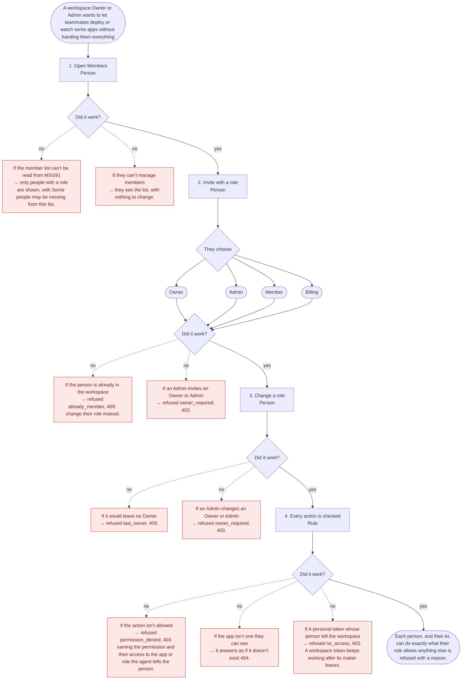

# Story 16: Team Roles

<!-- Generated by scripts/build-prd.mjs from app/lib/system/story.ts and the code. Do not edit by hand — run npm run prd. -->

- **ID:** `team-roles` (steps are `team-roles/<step>`)
- **Story:** An owner decides what each person in the workspace can do
- **Who:** A workspace Owner or Admin
- **Wants to:** let teammates deploy or watch some apps without handing them everything
- **Ends with:** Each person, and their AI, can do exactly what their role allows; anything else is refused with a reason.
- **Steps:** 4 · 0 by AI · 4 can go wrong
- **Last change to its code:** v15, 13 Oct 2026 — feat: add Company model to mirror billing state and fallback when Lago is unreachable

[← All stories](../README.md)

## Steps

| # | Step ID | Step | Who acts | What happens |
|---|---|---|---|---|
| 1 | `team-roles/open` | Open Members | Person | They see everyone in the workspace with their role and which apps they reach. |
| 2 | `team-roles/invite` | Invite with a role | Person | They choose a role (and, for a Member, access to apps) for an email, then send the invite from MSG91's list. The role applies when the person first arrives. |
| 3 | `team-roles/change` | Change a role | Person | They change someone's role and, for a Member, their access to each app: Can use (the default), Can edit or Full access. |
| 4 | `team-roles/enforce` | Every action is checked | Rule | Each panel call, agent call and deploy is checked against the role. The panel hides what the person can't do. |

## Flow

## Each step in detail

### 1. Open Members

- **ID:** `team-roles/open`
- **Who acts:** Person
- **What happens:** They see everyone in the workspace with their role and which apps they reach.
- **If it goes wrong:**
  - If the member list can't be read from MSG91 → only people with a role are shown, with "Some people may be missing from this list."
  - If they can't manage members → they see the list, with nothing to change.
- **Parts:** App builders (`builders`), Your apps panel (`console`), Panel bridge (`bridge`), Roles (`roles`), MSG91 (`msg91`)
- **Keeps:** `AppGrant`, `AuditLog`, `PendingInvite`, `WorkspaceMember`, `WorkspaceRoleSetup`
- **Looks up:** `Company`, `DeployToken`, `Project`
- **Code:** `page:/app/members` → `app/app/members/page.tsx`, `lib:app/components/console/TeamRoles` → `app/components/console/TeamRoles.tsx`, `api:@api/companies/:companyId/members` → `@api/src/routes/members.routes.ts`, `lib:@api/src/services/workspaceRoles` → `@api/src/services/workspaceRoles.ts`
- **Outside services:** Redis

### 2. Invite with a role

- **ID:** `team-roles/invite`
- **Who acts:** Person
- **What happens:** They choose a role (and, for a Member, access to apps) for an email, then send the invite from MSG91's list. The role applies when the person first arrives.
- **Choices:** Owner · Admin · Member · Billing
- **If it goes wrong:**
  - If the person is already in the workspace → refused (already_member, 409): change their role instead.
  - If an Admin invites an Owner or Admin → refused (owner_required, 403).
- **Parts:** Your apps panel (`console`), Roles (`roles`), Roles and app access (`roles-data`), MSG91 (`msg91`)
- **Keeps:** `AppGrant`, `AuditLog`, `PendingInvite`, `WorkspaceMember`, `WorkspaceRoleSetup`
- **Looks up:** `Company`, `DeployToken`, `Project`
- **Code:** `api:@api/companies/:companyId/invites` → `@api/src/routes/members.routes.ts`, `lib:app/components/console/UserManagementWidget` → `app/components/console/UserManagementWidget.tsx`
- **Outside services:** MSG91, Redis

### 3. Change a role

- **ID:** `team-roles/change`
- **Who acts:** Person
- **What happens:** They change someone's role and, for a Member, their access to each app: Can use (the default), Can edit or Full access.
- **If it goes wrong:**
  - If it would leave no Owner → refused (last_owner, 409).
  - If an Admin changes an Owner or Admin → refused (owner_required, 403).
- **Parts:** Your apps panel (`console`), Roles (`roles`), Roles and app access (`roles-data`)
- **Keeps:** `AppGrant`, `AuditLog`, `PendingInvite`, `WorkspaceMember`, `WorkspaceRoleSetup`
- **Looks up:** `Company`, `DeployToken`, `Project`
- **Code:** `api:@api/companies/:companyId/members/:userId` → `@api/src/routes/members.routes.ts`, `api:@api/companies/:companyId/members/:userId/apps` → `@api/src/routes/members.routes.ts`
- **Outside services:** Redis

### 4. Every action is checked

- **ID:** `team-roles/enforce`
- **Who acts:** Rule
- **What happens:** Each panel call, agent call and deploy is checked against the role. The panel hides what the person can't do.
- **If it goes wrong:**
  - If the action isn't allowed → refused (permission_denied, 403) naming the permission and their access to the app (or role); the agent tells the person.
  - If the app isn't one they can see → it answers as if it doesn't exist (404).
  - If A personal token whose person left the workspace → refused (no_access, 403). A workspace token keeps working after its maker leaves.
- **Parts:** Roles (`roles`), Deploy intake (`intake`), Your AI agent (`ai-agent`)
- **Keeps:** `AppGrant`, `AuditLog`, `PendingInvite`, `WorkspaceMember`, `WorkspaceRoleSetup`
- **Looks up:** `Company`, `DeployToken`, `Project`
- **Code:** `api:@api/me/permissions` → `@api/src/routes/members.routes.ts`, `lib:@api/src/middleware/requirePermission` → `@api/src/middleware/requirePermission.ts`, `lib:@api/src/lib/permissions` → `@api/src/lib/permissions.ts`
- **Outside services:** Redis

## Parts involved

| Part | Lane | What it does |
|---|---|---|
| App builders (`builders`) | People | People whose AI agent builds an app, who want it online and healthy. |
| Your apps panel (`console`) | Screens | Where builders see their apps, whether each is live, and what to do next. |
| Panel bridge (`bridge`) | Engine | Passes every panel request to the account service as the signed-in person. |
| Roles (`roles`) | Engine | Decides what each member may do in a workspace: Owner, Admin, Member or Billing, and each Member's access to each app: Can use, Can edit (their AI's changes wait for approval) or Full access (publishes). |
| MSG91 (`msg91`) | Outside | Checks who a person is, holds workspaces and members, and sends email templates. |
| Roles and app access (`roles-data`) | Data | Each member's role, which apps they can reach, roles waiting for people who were invited, and whether each workspace's existing members and owner have been set up. |
| Deploy intake (`intake`) | Engine | Takes an app from an AI, checks the key and the name, and starts the build. |
| Your AI agent (`ai-agent`) | Outside | The builder's own AI (Claude, ChatGPT, Cursor…) that builds and deploys the app. |

See [system-map.md](../system-map.md) for how the parts connect.

## Tables

- **Keeps** `AppGrant` — A Member's access to one project, above the default "use": "edit" (have their AI make changes as a preview; logs) or "full" (approve and publish, settings, delete, move) — ACCESS_LEVELS in permissions.ts.
- **Keeps** `AuditLog` — Every mutating action: who, what, when.
- **Keeps** `PendingInvite` — A role chosen for someone before they are a member.
- **Keeps** `WorkspaceMember` — A member's role in one workspace.
- **Keeps** `WorkspaceRoleSetup` — How far a workspace's roles have been set up (permissions.ts setUpWorkspaceRoles).
- **Looks up** `Company` — Local mirror of the few company facts the proxy doesn't hold.
- **Looks up** `DeployToken` — A deploy token.
- **Looks up** `Project` — One Project == one deployed app on hostnsoft-deploy.

See [tables.md](../tables.md).

## Recent changes

| Version | Date | Change | Steps changed |
|---|---|---|---|
| v15 (dc830b8) | 13 Oct 2026 | feat: add Company model to mirror billing state and fallback when Lago is unreachable | — |
| v14 (c85241c) | 13 Oct 2026 | feat(orphan): claim link — keep a temporary app by signing in, no redeploy | — |
| v13 (8107360) | 7 Oct 2026 | feat(panel): breadcrumb row replaces the header; calmer app cards | invite |
| v12 (2b852bb) | 29 Sept 2026 | Record app type and deploy attribution (source, agent name) | — |
| v11 (82811d9) | 24 Sept 2026 | storing kind on each deployment with token, either static or service | — |

## Open questions

- This story was written from the code; treat "wants to" as an assumption until a user confirms it.
