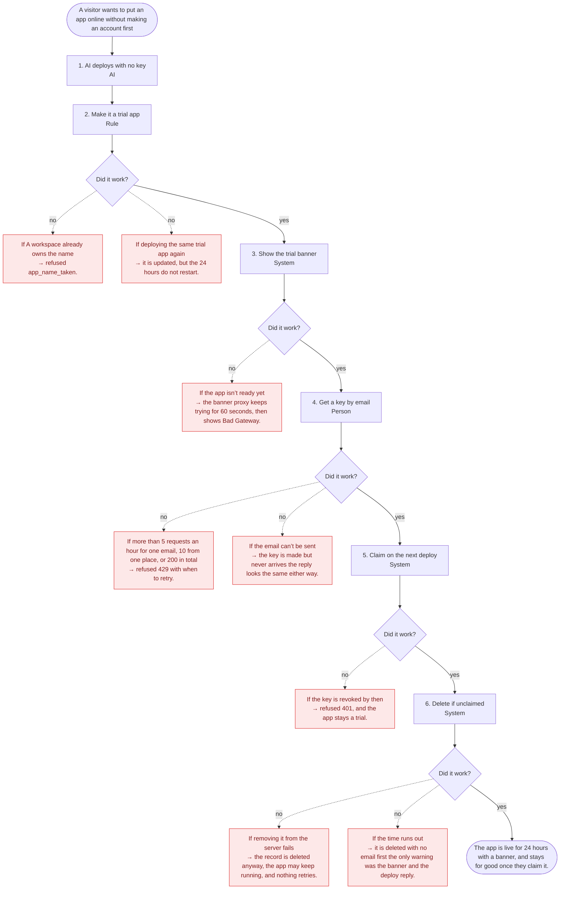

# Story 3: Trial App

<!-- Generated by scripts/build-prd.mjs from app/lib/system/story.ts and the code. Do not edit by hand — run npm run prd. -->

- **ID:** `try-without-account` (steps are `try-without-account/<step>`)
- **Story:** An AI deploys before anyone signs up
- **Who:** A visitor
- **Wants to:** put an app online without making an account first
- **Ends with:** The app is live for 24 hours with a banner, and stays for good once they claim it.
- **Steps:** 6 · 1 by AI · 5 can go wrong
- **Last change to its code:** v131, 22 Oct 2026 — feat: roles for an AI workspace: Owner, Admin, Member, Billing; per-app Can use / Can edit / Full access

[← All stories](../README.md)

## Steps

| # | Step ID | Step | Who acts | What happens |
|---|---|---|---|---|
| 1 | `try-without-account/ai-deploys` | AI deploys with no key | AI | The visitor's AI sends the app without any key. |
| 2 | `try-without-account/trial` | Make it a trial app | Rule | Embarko keeps the name for this trial app and sets it to be deleted in 24 hours. |
| 3 | `try-without-account/banner` | Show the trial banner | System | The app gets a banner counting down to deletion, with a link to keep it. |
| 4 | `try-without-account/get-key` | Get a key by email | Person | They give an email address; Embarko makes their account and workspace if needed, and emails a key. |
| 5 | `try-without-account/claim` | Claim on the next deploy | System | The next deploy with the key moves the trial app into their workspace and cancels the deletion. |
| 6 | `try-without-account/cleanup` | Delete if unclaimed | System | Every hour, trial apps past their 24 hours are removed. |

## Flow

## Each step in detail

### 1. AI deploys with no key

- **ID:** `try-without-account/ai-deploys`
- **Who acts:** AI
- **What happens:** The visitor's AI sends the app without any key.
- **If it goes wrong:** not written down yet — open question.
- **Parts:** Your AI agent (`ai-agent`), Deploy intake (`intake`)
- **Code:** `api:@deploy/apps` → `@deploy/server.js`, `lib:@deploy/deploy-credential` → `@deploy/deploy-credential.js`
- **Outside services:** Docker, Nomad, Railpack

### 2. Make it a trial app

- **ID:** `try-without-account/trial`
- **Who acts:** Rule
- **What happens:** Embarko keeps the name for this trial app and sets it to be deleted in 24 hours.
- **If it goes wrong:**
  - If A workspace already owns the name → refused (app_name_taken).
  - If deploying the same trial app again → it is updated, but the 24 hours do not restart.
- **Parts:** App records (`app-records`), Apps and deploys (`apps-data`)
- **Keeps:** `AppDetails`, `AppGrant`, `AuditLog`, `Company`, `DeployToken`, `Deployment`, `EnvVar`, `PendingInvite`, `Project`, `Schedule`, `ShowcaseEvent`, `ShowcaseEventListing`, `SlugAlias`, `WorkspaceMember`, `WorkspaceRoleSetup`
- **Looks up:** `Domain`, `ScheduleRun`
- **Code:** `api:@api/internal/projects/claim` → `@api/src/routes/internalProjects.routes.ts`, `lib:@api/src/services/projectClaim` → `@api/src/services/projectClaim.ts`, `lib:@api/src/lib/orphanMessage` → `@api/src/lib/orphanMessage.ts`
- **Outside services:** Lago, Redis, Stripe, viaSocket webhook

### 3. Show the trial banner

- **ID:** `try-without-account/banner`
- **Who acts:** System
- **What happens:** The app gets a banner counting down to deletion, with a link to keep it.
- **If it goes wrong:**
  - If the app isn't ready yet → the banner proxy keeps trying for 60 seconds, then shows Bad Gateway.
- **Parts:** Trial banner (`trial-banner`), App runner (`runner`)
- **Code:** `lib:@deploy/orphan-proxy/proxy` → `@deploy/orphan-proxy/proxy.js`, `lib:@deploy/nomad-job-spec` → `@deploy/nomad-job-spec.js`

### 4. Get a key by email

- **ID:** `try-without-account/get-key`
- **Who acts:** Person
- **What happens:** They give an email address; Embarko makes their account and workspace if needed, and emails a key.
- **If it goes wrong:**
  - If more than 5 requests an hour for one email, 10 from one place, or 200 in total → refused (429) with when to retry.
  - If the email can't be sent → the key is made but never arrives; the reply looks the same either way.
- **Parts:** Visitors (`visitors`), Deploy keys (`tokens`), viaSocket (`webhook`), MSG91 (`msg91`)
- **Keeps:** `AuditLog`, `Company`, `DeployToken`
- **Code:** `api:@api/public/deploy-tokens/request` → `@api/src/routes/publicTokens.routes.ts`, `lib:@api/src/services/publicTokenRequest` → `@api/src/services/publicTokenRequest.ts`, `lib:@api/src/services/emailToken` → `@api/src/services/emailToken.ts`
- **Outside services:** Lago, Redis, Stripe, viaSocket webhook

### 5. Claim on the next deploy

- **ID:** `try-without-account/claim`
- **Who acts:** System
- **What happens:** The next deploy with the key moves the trial app into their workspace and cancels the deletion.
- **If it goes wrong:**
  - If the key is revoked by then → refused (401), and the app stays a trial.
- **Parts:** Deploy intake (`intake`), App records (`app-records`)
- **Keeps:** `AppDetails`, `AppGrant`, `AuditLog`, `Company`, `DeployToken`, `Deployment`, `EnvVar`, `PendingInvite`, `Project`, `Schedule`, `ShowcaseEvent`, `ShowcaseEventListing`, `SlugAlias`, `WorkspaceMember`, `WorkspaceRoleSetup`
- **Looks up:** `Domain`, `ScheduleRun`
- **Code:** `api:@api/internal/projects/claim` → `@api/src/routes/internalProjects.routes.ts`, `lib:@api/src/services/projectClaim` → `@api/src/services/projectClaim.ts`
- **Outside services:** Lago, Redis, Stripe, viaSocket webhook

### 6. Delete if unclaimed

- **ID:** `try-without-account/cleanup`
- **Who acts:** System
- **What happens:** Every hour, trial apps past their 24 hours are removed.
- **If it goes wrong:**
  - If removing it from the server fails → the record is deleted anyway, the app may keep running, and nothing retries.
  - If the time runs out → it is deleted with no email first; the only warning was the banner and the deploy reply.
- **Parts:** Cleanup and re-checks (`cleanup`), App runner (`runner`), Apps and deploys (`apps-data`)
- **Keeps:** `Project`
- **Code:** `lib:@api/src/services/orphanCleanup` → `@api/src/services/orphanCleanup.ts`, `lib:@api/src/services/appTeardown` → `@api/src/services/appTeardown.ts`, `api:@deploy/internal/apps/:appName` → `@deploy/server.js`
- **Outside services:** Docker, Nomad, Traefik

## Parts involved

| Part | Lane | What it does |
|---|---|---|
| Your AI agent (`ai-agent`) | Outside | The builder's own AI (Claude, ChatGPT, Cursor…) that builds and deploys the app. |
| Deploy intake (`intake`) | Engine | Takes an app from an AI, checks the key and the name, and starts the build. |
| App records (`app-records`) | Engine | Keeps the list of apps: who owns each, its name and address, and whether it is live. |
| Apps and deploys (`apps-data`) | Data | Each app, its versions, settings, custom domains and old names. |
| Trial banner (`trial-banner`) | Background | Puts a banner on trial and free-plan apps saying how to keep them. |
| App runner (`runner`) | Engine | Runs each app, gives it its address and domains, and moves or removes it when asked. |
| Visitors (`visitors`) | People | People who land on embarko.ai, read about it and browse the Showcase. |
| Deploy keys (`tokens`) | Engine | Makes, checks, rotates and revokes the keys an AI uses to deploy, and decides which apps each key may reach. |
| viaSocket (`webhook`) | Outside | Receives early-access requests and sends Embarko's emails (keys, Showcase notices). |
| MSG91 (`msg91`) | Outside | Checks who a person is, holds workspaces and members, and sends email templates. |
| Cleanup and re-checks (`cleanup`) | Background | Deletes trial apps nobody claimed, and re-checks custom domains every day. |

See [system-map.md](../system-map.md) for how the parts connect.

## Tables

- **Keeps** `AppDetails` — Public-facing details of a deployed app.
- **Keeps** `AppGrant` — One app a Member with appAccess "chosen" can reach, and how far: "use", "edit" (have their AI make changes as a preview; logs) or "full" (approve and publish, settings, delete, move) — ACCESS_LEVELS in permissions.ts.
- **Keeps** `AuditLog` — Every mutating action: who, what, when.
- **Keeps** `Company` — Local mirror of the few company facts the proxy doesn't hold.
- **Keeps** `DeployToken` — A deploy token.
- **Keeps** `Deployment` — Versioned deploy history — one row per deploy attempt.
- **Keeps** `EnvVar`
- **Keeps** `PendingInvite` — A role chosen for someone before they are a member.
- **Keeps** `Project` — One Project == one deployed app on hostnsoft-deploy.
- **Keeps** `Schedule` — A timed HTTP call into the app — see docs/schedules.md.
- **Keeps** `ShowcaseEvent` — An event page, /showcase/<slug>: a hackathon, a demo day.
- **Keeps** `ShowcaseEventListing` — One app shown on one event page.
- **Keeps** `SlugAlias` — A name an app used to have — one row per previous slug, written on every successful address change (services/projectSlugChange.ts).
- **Keeps** `WorkspaceMember` — A member's role in one workspace.
- **Keeps** `WorkspaceRoleSetup` — How far a workspace's roles have been set up (permissions.ts setUpWorkspaceRoles).
- **Looks up** `Domain` — A client-owned domain (or subdomain) attached to a project — see docs/Customdomain-req.md.
- **Looks up** `ScheduleRun` — One call the runner made (or chose not to make).

See [tables.md](../tables.md).

## Recent changes

| Version | Date | Change | Steps changed |
|---|---|---|---|
| v131 (28bcc06) | 22 Oct 2026 | feat: roles for an AI workspace: Owner, Admin, Member, Billing; per-app Can use / Can edit / Full access | trial, claim |
| v130 (7484583) | 22 Oct 2026 | feat: send status vs logs permission for dashboard reads; permission_denied next step | ai-deploys, cleanup |
| v129 (f3a0897) | 22 Oct 2026 | fix: refuse an app id sent under a name the app never had | trial, claim |
| v128 (1633d9d) | 21 Oct 2026 | feat: per-app access on status and logs for dashboard sessions | ai-deploys, cleanup |
| v127 (d2813cc) | 21 Oct 2026 | feat: workspace roles and per-app access | trial, claim |

## Open questions

- Step `try-without-account/ai-deploys` (AI deploys with no key) runs on its own but has no failure written down.
- This story was written from the code; treat "wants to" as an assumption until a user confirms it.
