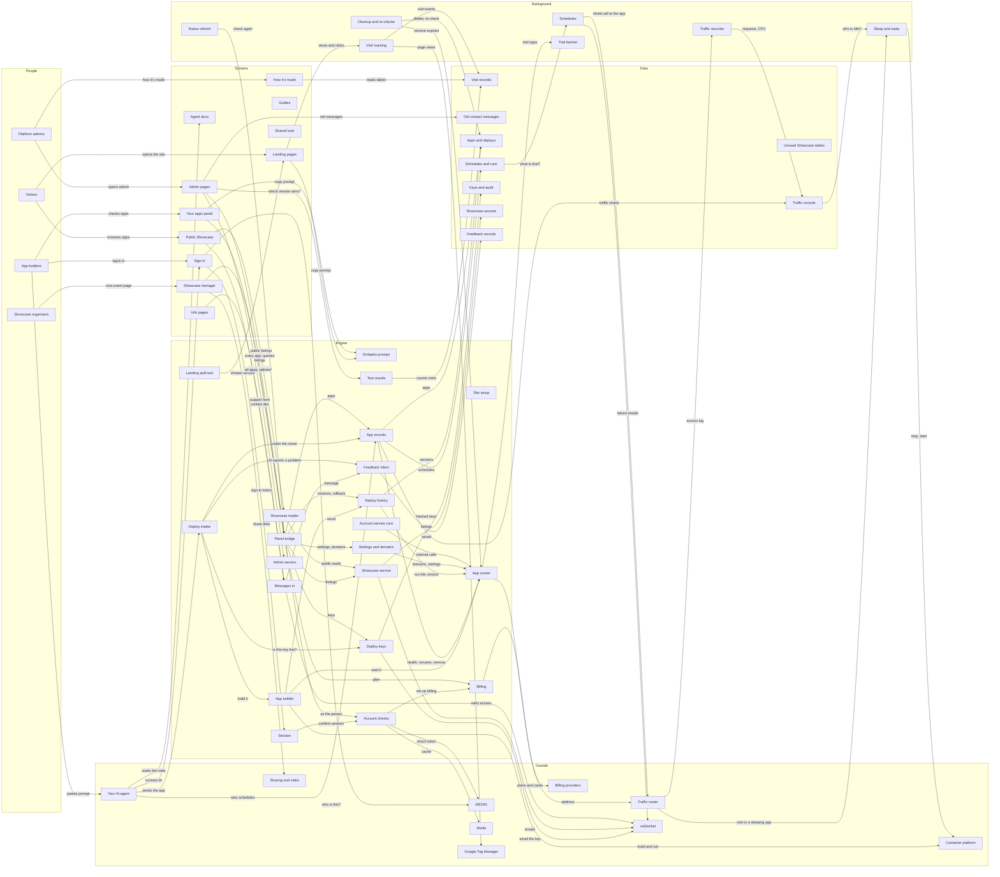

# Embarko — System map

<!-- Generated by scripts/build-prd.mjs from app/lib/system/story.ts and the code. Do not edit by hand — run npm run prd. -->

[← All stories](README.md)

## People — Who uses it

### Visitors (`visitors`)

People who land on embarko.ai, read about it and browse the Showcase.

- **Passes to:** Landing pages (opens the site), Public Showcase (browses apps)
- **Stories:** [Landing Visit](stories/landing-visit.md), [Trial App](stories/try-without-account.md), [Contact Dev](stories/contact-dev.md), [Ask For Help](stories/ask-for-help.md)

### App builders (`builders`)

People whose AI agent builds an app, who want it online and healthy.

- **Passes to:** Your AI agent (pastes prompt), Sign-in (signs in), Your apps panel (checks apps)
- **Stories:** [First Deploy](stories/first-deploy.md), [Check Apps](stories/check-apps.md), [Fix Or Update](stories/fix-or-update.md), [Sign In](stories/sign-in.md), [App Settings](stories/app-settings.md), [Scheduled Task](stories/scheduled-task.md), [Connect AI](stories/connect-ai.md), [Showcase Listing](stories/showcase-listing.md), [Ask For Help](stories/ask-for-help.md), [Change Plan](stories/change-plan.md)

### Showcase organisers (`organisers`)

People who run a Showcase page for an event and choose which apps go on it.

- **Passes to:** Showcase manager (runs event page)
- **Stories:** [Showcase Listing](stories/showcase-listing.md), [Event Page](stories/event-page.md)

### Platform admins (`admins`)

The Embarko team, who see every app, message and test result.

- **Passes to:** Admin pages (opens admin), How it's made (how it's made)
- **Stories:** [Ask For Help](stories/ask-for-help.md), [Pick A Winner](stories/pick-a-winner.md)

## Screens — What they see

### Landing pages (`landing`)

The four versions of the home page a visitor may see.

- **How it works:** Four pages (/v1–/v4) share one set of blocks; `/` is rewritten to one of them so the address never changes.
- **Passes to:** Visit tracking (views and clicks), Embarko prompt (copy prompt)
- **Receives from:** Visitors (opens the site), Landing split test (chosen version)
- **Stories:** [Landing Visit](stories/landing-visit.md)
- **Code files:** `app/components/AppsMarquee.tsx`, `app/components/BetaBanner.tsx`, `app/components/ExampleAppCards.tsx`, `app/components/FeatureShowcase.tsx`, `app/components/FeatureTiles.tsx`, `app/components/Header.tsx`, `app/components/NavDepth.tsx`, `app/components/NeedsGrid.tsx`, `app/components/SiteFooter.tsx`, `app/components/SiteHeader.tsx`, `app/components/WhyEmbarko.tsx`, `app/lib/agents.ts`, `app/lib/features.ts`, `app/lib/landingMetadata.ts`, `app/lib/trust.ts`, `app/page.tsx`, `app/v1/SectionSnap.tsx`, `app/v1/layout.tsx`, `app/v1/page.tsx`, `app/v2/HostLink.tsx`, `app/v2/HowItWorks.tsx`, `app/v2/layout.tsx`, `app/v2/page.tsx`, `app/v3/layout.tsx`, `app/v3/page.tsx`, `app/v4/layout.tsx`, `app/v4/page.tsx`

### Info pages (`site-pages`)

Pricing, use cases, events, status, support and the legal pages.

- **Passes to:** Messages in (support form)
- **Stories:** [Ask For Help](stories/ask-for-help.md), [Change Plan](stories/change-plan.md)
- **Code files:** `app/abuse/page.tsx`, `app/components/DocumentPage.tsx`, `app/dpa/page.tsx`, `app/hackathons/page.tsx`, `app/lib/publicApi.ts`, `app/pages/HeroDots.tsx`, `app/pages/PosterArt.tsx`, `app/pages/page.tsx`, `app/pricing/PricingPageClient.tsx`, `app/pricing/page.tsx`, `app/privacy/page.tsx`, `app/security/page.tsx`, `app/status/page.tsx`, `app/support/page.tsx`, `app/terms/page.tsx`, `app/use-cases/AppCards.tsx`, `app/use-cases/Parallax.tsx`, `app/use-cases/page.tsx`

### Agent docs (`docs`)

The instructions an AI agent reads before it deploys.

- **How it works:** The agent guide: one topic per page at /docs, built from app/lib/guide. A browser gets the page; an agent gets the same topic as Markdown or JSON, plus llms.txt, OpenAPI and the .well-known files. The deploy service's old /capabilities URLs redirect to it.
- **Receives from:** Your AI agent (reads the rules)
- **Stories:** [First Deploy](stories/first-deploy.md)
- **Code files:** `@api/src/routes/publicDocs.routes.ts`, `app/agent.json/route.ts`, `app/docs/DocView.tsx`, `app/docs/[slug]/page.tsx`, `app/docs/renderDoc.tsx`, `app/guide-raw/[file]/route.ts`, `app/lib/docs.ts`, `app/lib/guide/content.js`, `app/lib/guide/discovery.js`, `app/lib/guide/markdown.js`, `app/lib/guide/respond.ts`, `app/lib/guide/site.ts`, `app/llms-full.txt/route.ts`, `app/llms.txt/route.ts`, `app/openapi.json/route.ts`

### Guides (`guides`)

Step-by-step articles that bring people from search to their first deploy.

- **How it works:** Markdown with frontmatter in content/guides/, served at /guides and /guides/<slug> with cover images from public/assets/guides/ (drawn by scripts/guide-covers.mjs). Only posts with status "published" are built. Guides with their own interactive design (app/guides/_interactive/ registry) render it instead of the standard article.
- **Code files:** `app/guides/BlogArticle.tsx`, `app/guides/BlogShare.tsx`, `app/guides/ContinueReading.tsx`, `app/guides/GuidesIndex.tsx`, `app/guides/[slug]/llms.txt/route.ts`, `app/guides/[slug]/page.tsx`, `app/guides/_deploy-ai-app/article.ts`, `app/guides/_deploy-ai-app/engine.js`, `app/guides/_deploy-antigravity-website/article.ts`, `app/guides/_deploy-antigravity-website/engine.js`, `app/guides/_deploy-app-without-github/article.ts`, `app/guides/_deploy-app-without-github/engine.js`, `app/guides/_deploy-from-cursor/article.ts`, `app/guides/_deploy-from-cursor/engine.js`, `app/guides/_deploy-replit-app-free/article.ts`, `app/guides/_deploy-replit-app-free/engine.js`, `app/guides/_free-hosting-for-students/article.ts`, `app/guides/_free-hosting-for-students/engine.js`, `app/guides/_host-website-built-with-claude/article.ts`, `app/guides/_host-website-built-with-claude/engine.js`, `app/guides/_interactive/InteractiveGuide.tsx`, `app/guides/_interactive/engines.ts`, `app/guides/_interactive/registry.ts`, `app/guides/llms.txt/route.ts`, `app/guides/page.tsx`, `app/guides/prose.tsx`, `app/lib/guides.ts`

### Sign-in (`sign-in`)

Where people prove who they are, in the panel or for an AI tool.

- **Passes to:** MSG91 (who is this?), Session (sign-in token)
- **Receives from:** Your AI agent (connect AI), App builders (signs in)
- **Stories:** [Sign In](stories/sign-in.md), [Connect AI](stories/connect-ai.md)
- **Code files:** `app/components/LoginModal.tsx`, `app/components/connector/ConnectorRedirecting.tsx`, `app/components/connector/ConnectorTokenPickup.tsx`, `app/components/console/LoginScreen.tsx`, `app/connector/login/page.tsx`, `app/lib/connectorPendingRedirect.ts`

### Your apps panel (`console`)

Where builders see their apps, whether each is live, and what to do next.

- **Passes to:** Embarko prompt (copy prompt), Panel bridge (panel requests)
- **Receives from:** App builders (checks apps)
- **Stories:** [First Deploy](stories/first-deploy.md), [Check Apps](stories/check-apps.md), [Fix Or Update](stories/fix-or-update.md), [Sign In](stories/sign-in.md), [App Settings](stories/app-settings.md), [Ask For Help](stories/ask-for-help.md), [Change Plan](stories/change-plan.md)
- **Code files:** `app/app/billing/page.tsx`, `app/app/console-shell.tsx`, `app/app/layout.tsx`, `app/app/members/page.tsx`, `app/app/page.tsx`, `app/app/projects/[projectId]/deployments/page.tsx`, `app/app/projects/[projectId]/domain/page.tsx`, `app/app/projects/[projectId]/environment/page.tsx`, `app/app/projects/[projectId]/layout.tsx`, `app/app/projects/[projectId]/page.tsx`, `app/app/projects/[projectId]/settings/page.tsx`, `app/app/projects/[projectId]/showcase/page.tsx`, `app/app/settings/page.tsx`, `app/app/switch-workspace/page.tsx`, `app/app/tokens/page.tsx`, `app/components/console/AppTile.tsx`, `app/components/console/BulkEnvDialog.tsx`, `app/components/console/CloudBackdrop.tsx`, `app/components/console/CompanyDialog.tsx`, `app/components/console/ConfirmDialog.tsx`, `app/components/console/ConsoleBreadcrumbs.tsx`, `app/components/console/CouponBox.tsx`, `app/components/console/DeployPromptDialog.tsx`, `app/components/console/DeploySteps.tsx`, `app/components/console/FeedbackWidget.tsx`, `app/components/console/FirstAppEmpty.tsx`, `app/components/console/HeaderHomeButton.tsx`, `app/components/console/HeaderPlanBadge.tsx`, `app/components/console/HeaderTokenButton.tsx`, `app/components/console/HeaderUserMenu.tsx`, `app/components/console/HealthPill.tsx`, `app/components/console/LoginScreen.tsx`, `app/components/console/ProjectAnalytics.tsx`, `app/components/console/ProjectNav.tsx`, `app/components/console/ProjectSchedules.tsx`, `app/components/console/SkillDialog.tsx`, `app/components/console/StatusPill.tsx`, `app/components/console/UploadDeployPanel.tsx`, `app/components/console/UserManagementWidget.tsx`, `app/components/console/kit.tsx`, `app/components/console/showcase/ApprovalCodeDialog.tsx`, `app/components/console/showcase/CopyButton.tsx`, `app/components/console/showcase/CustomHtmlField.tsx`, `app/components/console/showcase/InviteCard.tsx`, `app/components/console/showcase/ListOnShowcaseDialog.tsx`, `app/components/console/showcase/ListingRows.tsx`, `app/components/console/showcase/PosterPreview.tsx`, `app/components/console/showcase/ProjectShowcasePages.tsx`, `app/components/console/showcase/RequestRows.tsx`, `app/components/console/showcase/ShareKit.tsx`, `app/components/console/useDeployWatch.ts`

### Showcase manager (`showcase-manage`)

Where builders list apps and organisers run their event pages.

- **Passes to:** Panel bridge (listings), Sharing and video (share links)
- **Receives from:** Showcase organisers (runs event page)
- **Stories:** [Showcase Listing](stories/showcase-listing.md), [Event Page](stories/event-page.md)
- **Code files:** `app/app/showcase/[collectionId]/page.tsx`, `app/app/showcase/new/NewShowcaseForm.tsx`, `app/app/showcase/new/page.tsx`, `app/app/showcase/page.tsx`, `app/app/showcase/submit/ListAppForm.tsx`, `app/app/showcase/submit/page.tsx`, `app/components/CustomHtml.tsx`, `app/components/console/showcase/ApprovalCodeDialog.tsx`, `app/components/console/showcase/CopyButton.tsx`, `app/components/console/showcase/CustomHtmlField.tsx`, `app/components/console/showcase/InviteCard.tsx`, `app/components/console/showcase/ListOnShowcaseDialog.tsx`, `app/components/console/showcase/ListingRows.tsx`, `app/components/console/showcase/PosterPreview.tsx`, `app/components/console/showcase/ProjectShowcasePages.tsx`, `app/components/console/showcase/RequestRows.tsx`, `app/components/console/showcase/ShareKit.tsx`, `app/lib/poster.ts`, `app/lib/qr.ts`, `app/lib/showcaseAddress.ts`, `app/lib/showcaseOptions.ts`, `app/lib/showcasePrompt.ts`, `app/lib/showcaseSeen.ts`, `app/lib/showcaseShare.ts`

### Public Showcase (`showcase-public`)

Public pages of apps people built on Embarko, grouped by event, tool and topic.

- **Passes to:** Showcase reader (public listings), Messages in (contact dev)
- **Receives from:** Visitors (browses apps)
- **Stories:** [Showcase Listing](stories/showcase-listing.md), [Event Page](stories/event-page.md), [Contact Dev](stories/contact-dev.md)
- **Code files:** `app/showcase/BackLink.tsx`, `app/showcase/ListPage.tsx`, `app/showcase/SearchGallery.tsx`, `app/showcase/ShotImage.tsx`, `app/showcase/ShowcaseHeader.tsx`, `app/showcase/[...collection]/page.tsx`, `app/showcase/app/[slug]/ContactDev.tsx`, `app/showcase/app/[slug]/Media.tsx`, `app/showcase/app/[slug]/page.tsx`, `app/showcase/breadcrumbs.tsx`, `app/showcase/category/[slug]/page.tsx`, `app/showcase/kit.tsx`, `app/showcase/layout.tsx`, `app/showcase/page.tsx`, `app/showcase/share.tsx`, `app/showcase/tag/[slug]/page.tsx`

### Admin pages (`admin`)

Internal pages for the Embarko team: test results, every app, messages.

- **How it works:** Every /admin page checks the platform-admin flag on the server; its endpoints check it again.
- **Passes to:** Panel bridge (every app, queries), Test results (which version wins?), Admin service (all apps, admins), Old contact messages (old messages)
- **Receives from:** Platform admins (opens admin)
- **Stories:** [Ask For Help](stories/ask-for-help.md), [Pick A Winner](stories/pick-a-winner.md)
- **Code files:** `app/admin/apps/apps.tsx`, `app/admin/apps/page.tsx`, `app/admin/contact/messages.tsx`, `app/admin/contact/page.tsx`, `app/admin/customer-query/page.tsx`, `app/admin/customer-query/queries.tsx`, `app/admin/dashboard.tsx`, `app/admin/guard.tsx`, `app/admin/layout.tsx`, `app/admin/page.tsx`, `app/admin/showcase/page.tsx`, `app/admin/showcase/submissions.tsx`, `app/admin/super-admins/page.tsx`, `app/admin/super-admins/super-admins.tsx`, `app/api/contact/list/route.ts`, `app/components/AdminNav.tsx`

### How it's made (`system`)

This page: the product explained story by story, built from the code of all three repos.

- **How it works:** Facts are scanned from the code, stories are written in app/lib/system/story.ts, versions come from git. Read-only.
- **Passes to:** Visit records (reads tables)
- **Receives from:** Platform admins (how it's made)
- **Code files:** `app/admin/system/FlowChart.tsx`, `app/admin/system/MapView.tsx`, `app/admin/system/StoryModal.tsx`, `app/admin/system/SystemPage.tsx`, `app/admin/system/TableViews.tsx`, `app/admin/system/TablesCanvas.tsx`, `app/admin/system/access.tsx`, `app/admin/system/page.tsx`, `app/admin/system/ui.tsx`, `app/api/system/graph/route.ts`, `app/api/system/table/route.ts`, `app/lib/system/catalogue.ts`, `app/lib/system/history.ts`, `app/lib/system/links.ts`, `app/lib/system/load.ts`, `app/lib/system/map.ts`, `app/lib/system/model.ts`, `app/lib/system/story.ts`

### Shared look (`look`)

The shared buttons, cards, type and theme every page is built from.

- **Code files:** `app/components/Logo.tsx`, `app/components/ds/Button.tsx`, `app/components/ds/Card.tsx`, `app/components/ds/CtaSection.tsx`, `app/components/ds/GlowBackdrop.tsx`, `app/components/ds/Hero.tsx`, `app/components/ds/Pill.tsx`, `app/components/ds/PrimaryCta.tsx`, `app/components/ds/Section.tsx`, `app/components/ds/Serif.tsx`, `app/components/ds/Steps.tsx`, `app/components/ds/cx.ts`, `app/components/ds/index.ts`, `app/components/ui/alert.tsx`, `app/components/ui/button.tsx`, `app/components/ui/chart.tsx`, `app/components/ui/dialog.tsx`, `app/components/ui/dictation.tsx`, `app/components/ui/dropdown-menu.tsx`, `app/components/ui/input.tsx`, `app/components/ui/kbd.tsx`, `app/components/ui/popover.tsx`, `app/components/ui/separator.tsx`, `app/components/ui/sheet.tsx`, `app/components/ui/sidebar.tsx`, `app/components/ui/skeleton.tsx`, `app/components/ui/sonner.tsx`, `app/components/ui/switch.tsx`, `app/components/ui/table.tsx`, `app/components/ui/tabs.tsx`, `app/components/ui/tooltip.tsx`, `app/hooks/use-mobile.ts`, `app/layout.tsx`, `app/lib/theme.tsx`, `app/lib/utils.ts`

## Engine — What answers them

### Landing split test (`split`)

Gives each visitor one landing version and keeps them on it.

- **How it works:** middleware.ts reads the lp_variant cookie, or picks an arm at random and sets it for 90 days, then rewrites `/` to that arm's page.
- **Who decides:** a fixed rule
- **Passes to:** Landing pages (chosen version)
- **Stories:** [Landing Visit](stories/landing-visit.md)
- **Code files:** `app/lib/variants.ts`, `middleware.ts`

### Embarko prompt (`prompt`)

The text people copy into their AI so it knows how to deploy to Embarko.

- **How it works:** One public prompt, plus panel versions that carry a deploy token or an app name to redeploy under.
- **Receives from:** Landing pages (copy prompt), Your apps panel (copy prompt)
- **Stories:** [Landing Visit](stories/landing-visit.md), [First Deploy](stories/first-deploy.md), [Fix Or Update](stories/fix-or-update.md)
- **Code files:** `app/components/CopyPromptButton.tsx`, `app/components/console/DeployPromptDialog.tsx`, `app/components/console/DeploySteps.tsx`, `app/components/console/FirstAppEmpty.tsx`, `app/lib/deployPrompt.ts`

### Session (`session`)

Keeps a person signed in and knows which workspace they are in.

- **How it works:** The MSG91 sign-in token is the session, kept in an httpOnly cookie for 30 days; the account service confirms it, MSG91 alone when that service is down.
- **Who decides:** a fixed rule
- **Passes to:** Account checks (confirm session)
- **Receives from:** Sign-in (sign-in token)
- **Stories:** [Sign In](stories/sign-in.md)
- **Code files:** `app/api/auth/connector-callback/route.ts`, `app/api/auth/exchange/route.ts`, `app/api/auth/logout/route.ts`, `app/api/auth/me/route.ts`, `app/api/auth/switch-company/route.ts`, `app/api/auth/widget-token/route.ts`, `app/lib/earlyReads.ts`, `app/lib/session.tsx`

### Panel bridge (`bridge`)

Passes every panel request to the account service as the signed-in person.

- **How it works:** The browser calls /api/hns/*; the server adds the session cookie and forwards it, 5s for reads and 10s for changes. In production worker.ts answers it before Next starts.
- **Passes to:** Account checks (as the person), App records (apps), Deploy history (versions, rollback), Settings and domains (settings, domains), Deploy keys (keys), Billing (plan), Showcase service (listings)
- **Receives from:** Your apps panel (panel requests), Showcase manager (listings), Admin pages (every app, queries), Status refresh (check again)
- **Stories:** [First Deploy](stories/first-deploy.md), [Check Apps](stories/check-apps.md), [Showcase Listing](stories/showcase-listing.md), [Change Plan](stories/change-plan.md)
- **Code files:** `app/api/apps/[slug]/logs/route.ts`, `app/api/apps/upload/route.ts`, `app/api/hns/[...path]/route.ts`, `app/lib/api.ts`, `app/lib/appName.ts`, `app/lib/billing.tsx`, `app/lib/client.ts`, `app/lib/envFile.ts`, `app/lib/format.ts`, `app/lib/hnsApi.ts`, `app/lib/hnsForward.ts`, `app/lib/lastSeen.ts`, `app/lib/pack.ts`, `app/lib/plans.ts`, `app/lib/tokenName.ts`, `app/lib/types.ts`, `app/lib/useProject.ts`, `worker.ts`

### Showcase reader (`showcase-reader`)

Reads the public Showcase listings, without the builders' email addresses.

- **Passes to:** Showcase service (public reads)
- **Receives from:** Public Showcase (public listings)
- **Stories:** [Showcase Listing](stories/showcase-listing.md), [Event Page](stories/event-page.md), [Contact Dev](stories/contact-dev.md)
- **Code files:** `app/lib/showcase.ts`

### Messages in (`messages`)

Checks feedback, support and contact messages before passing them on.

- **How it works:** Validates on the server, drops obvious spam silently, then posts to the account service's feedback inbox (or a webhook for early access).
- **Who decides:** a fixed rule
- **Passes to:** Feedback inbox (message), viaSocket (early access)
- **Receives from:** Public Showcase (contact dev), Info pages (support form)
- **Stories:** [Contact Dev](stories/contact-dev.md), [Ask For Help](stories/ask-for-help.md)
- **Code files:** `app/api/contact/route.ts`, `app/api/early-access/route.ts`, `app/api/showcase/contact/route.ts`, `app/components/EarlyAccess.tsx`, `app/components/SupportForm.tsx`, `app/lib/speech.ts`

### Test results (`results`)

Counts visitors per landing version and says whether one is winning.

- **How it works:** Unique visitors per arm with bots filtered on read; a winner needs 100+ visitors per arm and a 95% Wilson interval that clears every rival.
- **Who decides:** a fixed rule
- **Passes to:** Visit records (counts visits)
- **Receives from:** Admin pages (which version wins?)
- **Stories:** [Pick A Winner](stories/pick-a-winner.md)
- **Code files:** `app/api/metrics/route.ts`

### Site setup (`site-setup`)

Redirects, search-engine files and the list of Embarko addresses.

- **Code files:** `app/lib/site.ts`, `app/robots.ts`, `app/sitemap.ts`, `next.config.mjs`

### Account checks (`accounts`)

Confirms who someone is, which workspaces they belong to, and whether they are an admin.

- **How it works:** Every panel request carries the MSG91 token; @api checks it with MSG91 (cached 5 minutes in Redis) and checks workspace membership on every request, uncached.
- **Who decides:** a fixed rule
- **Passes to:** MSG91 (check token), Redis (cache), Billing (set up billing)
- **Receives from:** Session (confirm session), Panel bridge (as the person)
- **Stories:** [Sign In](stories/sign-in.md), [Connect AI](stories/connect-ai.md)
- **Code files:** `@api/src/lib/connectorPendingLogin.ts`, `@api/src/lib/connectorRedirect.ts`, `@api/src/lib/connectorTokenConfig.ts`, `@api/src/lib/msg91.ts`, `@api/src/lib/superAdmin.ts`, `@api/src/lib/ttlCache.ts`, `@api/src/middleware/companyContext.ts`, `@api/src/middleware/proxyToken.ts`, `@api/src/middleware/requireSuperAdmin.ts`, `@api/src/routes/auth.routes.ts`, `@api/src/routes/companies.routes.ts`, `@api/src/routes/connectorAuth.routes.ts`, `@api/src/routes/internalProxyAuth.routes.ts`, `@api/src/services/connectorToken.ts`

### Deploy keys (`tokens`)

Makes, checks, rotates and revokes the keys an AI uses to deploy as a workspace.

- **How it works:** Keys are emb_ + 64 hex; only a hash is kept. Rotation keeps the old key alive for an hour. Every check updates lastUsedAt.
- **Who decides:** a fixed rule
- **Passes to:** viaSocket (email the key), Keys and audit (hashed keys)
- **Receives from:** Deploy intake (is this key live?), Panel bridge (keys)
- **Stories:** [First Deploy](stories/first-deploy.md), [Trial App](stories/try-without-account.md), [Connect AI](stories/connect-ai.md)
- **Code files:** `@api/src/lib/deployTokenEmail.ts`, `@api/src/lib/deployTokens.ts`, `@api/src/lib/publicTokenConfig.ts`, `@api/src/middleware/deployTokenContext.ts`, `@api/src/routes/internalTokens.routes.ts`, `@api/src/routes/publicTokens.routes.ts`, `@api/src/routes/tokens.routes.ts`, `@api/src/services/deployTokenAuth.ts`, `@api/src/services/emailToken.ts`, `@api/src/services/publicTokenRequest.ts`

### App records (`app-records`)

Keeps the list of apps: who owns each, its name and address, and whether it is live.

- **How it works:** One Project per app; the slug is its address. Names are claimed platform-wide; trial (orphan) apps expire after 24 hours unless claimed.
- **Who decides:** a fixed rule
- **Passes to:** Apps and deploys (apps), App runner (health, rename, remove), Traffic records (traffic charts), Schedules and runs (schedules)
- **Receives from:** Deploy intake (claim the name), Panel bridge (apps), Your AI agent (sets schedules)
- **Stories:** [First Deploy](stories/first-deploy.md), [Trial App](stories/try-without-account.md), [Check Apps](stories/check-apps.md), [App Settings](stories/app-settings.md), [Scheduled Task](stories/scheduled-task.md)
- **Code files:** `@api/src/lib/orphanConfig.ts`, `@api/src/lib/orphanMessage.ts`, `@api/src/lib/reservedSlugs.ts`, `@api/src/lib/slug.ts`, `@api/src/middleware/projectContext.ts`, `@api/src/middleware/refuseForStaticApp.ts`, `@api/src/routes/agentApps.routes.ts`, `@api/src/routes/analytics.routes.ts`, `@api/src/routes/internalProjects.routes.ts`, `@api/src/routes/projects.routes.ts`, `@api/src/services/appAnalytics.ts`, `@api/src/services/appHealth.ts`, `@api/src/services/appRename.ts`, `@api/src/services/appTeardown.ts`, `@api/src/services/projectClaim.ts`, `@api/src/services/projectSlugChange.ts`, `@api/src/services/projectStatus.ts`, `@api/src/services/renameStatus.ts`, `@api/src/services/slugChangeFlow.ts`

### Deploy history (`deploy-history`)

Records every deploy as a numbered version, and puts an earlier one back on request.

- **How it works:** Versions are v1, v2… per app. A rollback creates a new version from an old image and asks @deploy to run it; @deploy reports back when done.
- **Passes to:** Apps and deploys (versions), App runner (run this version)
- **Receives from:** App builder (result), Panel bridge (versions, rollback)
- **Stories:** [First Deploy](stories/first-deploy.md), [Fix Or Update](stories/fix-or-update.md), [App Settings](stories/app-settings.md)
- **Code files:** `@api/src/lib/deployAttribution.ts`, `@api/src/routes/deployments.routes.ts`, `@api/src/routes/internalDeployments.routes.ts`, `@api/src/services/deployActor.ts`, `@api/src/services/deploymentVersioning.ts`, `@api/src/services/redeploy.ts`

### Settings and domains (`app-config`)

Stores an app's settings and custom domains, and checks the domain's DNS.

- **How it works:** Domains are checked by resolving DNS to the platform; an active domain is pushed to @deploy. Settings are stored as plain text and reach the app on its next deploy.
- **Who decides:** a fixed rule
- **Passes to:** App runner (domains, settings)
- **Receives from:** Panel bridge (settings, domains)
- **Stories:** [App Settings](stories/app-settings.md)
- **Code files:** `@api/src/lib/customDomain.ts`, `@api/src/lib/customDomainConfig.ts`, `@api/src/lib/dnsVerify.ts`, `@api/src/routes/domains.routes.ts`, `@api/src/routes/envVars.routes.ts`, `@api/src/services/customDomainActivation.ts`

### Billing (`billing`)

Keeps each workspace's plan and card, through the billing and payment providers.

- **How it works:** Every workspace gets a Stripe customer, a Lago customer and the free plan at sign-in. Plan limits are not enforced; the plan only decides the trial banner.
- **Passes to:** Billing providers (plans and cards)
- **Receives from:** Account checks (set up billing), Panel bridge (plan)
- **Stories:** [Sign In](stories/sign-in.md), [Change Plan](stories/change-plan.md)
- **Code files:** `@api/src/lib/billingUtility.ts`, `@api/src/lib/lago.ts`, `@api/src/lib/publicPlansConfig.ts`, `@api/src/lib/stripe.ts`, `@api/src/routes/billing.routes.ts`, `@api/src/routes/publicBilling.routes.ts`, `@api/src/services/billingCustomer.ts`, `@api/src/validation/billing.validation.ts`

### Showcase service (`showcase-service`)

Stores Showcase pages and listings, decides what needs approval, and emails people about it.

- **Who decides:** a mix of people, AI and rules
- **Passes to:** Showcase records (listings), viaSocket (emails)
- **Receives from:** Panel bridge (listings), Showcase reader (public reads)
- **Stories:** [Showcase Listing](stories/showcase-listing.md), [Event Page](stories/event-page.md)
- **Code files:** `@api/src/routes/adminShowcase.routes.ts`, `@api/src/routes/publicShowcase.routes.ts`, `@api/src/routes/showcase.routes.ts`, `@api/src/services/showcase.ts`, `@api/src/services/showcaseMail.ts`

### Feedback inbox (`inbox`)

Saves every message from people and AI agents for the team to read.

- **How it works:** All messages go to the FeatureRequest table. Nobody is notified; admins read them on /admin/customer-query.
- **Passes to:** Feedback records (saved)
- **Receives from:** Messages in (message), Deploy intake (AI reports a problem)
- **Stories:** [Contact Dev](stories/contact-dev.md), [Ask For Help](stories/ask-for-help.md)
- **Code files:** `@api/src/lib/featureRequestConfig.ts`, `@api/src/routes/customerQuery.routes.ts`, `@api/src/routes/internalCustomerQuery.routes.ts`, `@api/src/routes/publicCustomerQuery.routes.ts`, `@api/src/services/featureRequests.ts`, `@deploy/customer-query.js`

### Admin service (`admin-service`)

Lists every app and message for admins, and grants or removes admin rights.

- **Receives from:** Admin pages (all apps, admins)
- **Stories:** [Ask For Help](stories/ask-for-help.md)
- **Code files:** `@api/scripts/grant-super-admin.ts`, `@api/src/routes/admin.routes.ts`

### Account service core (`api-core`)

The account service's start-up, error handling, logging, limits and its link to the deploy service.

- **Passes to:** App runner (internal calls)
- **Code files:** `@api/src/app.ts`, `@api/src/lib/buildInfo.ts`, `@api/src/lib/env.ts`, `@api/src/lib/frontendOrigin.ts`, `@api/src/lib/internalDeployClient.ts`, `@api/src/lib/logger.ts`, `@api/src/lib/prisma.ts`, `@api/src/lib/prismaErrors.ts`, `@api/src/lib/rateLimit.ts`, `@api/src/lib/redis.ts`, `@api/src/lib/requestContext.ts`, `@api/src/lib/webhooks.ts`, `@api/src/middleware/errorHandler.ts`, `@api/src/middleware/requestLogger.ts`, `@api/src/middleware/requireInternalSecret.ts`, `@api/src/routes/health.routes.ts`, `@api/src/routes/index.ts`, `@api/src/server.ts`, `@api/src/services/audit.ts`

### Deploy intake (`intake`)

Takes an app from an AI, checks the key and the name, and starts the build.

- **How it works:** POST /apps on @deploy. Accepts a .tar.gz or a JSON list of files; a deploy token, a panel session or nothing (a trial app). Asks @api to claim the name before building.
- **Who decides:** a fixed rule
- **Passes to:** Deploy keys (is this key live?), App records (claim the name), App builder (build it), Feedback inbox (AI reports a problem)
- **Receives from:** Your AI agent (sends the app)
- **Stories:** [First Deploy](stories/first-deploy.md), [Trial App](stories/try-without-account.md), [Fix Or Update](stories/fix-or-update.md)
- **Code files:** `@deploy/build-info.js`, `@deploy/claim-project.js`, `@deploy/deploy-credential.js`, `@deploy/deploy-response.js`, `@deploy/internal-auth.js`, `@deploy/json-source.js`, `@deploy/logger.js`, `@deploy/project-lookup.js`, `@deploy/request-context.js`, `@deploy/server.js`, `@deploy/validate-deploy-token.js`, `@deploy/verify-proxy-auth.js`

### App builder (`builder`)

Checks the files, works out what kind of app it is, builds it and reports the result.

- **How it works:** Finds the app's root, refuses unsupported patterns (window.storage without SQLite, an app hidden in a subfolder), reads the optional embarko.json and warns about in-app timers, builds with Railpack, keeps the newest 5 images.
- **Who decides:** a fixed rule
- **Passes to:** Container platform (build and run), Deploy history (result), App runner (start it)
- **Receives from:** Deploy intake (build it)
- **Stories:** [First Deploy](stories/first-deploy.md)
- **Code files:** `@deploy/app-kind.js`, `@deploy/build-diagnostics.js`, `@deploy/build-plan.js`, `@deploy/deploy-status.js`, `@deploy/detect-manifest-root.js`, `@deploy/detect-storage-usage.js`, `@deploy/detect-timers.js`, `@deploy/embarko-config.js`, `@deploy/image-registry.js`, `@deploy/image-retention.js`, `@deploy/old_server.js`, `@deploy/record-deployment.js`, `@deploy/report-config-push.js`

### App runner (`runner`)

Runs each app, gives it its address and domains, and moves or removes it when asked.

- **How it works:** Server apps run as Nomad jobs; static sites are served from files. Traefik routes each address. Each app gets a /data folder that survives redeploys.
- **Passes to:** Traffic router (address), Trial banner (trial apps)
- **Receives from:** App builder (start it), App records (health, rename, remove), Deploy history (run this version), Settings and domains (domains, settings), Cleanup and re-checks (remove expired), Account service core (internal calls)
- **Stories:** [First Deploy](stories/first-deploy.md), [Trial App](stories/try-without-account.md), [Check Apps](stories/check-apps.md), [Fix Or Update](stories/fix-or-update.md), [App Settings](stories/app-settings.md)
- **Code files:** `@deploy/app-health.js`, `@deploy/app-logs.js`, `@deploy/nomad-job-spec.js`, `@deploy/nomad-job.js`, `@deploy/rename-app.js`, `@deploy/static-site.js`, `@deploy/traefik-router-file.js`

## Background — What runs on its own

### Visit tracking (`tracking`)

Quietly records page views and button clicks for the split test and analytics.

- **How it works:** Our own events go to /api/events and the site database; Google Tag Manager gets page views and signed-in state.
- **Who decides:** a fixed rule
- **Passes to:** Visit records (visit events), Google Tag Manager (page views)
- **Receives from:** Landing pages (views and clicks)
- **Stories:** [Landing Visit](stories/landing-visit.md)
- **Code files:** `app/api/events/route.ts`, `app/components/analytics/GoogleTagManager.tsx`, `app/components/analytics/PageViewTracker.tsx`, `app/components/analytics/SessionSignals.tsx`, `app/lib/gtm.ts`, `app/lib/tracking.ts`

### Status refresh (`refresh`)

Checks again every few seconds while something is changing, then stops.

- **How it works:** 5s while a new app is expected or deploying, 1s on the deployments list, 3s while an address moves, 30–60s on an open event page — each with a cap.
- **Who decides:** a fixed rule
- **Passes to:** Panel bridge (check again)
- **Stories:** [First Deploy](stories/first-deploy.md), [Check Apps](stories/check-apps.md), [Fix Or Update](stories/fix-or-update.md), [App Settings](stories/app-settings.md), [Event Page](stories/event-page.md), [Pick A Winner](stories/pick-a-winner.md)
- **Code files:** `app/app/console-shell.tsx`, `app/app/layout.tsx`, `app/app/page.tsx`, `app/app/projects/[projectId]/deployments/page.tsx`, `app/lib/showcaseSeen.ts`

### Sleep and wake (`sleep-wake`)

Stops apps nobody has used for hours, and starts them again on the next visit.

- **How it works:** A timer every 10 minutes stops apps idle for 6 hours (bots don't count), saving a snapshot of their data. The activator wakes one within 90 seconds when a real visitor arrives.
- **Who decides:** a fixed rule
- **Passes to:** Container platform (stop, start)
- **Receives from:** Traffic records (who is idle?), Traffic router (visit to a sleeping app)
- **Stories:** [Sleep And Wake](stories/sleep-and-wake.md), [Scheduled Task](stories/scheduled-task.md)
- **Code files:** `@deploy/activator.js`, `@deploy/analytics/bot-filter.js`, `@deploy/idle-report.js`, `@deploy/scale-to-zero-apps.js`, `@deploy/scale-to-zero-images.js`, `@deploy/scale-to-zero-registry.js`, `@deploy/sqlite-data-check.js`

### Traffic recorder (`traffic-recorder`)

Records every request and each app's CPU and memory, and forgets them after 100 days.

- **How it works:** Reads Traefik's access log every 5s and samples resources every 60s; deletes rows older than ANALYTICS_RETENTION_DAYS (100) once a day.
- **Passes to:** Traffic records (requests, CPU)
- **Receives from:** Traffic router (access log)
- **Stories:** [Check Apps](stories/check-apps.md), [Sleep And Wake](stories/sleep-and-wake.md)
- **Code files:** `@deploy/analytics/access-log-tailer.js`, `@deploy/analytics/db.js`, `@deploy/analytics/query.js`, `@deploy/analytics/resource-poller.js`, `@deploy/analytics/retention.js`

### Cleanup and re-checks (`cleanup`)

Deletes trial apps nobody claimed, and re-checks custom domains every day.

- **How it works:** Two timers inside @api: orphan cleanup every hour, domain re-verification every 24 hours. Neither notifies anyone.
- **Who decides:** a fixed rule
- **Passes to:** App runner (remove expired), Apps and deploys (delete, re-check)
- **Stories:** [Trial App](stories/try-without-account.md), [App Settings](stories/app-settings.md)
- **Code files:** `@api/src/services/domainReverification.ts`, `@api/src/services/orphanCleanup.ts`

### Schedules (`schedules`)

Calls a route of an app at the times listed in the app's embarko.json, keeps a record of each run, and emails the owner when a schedule starts failing or recovers.

- **How it works:** The AI lists an app's full set of schedules in the optional embarko.json in the app's top folder; @deploy reads the file from the upload (refusing bad JSON or anything secret-looking) and @api checks the schedules at claim, before the build, creates a CRON_SECRET setting if the app has none, and replaces the app's schedules with the declared set (matched by path, history kept) only when the deploy succeeds. A timer inside @api every 30s takes due schedules and sends GET <path> to the app's own address, with the app's CRON_SECRET as a bearer token when it has one. A sleeping app is woken like any visitor. 2xx is ok; 5 minutes to answer; at most 5 schedules per app, no closer than 5 minutes apart. One alert on the first failure and one on recovery, by email and an optional webhook. The panel shows each app's jobs read-only (next run, last run) and marks the app 'Needs attention' while one is failing, with a prompt to hand it to the AI.
- **Who decides:** a fixed rule
- **Passes to:** Traffic router (timed call to the app), viaSocket (failure emails)
- **Receives from:** Schedules and runs (what is due?)
- **Stories:** [Scheduled Task](stories/scheduled-task.md)
- **Code files:** `@api/src/lib/publicHttpsUrl.ts`, `@api/src/lib/scheduleConfig.ts`, `@api/src/routes/schedules.routes.ts`, `@api/src/services/scheduleAlerts.ts`, `@api/src/services/scheduleRunner.ts`, `@api/src/services/scheduleSync.ts`, `@api/src/services/schedules.ts`

### Trial banner (`trial-banner`)

Puts a banner on trial and free-plan apps saying how to keep them.

- **Receives from:** App runner (trial apps)
- **Stories:** [Trial App](stories/try-without-account.md)
- **Code files:** `@deploy/orphan-proxy/proxy.js`

## Data — What gets written down

### Visit records (`visit-records`)

Every page view and click, tagged with the landing version that produced it.

- **How it works:** Cloudflare D1. Dev writes locally; the admin dashboard reads production through DB_ADMIN.
- **Receives from:** Visit tracking (visit events), Test results (counts visits), How it's made (reads tables)
- **Stories:** [Landing Visit](stories/landing-visit.md), [Pick A Winner](stories/pick-a-winner.md)
- **Code files:** `app/lib/db.ts`
- **Tables:** `hero_assignments`, `hero_events`, `variant_metrics`

### Old contact messages (`old-messages`)

Messages sent before the contact form moved to the account service. Read only.

- **Receives from:** Admin pages (old messages)
- **Tables:** `contact_messages`

### Unused Showcase tables (`showcase-tables`)

Showcase tables created in the site database but never used; Showcase lives in the account service.

- **Tables:** `showcase_apps`, `showcase_collection_apps`, `showcase_collections`, `showcase_tags`

### Apps and deploys (`apps-data`)

Each app, its versions, settings and custom domains.

- **How it works:** API database (SQLite via Prisma). There is no user or workspace table: owners are MSG91 ids stored as text.
- **Receives from:** Deploy history (versions), App records (apps), Cleanup and re-checks (delete, re-check)
- **Stories:** [First Deploy](stories/first-deploy.md), [Trial App](stories/try-without-account.md), [Fix Or Update](stories/fix-or-update.md), [App Settings](stories/app-settings.md)
- **Tables:** `Deployment`, `Domain`, `EnvVar`, `Project`

### Schedules and runs (`schedule-data`)

Each app's schedules, and the last 100 runs of each with what the app answered.

- **Passes to:** Schedules (what is due?)
- **Receives from:** App records (schedules)
- **Stories:** [Scheduled Task](stories/scheduled-task.md)
- **Tables:** `Schedule`, `ScheduleRun`

### Keys and audit (`access-data`)

Deploy keys (hashed), who the admins are, and a log of important actions.

- **Receives from:** Deploy keys (hashed keys)
- **Stories:** [First Deploy](stories/first-deploy.md), [Connect AI](stories/connect-ai.md)
- **Tables:** `AuditLog`, `DeployToken`, `SuperAdmin`

### Showcase records (`showcase-data`)

Each app's Showcase details, the event pages, and which apps are on which page.

- **Receives from:** Showcase service (listings)
- **Stories:** [Showcase Listing](stories/showcase-listing.md), [Event Page](stories/event-page.md)
- **Tables:** `AppDetails`, `ShowcaseEvent`, `ShowcaseEventListing`

### Feedback records (`feedback-data`)

Every message, feature request and bug report from people and AI agents.

- **Receives from:** Feedback inbox (saved)
- **Stories:** [Contact Dev](stories/contact-dev.md), [Ask For Help](stories/ask-for-help.md)
- **Tables:** `FeatureRequest`

### Traffic records (`traffic-data`)

Each app's requests and resource use, for its traffic charts and for sleep decisions.

- **How it works:** SQLite on the deploy server. Rows are not deleted when an app is.
- **Passes to:** Sleep and wake (who is idle?)
- **Receives from:** App records (traffic charts), Traffic recorder (requests, CPU)
- **Stories:** [Check Apps](stories/check-apps.md), [Sleep And Wake](stories/sleep-and-wake.md)
- **Tables:** `request_log`, `resource_sample`, `tail_state`

## Outside — Services we rely on

### Your AI agent (`ai-agent`)

The builder's own AI (Claude, ChatGPT, Cursor…) that builds and deploys the app.

- **Who decides:** AI
- **Passes to:** Agent docs (reads the rules), Deploy intake (sends the app), Sign-in (connect AI), App records (sets schedules)
- **Receives from:** App builders (pastes prompt)
- **Stories:** [First Deploy](stories/first-deploy.md), [Trial App](stories/try-without-account.md), [Fix Or Update](stories/fix-or-update.md), [Scheduled Task](stories/scheduled-task.md), [Connect AI](stories/connect-ai.md), [Ask For Help](stories/ask-for-help.md)

### MSG91 (`msg91`)

Checks who a person is, holds workspaces and members, and sends email templates.

- **Receives from:** Sign-in (who is this?), Account checks (check token)
- **Stories:** [Trial App](stories/try-without-account.md), [Sign In](stories/sign-in.md), [Connect AI](stories/connect-ai.md)
- **Services:** MSG91

### Container platform (`containers`)

The tools that build app images and run them as containers.

- **Receives from:** App builder (build and run), Sleep and wake (stop, start)
- **Stories:** [First Deploy](stories/first-deploy.md), [Sleep And Wake](stories/sleep-and-wake.md)
- **Services:** Docker, Nomad, Railpack, Image registry

### Traffic router (`router`)

Traefik: sends each address to the right app and gets its certificate.

- **Passes to:** Traffic recorder (access log), Sleep and wake (visit to a sleeping app)
- **Receives from:** App runner (address), Schedules (timed call to the app)
- **Stories:** [First Deploy](stories/first-deploy.md), [Sleep And Wake](stories/sleep-and-wake.md), [App Settings](stories/app-settings.md), [Scheduled Task](stories/scheduled-task.md)
- **Services:** Traefik

### Billing providers (`payments`)

Lago keeps plans and invoices; Stripe keeps cards.

- **Receives from:** Billing (plans and cards)
- **Stories:** [Change Plan](stories/change-plan.md)
- **Services:** Lago, Stripe

### Redis (`redis`)

Short-lived memory for sign-in checks, one-time codes and rate limits.

- **Receives from:** Account checks (cache)
- **Stories:** [Sign In](stories/sign-in.md), [Connect AI](stories/connect-ai.md)
- **Services:** Redis

### viaSocket (`webhook`)

Receives early-access requests and sends Embarko's emails (keys, Showcase notices).

- **Receives from:** Deploy keys (email the key), Showcase service (emails), Messages in (early access), Schedules (failure emails)
- **Stories:** [Trial App](stories/try-without-account.md), [Scheduled Task](stories/scheduled-task.md), [Showcase Listing](stories/showcase-listing.md), [Contact Dev](stories/contact-dev.md)
- **Services:** viaSocket webhook

### Google Tag Manager (`gtm`)

Site analytics.

- **Receives from:** Visit tracking (page views)
- **Stories:** [Landing Visit](stories/landing-visit.md)
- **Services:** Google Tag Manager

### Sharing and video (`sharing`)

WhatsApp, X and LinkedIn share links, and YouTube videos on app pages.

- **Receives from:** Showcase manager (share links)
- **Stories:** [Event Page](stories/event-page.md)
- **Services:** Social share links, YouTube
